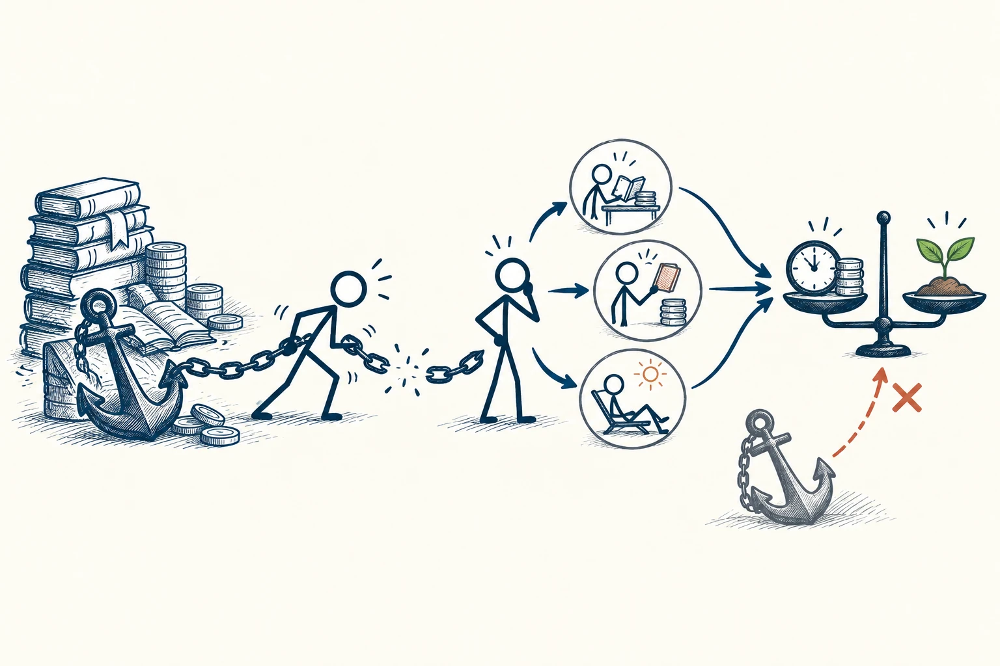

# 28 · 沉没成本

Sunk Cost · 选择与决策

> 已经花掉、拿不回来的，不该替你决定下一步。

*配图说明：左右牵绊与重新比较：左边火柴人被旧书堆、硬币和重锚牵住；链条在中间断开。*

## 定义

“钱都花了，不用就亏了。”这句话你是不是也说过？不好看的电影硬着头皮看完，不合适的课还逼自己继续听，明明已经很累，却因为“都坚持这么久了”不敢停。我们常把过去的付出，当成现在必须继续的理由。

在经济学中，沉没成本指已经发生、无法收回，而且不会因当前选择而改变的成本；它不应计入对未来选项的增量比较。

这件事最容易绕进去的地方，是把“停下来”理解为“之前全白费了”。但已经花掉的钱，不会因为你继续难受就回来；已经过去的时间，也不会因为再搭进去几个小时而变得更值。真正能改变的是，从现在开始，你还准备付出什么，又能得到什么。

理解时可以分成两栏：一栏是已经无法追回的付出，另一栏是从现在开始的收益与代价。旧投入可以解释你为什么舍不得，但决定下一步时，要比较的是第二栏中的不同选择。

## 举个身边的例子

你花了1980元报一门课，听了几节发现内容并不适合现在的水平。每次打开都听不懂，也没有解决眼前的问题，但你仍要求自己每晚听一小时：“不听完，这笔钱不就浪费了？”

先看看能不能退款、换课或调整学习顺序。如果确实无法退回，就把已经支付的费用和今晚的选择分开：继续听，能不能获得值得这一小时的帮助？换一本合适的入门书，是否反而更能学会？决定依据应该是接下来哪种安排更有用，而不是单纯想证明当初的钱没有白花。

*左边是无法追回的旧投入；右边是接下来还要花的时间，以及可能得到的收获。*

## 换个场景看看

你买了一张不能退款的电影票，看了半小时发现实在不喜欢。此时无论留下还是离开，票钱都拿不回来。更值得比较的是：剩下的九十分钟，继续看有没有乐趣，还是散步、休息更合适？如果你仍想知道结局，留下也可以，只要理由来自接下来想得到的体验。

## 可以这样试

**什么时候用得上：** 当你主要因为“钱都花了”“已经做了这么久”“现在退出太可惜”而想继续时，可以先停下来想一想。

1. 先分清哪些付出已经拿不回来，哪些还可以退款、转让或调整，别把能挽回的也放弃。
2. 问自己：如果今天还没开始，我现在还愿不愿意为它再花一小时、再付一笔钱？
3. 比较继续、调整和停止各自的未来收益与代价，再选下一步，不只重复“已经花这么多了”。

## 别用过头了

这不等于遇到困难就放弃。基础练习暂时枯燥，但继续学确实有价值，当然可以坚持。取消费用、还没花掉的预算、失去的机会和需要履行的责任，也应一起考虑；只是不让无法追回的旧投入单独作主。

## 花一分钟试试

写一件你正因为舍不得过去投入而继续的事。分两栏列出“已经无法收回”和“接下来还要付出”，再问：如果只看第二栏，我还会怎么选？

## 顺着看下去

- [31 · 损失厌恶](028.md)
- [36 · 成本效益分析](051.md)
- [95 · 认知失调](075.md)

## 来源与延伸

- [OpenStax · 沉没成本与当前选择](https://openstax.org/books/principles-economics-3e/pages/2-1-how-individuals-make-choices-based-on-their-budget-constraint)

---

例子为方便理解而设置，不是真实案例报道。
