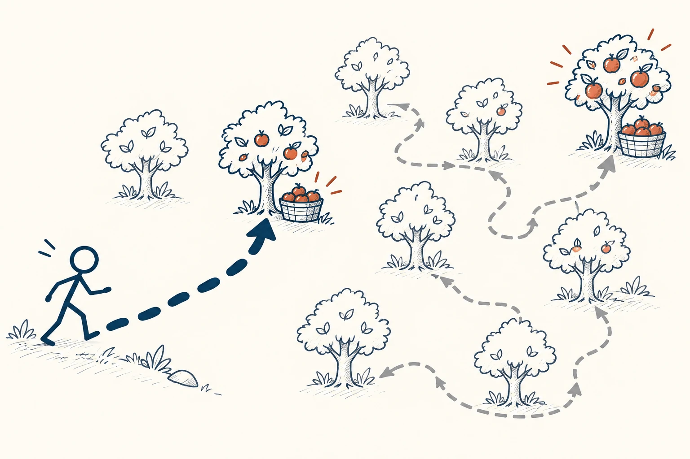

# 01 · 启发式法则

Heuristic · 认知与推理

> 给小事设几条靠谱的经验规则，就不用每次都从头想。

*配图说明：捷径与完整搜索的路线图：一个火柴人在许多树之间找果实，沿脚印走简洁捷径，很快找到一筐果实；旁边较长的细灰搜索路线遍历更多树，可能找到更大果实。*

## 定义

早上出门前看看天色，手机出问题先重启，买东西先看是否能退换——这些都属于启发式。名字很长，意思却简单：用一条顺手的经验，帮助自己快一点作决定。它通常不是最完美的办法，但省下的时间和精力也有价值。

在认知心理学中，启发式指人们为简化判断和解决问题而采用的经验规则或思维捷径，它能降低思考成本，但不保证得到最优答案。

为什么需要它？因为一天里要决定的事情太多了。午饭吃什么、什么时候回复消息，不值得每次都做一张分析表。不过，经验也有“保质期”和适用范围：平时好用的规则，遇到特殊情况就得换。

## 举个身边的例子

你总在等别人回复时纠结：“要不要催？是不是显得很烦？”后来，你给普通合作邮件定了一个办法：三个工作日没回复，就礼貌跟进一次，并在邮件里说清楚下一步需要什么。

这样你不再每天反复惦记。但如果对方负责的是明天活动的场地，就不能照等三天，而要提前约好确认时间。好规则既能让你少操心，也会给紧急情况留出口。

## 换个场景看看

做饭的新手先按菜谱放盐，熟练后会先少放，再尝味道补一点。“先少后加”就是一条好用的经验：不保证每次味道完美，但比一次倒多了容易补救。

## 可以这样试

**什么时候用得上：** 小决定太多、经常纠结，或你已经有一些可靠经验时，可以试着用它。

1. 挑一件反复让你纠结的小事，为它定一条简单规则。
2. 顺手写上例外：什么时候不能照着做，什么时候需要另想办法？
3. 试上一两周，看看它究竟节省了精力，还是带来了更多麻烦。

## 别用过头了

顺口的经验不一定靠谱。“贵的就好”“别人都买就不会错”也是捷径，却可能让你吃亏。买房、签重要合同这类代价很大的事，别只靠一句口诀决定。

## 花一分钟试试

找一件这周已经纠结过三次的小事，写一句“以后遇到这种情况，我先……”。再补一句“但如果……，就不照做”。

## 顺着看下去

- [04 · 马斯洛之锤](005.md)
- [12 · 可得性启发式](027.md)
- [14 · 确认偏误](035.md)

## 来源与延伸

- [维基百科 · 启发式法则](https://en.wikipedia.org/wiki/Heuristic)

---

例子为方便理解而设置，不是真实案例报道。
