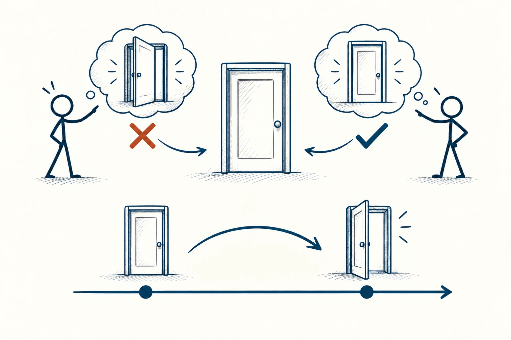
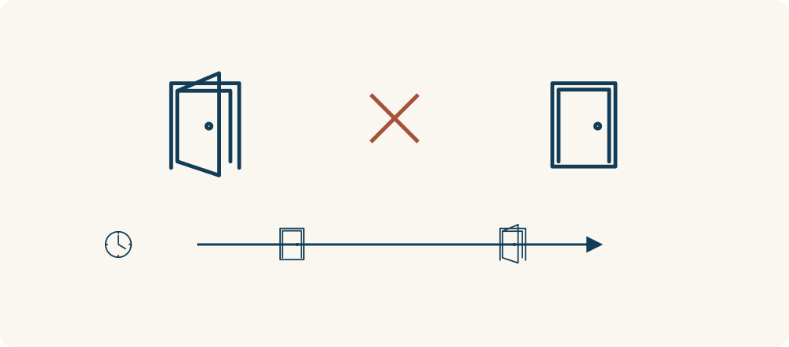

# 02 · 矛盾律

The Law of Non-Contradiction · 认知与推理

> 说一件事时，前后别自己打架；先确认大家说的是同一回事。

*配图说明：同一扇门同一时刻的两种矛盾陈述：中央一扇完整关闭的门；两侧火柴人分别展示同一扇门打开和关闭的图形想法，图形下用小叉标明不能同时套用到中央这扇门。*

## 定义

假如有人说“今天店里一杯咖啡都没卖”，转头又说“今天卖了五杯咖啡”，你会觉得不对劲。这两句话在同样的时间、同样的口径下，不能都是真的。这就是矛盾律最容易懂的样子。

在经典逻辑中，矛盾律指同一命题及其否定，不能在同一时间、同一方面同时为真。

它能帮我们检查自己的话有没有前后冲突，也能帮忙找出争论里被藏起来的条件。不过，先别急着说“你矛盾了”。“今天”是不是指同一天？一边说的“卖”会不会只算外卖，另一边把堂食也算进去了？先把话对齐，再判断对错。

最容易混淆的是“同时”与“先后”。同一扇门可以先关着、后来打开，却不能在同一时刻、同一意义上既完全开着又完全关着。比较矛盾判断前，先把时间和讨论的方面固定下来。

## 举个身边的例子

一家店宣传“所有商品都可以七天无理由退货”，你买了一件之后，客服却说“这件商品不支持无理由退货”。如果商品、时间和购买条件都没有变化，两种说法就对不上。

这时你可以请对方明确：到底是所有商品，还是除某几类之外的商品？问题就从互相指责，变成了需要澄清的一条规则。查矛盾的用处，是把承诺说清楚，让事情能继续处理。

*同一时刻不能同时完全开门和关门；时间往后走，门的状态则可以改变。*

## 换个场景看看

你说“我周末完全没空”，朋友又发现你去看了电影。可能你真正的意思是“我不想再安排社交”。把拒绝说得准确一点，通常比靠过头的解释更轻松。

## 可以这样试

**什么时候用得上：** 遇到前后不一致的承诺、解释或规定时，它能帮你把问题问明白。

1. 把听到的两句话原样写下来，别先加自己的解释。
2. 核对时间、对象和词语：两句话是不是在说完全相同的条件？
3. 如果仍然冲突，请对方说明该改哪一句，或者补上遗漏的条件。

## 别用过头了

“我喜欢热闹，也需要独处”不矛盾，因为可能发生在不同时候。“以前觉得好，现在不喜欢”也只是想法变了。不要为了抓住别人的话柄，故意删掉条件。

## 花一分钟试试

找一条你常说的绝对承诺，比如“随时找我都行”。想一想，你真能做到吗？把它改成自己愿意、也能够兑现的版本。

## 顺着看下去

- [07 · 苏格拉底式提问法](010.md)
- [05 · 批判性思维](007.md)
- [15 · 虚假两难](065.md)

## 来源与延伸

- [维基百科 · 矛盾律](https://en.wikipedia.org/wiki/Law_of_noncontradiction)

---

例子为方便理解而设置，不是真实案例报道。
