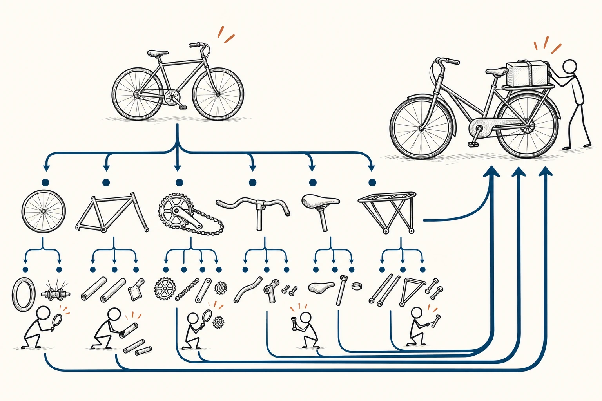
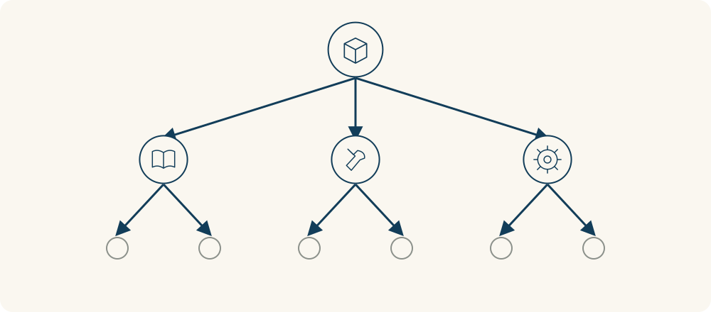

# 03 · 第一性原理

First Principles Thinking · 认知与推理

> 先弄清最基本的事实，再想办法，不急着照搬别人。

*配图说明：自行车逐层拆成基础零件，再按载物需求重组为新方案。*

## 定义

书桌太乱，你的第一反应可能是再买一个收纳架；学习没进展，就想再报一门课。可在继续加东西之前，也可以先退一步：我到底要解决什么？有哪些条件是真的改不了的，又有哪些只是“大家一直都这么做”？

第一性原理思考，是从某个问题领域最基础的事实或前提出发，逐步推导结论或构建方案，而不只依赖既有做法的类比；实际应用时，必须检查这些起点是否有充分依据。

这个名字听着很大，日常可以从一个简单动作练起：把事实和习惯分开。比如“桌面只有一米宽”是能量出来的条件，“所有书都得放桌上”却未必是必要规则。保留真正成立的条件，再重新组合做法，可能比把旧办法继续放大更有用。

可以把思考画成“拆开，再重组”：先把一个完整方案拆到有依据的基本条件，再从这些条件向上构建新方案。拆得细本身不是目的，关键是起点可靠，重新组合后能解决实际问题。

*整体向下拆成基础部分，再从这些部分重新构建方案。*

## 举个身边的例子

你想换张更大的书桌，因为现在一摊开电脑就没地方写字。先别急着买，量一下房间和桌面，再看自己每天同时需要用什么：电脑、笔记本和一支笔，其余大多是暂时不用的书和零碎物品。

目标其实是“工作时有足够的可用平面”，不一定是“买一张更大的桌子”。在房间面积不变的条件下，你可以把不用的书移到别处，整理线材，或试着调整摆放。最后仍可能需要换桌子，但这次是根据真实尺寸和使用需要作决定，而不是因为大家说桌子越大越好。

## 换个场景看看

给朋友庆生，不一定先从“大家都订哪家餐厅”开始。先确定人数、预算、交通，以及朋友真正希望的体验：安静聊天、一起做饭，还是热闹庆祝？从这些需要和约束往回安排，家里聚餐、公园野餐或小餐馆都可能成为合适方案，而不必照着热门照片复制。

## 可以这样试

**什么时候用得上：** 旧办法越改越复杂、总觉得只能照着别人做，或你已经认定必须购买某个东西才能解决问题时，可以先用它重新拆一遍。

1. 先写目标，不把方案混进去：例如“能舒适地写字”，而不是“必须买大桌子”。
2. 列出有依据的基本条件，再圈出“必须这样”“别人都这样”中尚未证实的假设。
3. 从这些条件出发想两三种做法，先试成本低的一种，再用实际结果检查推理。

## 别用过头了

第一性原理不等于无视经验、凭空重来，也不是多问几次“为什么”就一定找到真相。你认为的基本事实也可能有误，需要测量和核实；对已经成熟的小事，可靠经验往往更省时，不必每次从头推导。

## 花一分钟试试

写一件你正想解决的小事，分三栏：真正目标、已经确认的事实、我默认必须如此的做法。挑第三栏中的一条，想想拿掉它之后，还有没有其他可行办法。

## 顺着看下去

- [05 · 批判性思维](007.md)
- [07 · 苏格拉底式提问法](010.md)
- [63 · 逆向工程](041.md)

## 来源与延伸

- [Wiley · First Principles 章节试读](https://catalogimages.wiley.com/images/db/pdf/9781394173082.excerpt.pdf)

---

例子为方便理解而设置，不是真实案例报道。
