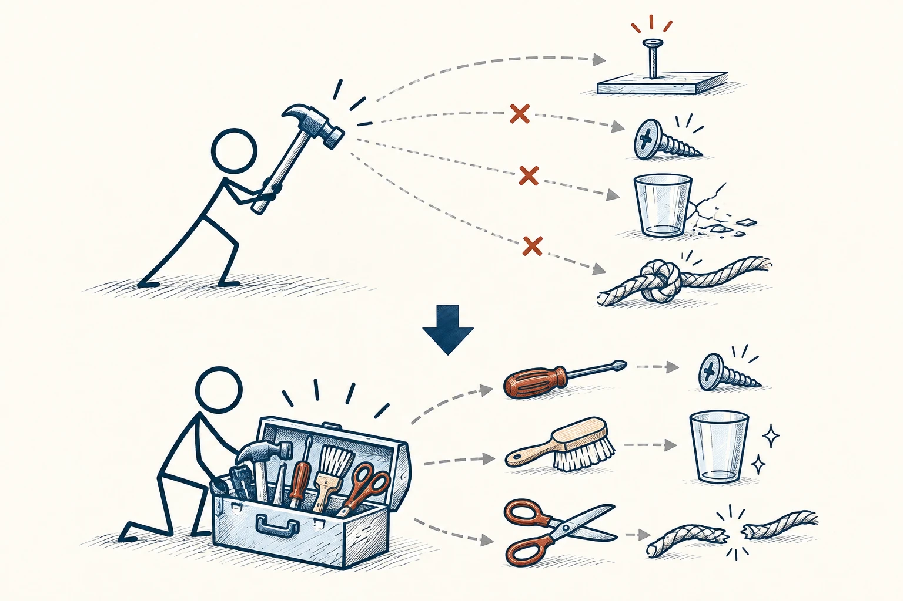

# 04 · 马斯洛之锤

Maslow’s Hammer · 认知与推理

> 别因为手里只有一把锤子，就把所有问题都当成钉子。

*配图说明：同一工具误用的扇形图：火柴人拿锤子面对钉子、螺丝、玻璃杯和绳结，只有钉子适合；锤子通往其他物件的连线用小砖红阻断。*

## 定义

刚学会一种方法时，我们特别想用它解决一切。买了时间管理软件，觉得拖延全靠它；学了沟通课，觉得所有矛盾都能靠谈话解决。这就是马斯洛之锤提醒的事：你擅长的办法，很容易变成你唯一看得见的办法。

这一现象也称“工具定势”或“工具法则”：人容易过度依赖熟悉的工具，并倾向于用它来理解和处理不同问题。

真正的第一步应该是弄清问题。有人迟到，可能是时间观念，也可能是排班不合理；房间总乱，可能是习惯，也可能是收纳位置太难用。原因不同，需要的工具自然不同。

## 举个身边的例子

你发现自己早上总起不来，便买更响的闹钟、设置更多提醒。结果闹钟越来越多，人还是困。仔细回想才发现，最近总是凌晨两点才睡，七点就要起床。

这时继续研究“如何叫醒自己”，就像一直挥锤子。比起再买一个闹钟，你可能更需要调整睡前安排、减少夜间任务，给自己留够睡眠。解决的是问题本身，工具才不白忙。

## 换个场景看看

孩子做作业慢，未必只需要催。可能题目不会、书桌太吵，也可能不知道先做哪科。先陪着看一次真实过程，比直接贴上“磨蹭”的标签更容易找到办法。

## 可以这样试

**什么时候用得上：** 你已经反复使用同一个办法，问题却一直没变，或者刚学新工具就想全面推广时，值得停一下。

1. 先说现象，例如“最近一周迟到了三次”，不要马上认定原因。
2. 试着从习惯、环境、资源和规则几个方向各想一种解释。
3. 比较几种办法，挑最对原因、又容易试的一种，先做小调整。

## 别用过头了

工具多也不是目的。收集了八十个模型，却每次都想一股脑套上去，一样会把事情弄复杂。眼前这件事需要什么，就先拿什么。

## 花一分钟试试

想一件你试了三次还没解决的事。先禁止自己使用原来的方案，再写出两个完全不同的方向。

## 顺着看下去

- [03 · 第一性原理](004.md)
- [66 · 5W1H 分析法](045.md)
- [71 · 六顶思考帽](079.md)

## 来源与延伸

- [维基百科 · 马斯洛之锤](https://en.wikipedia.org/wiki/Law_of_the_instrument)

---

例子为方便理解而设置，不是真实案例报道。
