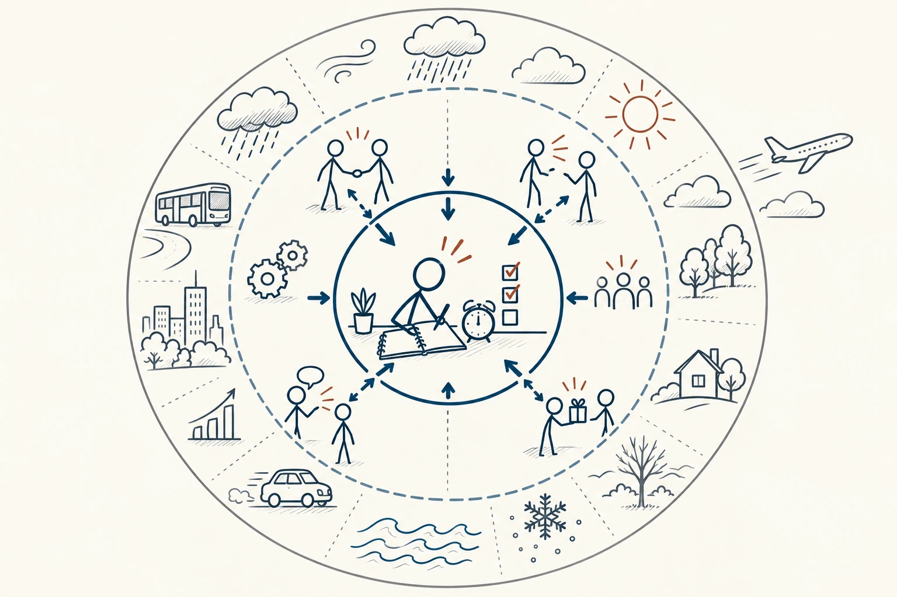
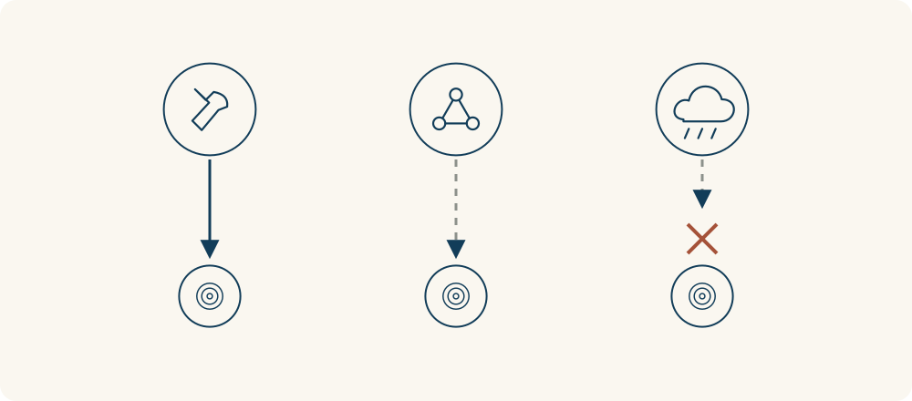

# 84 · 控制圈

Circles of Control and Influence · 行为与成长

> 先做自己能做的那一步，别让所有担心一起抢走精力。

*配图说明：三层同心圆分别呈现自身行动、人际影响与外部条件。*

## 定义

面试结束后，你不停回想哪句话没说好，隔几分钟就看一次手机，想知道对方会不会录用。担心很正常，但反复刷新并不会让结果更快出现。控制圈想帮你分清：这件事里，我能直接做什么，能争取什么，又有哪些暂时不由我决定？

控制圈是一种按可控制程度整理问题的思考工具，常将事情区分为直接控制、间接影响和目前无法控制的部分；它与柯维的影响圈、关注圈思路相关，用来帮助安排注意力和行动。

这不是劝你“别想了”，而是给担心找一个能落地的去处。你不能决定别人最后选谁，却可以复盘回答、补发必要材料、继续投递，也可以安排一点休息。把结果和行动分开，会更容易找到下一步，而不是只在脑子里来回打转。

三个圈表示能采取的行动范围不同：最里面是自己可以直接做的事，中间是可以沟通、争取和影响的事，外面是需要观察、适应但无法独自决定的条件。把精力放回内圈，并不等于忽略外部问题。

*实线表示可以直接行动，虚线表示只能争取影响，断开的连接表示无法独自决定。*

## 举个身边的例子

你要参加一场重要面试，担心下雨、路上堵车，也怕面试官不喜欢自己。把这些放在一起想，会觉得从头到尾都没把握。分开看就清楚一些：你能决定什么时候出门、是否提前查路线、怎样准备资料；可以通过表达和作品影响对方的判断；天气、其他候选人的表现和最终名额，则不能由你直接决定。

于是你提前留出路上的余量，练习两段真实经历，检查文件是否能打开。面试后如果需要，可以按约定时间跟进，再继续其他安排。结果仍有不确定性，但你已把能做的部分照顾到了，不必靠反复自责来证明自己认真。

## 换个场景看看

朋友一直没回消息，你无法直接让他马上回复，却可以检查自己的问题是否清楚、说明需要回复的时间，必要时换一种联系方式。若不是急事，也可以约好自己晚些时候再看手机。主动沟通和给彼此空间，都是能做的事；猜测一百遍他的想法，却不一定会增加了解。

## 可以这样试

**什么时候用得上：** 等结果、担心别人怎么看自己，或一件事让你越想越慌、却不知道从哪里开始时，可以先这样分一分。

1. 把担心逐条写下来，分成“我能直接做主”“我能沟通争取”“目前无法决定”三类。
2. 从第一类选一个小动作；第二类想清楚向谁提什么请求，别把影响等同于保证结果。
3. 第三类保留必要关注和备用安排，给查消息设个时间，再回到当前能推进的事。

## 别用过头了

可控与不可控不是永远不变的，也不等于事情重不重要。有些问题需要求助、协商或共同争取；不能单独解决，不代表只能忍受。情绪也不会因为一句“想开点”立刻消失，可以先照顾自己，再选择合适行动。

## 花一分钟试试

写下此刻最占心的一件事，再补三句：“我现在能做的是……”“我可以请谁帮忙或沟通的是……”“我暂时无法决定的是……”。先完成第一句里一个十分钟内的小动作。

## 顺着看下去

- [30 · 逆向思维](020.md)
- [70 · 帕金森定律](069.md)
- [60 · 汉隆剃刀](080.md)

## 来源与延伸

- [FranklinCovey · 积极主动与影响圈](https://mp.franklincovey.com/habit-1/)
- [牛津大学 · 关注圈、影响圈与控制圈](https://www.mpls.ox.ac.uk/training/resources-for-researcher-and-career-development/personal-effectiveness-or-taking-owndership/mpls-division-circles-of-concern-influence-and-control)

---

例子为方便理解而设置，不是真实案例报道。
