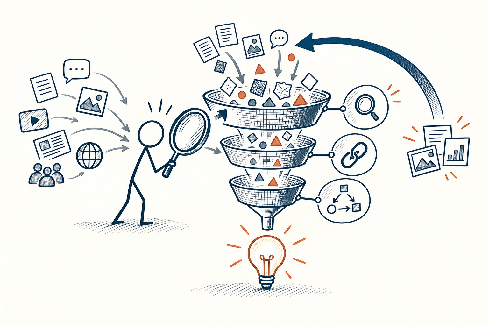

# 05 · 批判性思维

Critical Thinking · 认知与推理

> 听到一个说法，先别急着点头，也别急着抬杠。

*配图说明：证据筛选漏斗：多种无字消息图标进入火柴人手中的放大镜与多层筛网，核对放大镜、来源链接、推理链三类图标，最后流出有证据支撑的结论灯泡；另有回流箭头从新证据回到筛查，表示会修正，而不是所有信息都否定。*

## 定义

“批判性思维”听着像专门挑毛病，其实更像认真检查：这话到底在说什么？有什么依据？还有没有别的解释？你不是非得把对方说服，而是给自己的判断多加一道检查。

较正式地说，批判性思维是对信息、证据及推理进行审慎评价，并据此形成或修正判断的思考方式。

这一步对喜欢的观点尤其重要。人很容易对合心意的说法放松警惕，觉得“我早就这么认为了，所以它一定对”。练习的重点，是让自己愿意根据新证据改主意，而不只是变得更会辩论。

## 举个身边的例子

看到一个视频说“每天早起一小时，人生就会改变”，你觉得很有道理，差点立刻转发。停一下再想：他说的改变具体指什么？展示的人是不是本来就很自律？有没有早起了却没改善的人？

你仍然可以尝试早起，但给自己一个更实际的问题：“如果早点起床、同时不减少睡眠，我能不能多出半小时安心阅读？”这样你得到的是可检查的生活尝试，而不是一句必须相信的口号。

## 换个场景看看

朋友说“你们公司的人都不好相处”，你可以先问最近发生了什么。可能是某次冲突，也可能确实有长期问题；先分清经历和概括，再决定怎样帮忙。

## 可以这样试

**什么时候用得上：** 刷到很吸引人的结论、听到很绝对的建议，或者自己已经特别想相信某件事时，最值得用。

1. 先用自己的话复述对方的意思，看看自己有没有听偏。
2. 问三个问题：证据在哪、有没有别的原因、谁的情况没有被提到？
3. 暂时作决定也没关系，顺手记下什么新情况会让你改主意。

## 别用过头了

不要把认真思考变成永远挑刺。生活不可能等所有问题都查清再继续。重要的事多查一点，小事可以先试，同时保留回头调整的余地。

## 花一分钟试试

选一条你最近转发或收藏的观点，写一句“我相信它，是因为……”。如果只能写出“听着很有道理”，再找一项具体依据。

## 顺着看下去

- [18 · 证伪原则](011.md)
- [19 · 举证责任](012.md)
- [14 · 确认偏误](035.md)

## 来源与延伸

- [维基百科 · 批判性思维](https://en.wikipedia.org/wiki/Critical_thinking)

---

例子为方便理解而设置，不是真实案例报道。
