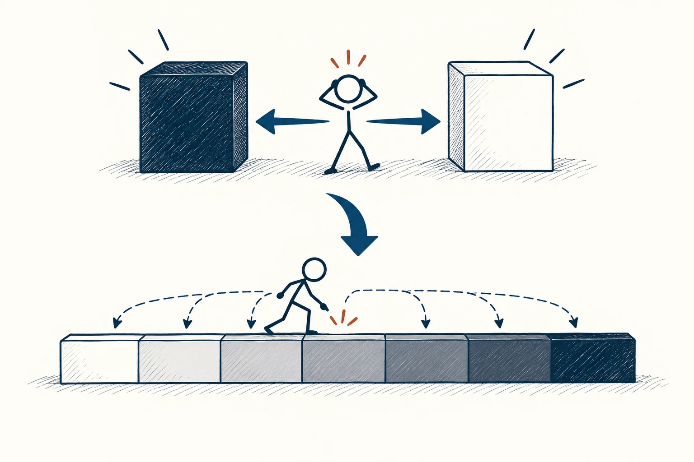
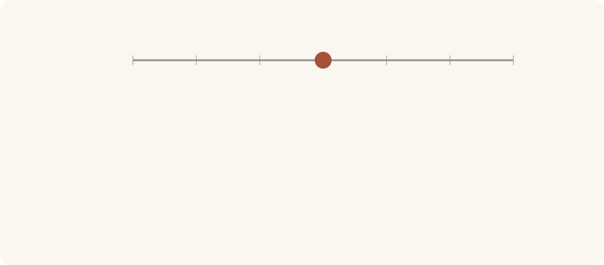

# 06 · 非黑即白思维

Black-and-White Thinking · 认知与推理

> 一次没做好，不等于你整个人都不行。

*配图说明：二极化与连续程度对比：上方火柴人被困在全黑和全白两个块之间，只有两个端点；下方长条分成由白到深灰的多个阶梯，中间有多种可停位置，火柴人观察具体位置。*

## 定义

“要么完美，要么没意义”“不支持我，就是不在乎我”“今天破戒了，这周都白减了”——这种只剩两个极端的想法，就是非黑即白思维。它让人很快下结论，却把中间那些有用的信息都丢掉了。

在认知心理学中，这通常被称为“全或无思维”：将复杂情况理解为两个互斥的极端，忽略程度差异与中间可能。

生活里更多的情况是：有的地方不错，有的还要改；这次没做到，但之前做到了。把事情说得具体一点，不是在自我安慰，而是在给下一步留空间。你不必先给整个人判个输赢，才能处理一个小问题。

现实中的许多评价更像一条刻度，而不是两个开关。“这次没做好”可能只是某一步需要改，不能直接跳到“我完全不行”。先找到自己处在哪个位置，再决定往哪里调整。

*两个极端之间，通常还有许多可以区分的位置。*

## 举个身边的例子

你计划每天读二十页书，连着读了四天，第五天太忙没读，立刻觉得“我果然坚持不了”。这个判断把四天的努力一起抹掉了，还让第六天重新开始变得更难。

换一种说法：“我这周读了四天，忙的时候二十页太多，下次保底读两页。”你既没有假装漏掉一天不重要，也没有因为漏掉一天就把整件事丢掉。计划因此更容易继续。

## 换个场景看看

一段关系里发生冲突，不代表过去的关心全是假的；但有过关心，也不代表现在的问题就不用处理。允许两件事同时存在，通常更接近现实。

## 可以这样试

**什么时候用得上：** 一次失误后想全盘放弃，或者关系中出现“你从来都……”这类争执时，先用它缓一缓。

1. 留意自己话里的“永远、根本、全部、一次都不”等词。
2. 找一个不完全符合结论的小例子，哪怕它很小。
3. 把整个人的标签，改成具体场景和下一步，例如“我需要练习开场”。

## 别用过头了

有些事情确实需要明确的“是或否”，例如是否赶上了截止时间。这个模型不是让规则都变模糊，而是别把某一项结果扩大成对全部生活的判决。

## 花一分钟试试

把最近一句让你很难受的绝对判断写下来。删掉“总是、从不、完全”，加上具体时间和事件，再读一遍。

## 顺着看下去

- [97 · 大五人格](077.md)
- [15 · 虚假两难](065.md)
- [95 · 认知失调](075.md)

## 来源与延伸

- [维基百科 · 非黑即白思维](https://en.wikipedia.org/wiki/Splitting_(psychology))

---

例子为方便理解而设置，不是真实案例报道。
