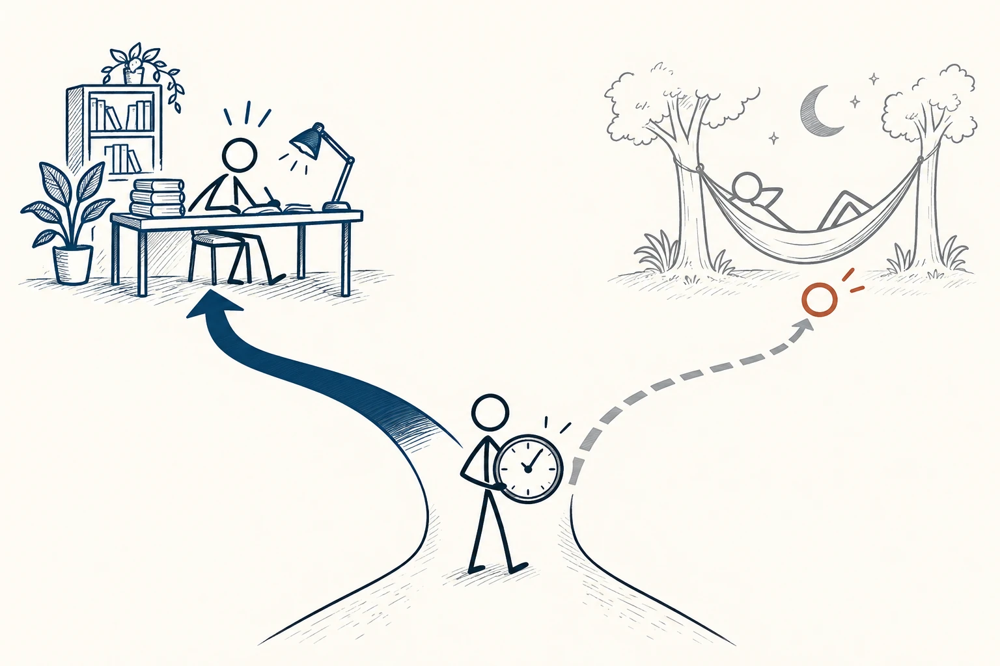
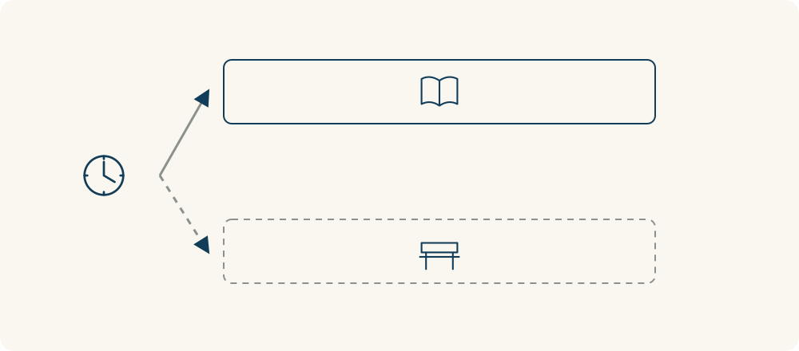

# 29 · 机会成本

Opportunity Cost · 选择与决策

> 选一件事时，也看看自己因此放弃了什么。

*配图说明：同一段时间分成学习与休息两种可能，实线路径与未选虚线并列。*

## 定义

你花两个小时刷视频，没有掏一分钱，真的就没有成本吗？这两个小时也可以睡觉、运动，或和朋友吃顿饭。机会成本提醒我们，选择不只涉及付出去的东西，也涉及同一份时间和资源原本还能用在哪里。

在经济学中，机会成本指为获得某种选择的收益，而放弃的最佳可行替代选择的价值；它可以包括金钱，也可以是时间、休息或其他重视的收获。

这里最容易误会的是把所有没选的好处加起来。你没有去看电影、跑步、读书，不代表一次刷视频就同时损失了三种活动；那两个小时本来也不可能全部做完。真正值得比较的是，你最可能、也最愿意选择的另一个安排。

想象同一段时间只能走一条岔路：选择学习，就可能放弃休息；选择休息，就可能放弃这次学习。机会成本看的是未选方案中最值得的那个，而不是把所有没走的路加起来。

## 举个身边的例子

周末下午你有三小时空闲，可以接一单赚三百元的兼职，也可以陪一位难得回来见面的朋友。接单的收益比较好算，但它也意味着，这段见面时间就用掉了。陪朋友则不只是“免费聊天”，你也放弃了那笔可能赚到的钱。

哪种更值得，没有适用于所有人的答案。如果你急需这笔收入，接单可能更合适；如果这次见面很难再约，陪朋友也有充分理由。把被放弃的那个选择摆出来，是为了让你选得更明白，而不是把所有关系和休息都换算成工资。

*同一段时间走向不同选择；虚线那条路，保留了未选方案的价值。*

## 换个场景看看

一家店打折能省二十元，但来回要多花一小时。如果这段路让你很疲惫，还错过了想参加的活动，便宜未必等于更合适；如果你本来就想散步、顺路也能逛逛，去一趟也可能值得。重点是这段时间对你实际有什么其他用处。

## 可以这样试

**什么时候用得上：** 当你觉得“反正免费”“只是多花一点时间”，或几个安排都想要却无法兼顾时，可以拿它比较。

1. 先确认真正有限的是什么：时间、预算、精力，还是某个只能用一次的机会？
2. 找出不做当前选择时，最有价值且确实可行的替代安排，不把所有想象中的好处相加。
3. 比较两边你最在意的收益和代价，选完就专心执行，不必反复惦记所有没选的路。

## 别用过头了

休息和娱乐也有价值，不必把每一分钟都拿来赚钱。不可行的安排不能算作真实替代选项；花钱本身的直接成本、过去已花掉的沉没成本，与放弃其他用途的机会成本，也要分开看，避免重复计算。

## 花一分钟试试

选一个这周准备花两小时做的安排。写下如果不做它，你最可能做的另一件事，以及两边分别带来什么。别列十个理想选项，只比一个真实可行的替代。

## 顺着看下去

- [28 · 沉没成本](001.md)
- [36 · 成本效益分析](051.md)
- [38 · 权衡取舍](055.md)

## 来源与延伸

- [OpenStax · 机会成本与个人选择](https://openstax.org/books/principles-economics-3e/pages/2-1-how-individuals-make-choices-based-on-their-budget-constraint)

---

例子为方便理解而设置，不是真实案例报道。
