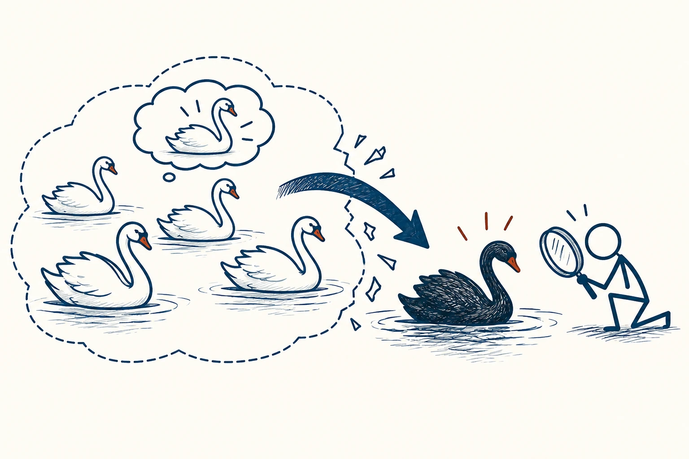

# 18 · 证伪原则

Principle of Falsification · 证据与统计

> 一个说法如果永远不会被判错，就很难知道它到底靠不靠谱。

*配图说明：可检验反例结构：左侧多只白天鹅支持一个关于天鹅颜色的简单白天鹅思维泡，右侧一只明确的黑天鹅通过醒目藏蓝箭头冲破原有泛化的边框，观察者用放大镜核实黑天鹅。*

## 定义

有人说一块石头能带来好运：事情顺利，是石头起作用；事情不顺，是石头替你挡了更大的灾。你会发现，不管发生什么，它都“没错”。证伪原则提醒我们：想认真检验一个关于现实的说法，得先说清楚什么情况出现时，它就需要重新考虑。

在波普尔的科学哲学中，可证伪性指一个理论必须与某些可能出现的经验观察不相容，也就是存在能够反驳它的检验结果。

“证伪”听起来像专门找茬，实际是在给想法留一个接受检验的入口。你可以很喜欢自己的方案，但仍愿意说：“如果这次没有改善，我就承认它可能不适合。”这样才有机会真正学到东西。

## 举个身边的例子

你认定“睡前列计划能让我第二天少拖延”，便提前选定一个观察方法：接下来两周，记录每天最重要的三件事完成了几件，也看看是否因此睡得更晚。

如果结果没改善，你不把标准偷偷改成“至少看起来更自律了”，而是检查计划是否太多、任务是否太大，或者这方法对你帮助有限。一次小尝试不能决定所有道理，却能让你少一点给自己找借口。

## 换个场景看看

你说“只要努力，就一定会成功”，别人失败了就被解释成“不够努力”。如果“足够努力”没有清楚标准，这句话就很难被检验，也很容易让受挫的人背下所有责任。

## 可以这样试

**什么时候用得上：** 你发现一种方法“怎么解释都对”，或者特别舍不得承认自己的计划没用时，可以想起它。

1. 把你的想法写成一句具体预测，别只说“会更好”。
2. 提前写下什么结果会让你降低信心，或愿意换个办法。
3. 看到结果后先按原来的标准检查，不临时更换“成功”的含义。

## 别用过头了

一次失败可能是方法执行出了问题，也可能是原先猜想不对，值得分开检查。感情、审美和道德讨论也不都能用一个实验裁决，别硬套。

## 花一分钟试试

对一个你很喜欢的方法补一句：“如果出现……，我就会重新考虑。”看看自己是否真的愿意接受这件事。

## 顺着看下去

- [24 · A/B 测试](025.md)
- [20 · 实验可重复性](021.md)
- [14 · 确认偏误](035.md)

## 来源与延伸

- [Karl Popper · Stanford Encyclopedia of Philosophy](https://plato.stanford.edu/entries/popper/)

---

例子为方便理解而设置，不是真实案例报道。
