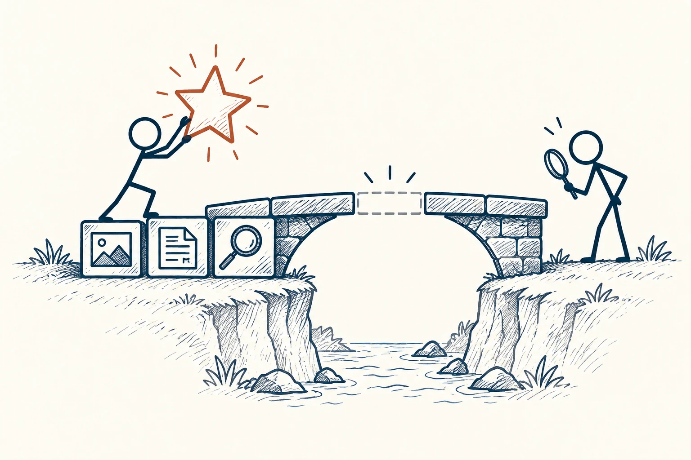

# 19 · 举证责任

Burden of Proof · 证据与统计

> 谁想让别人相信一件事，谁就该先拿出点依据。

*配图说明：主张需要证据支撑：火柴人举着一颗发光星形主张，星形下方桥面缺了一块，只有把照片、记录图标与观察放大镜三块证据放在桥墩上才能支撑主张；主张者自己搭桥，听者站对面查看，不要求听者证明一切不存在。*

## 定义

朋友说“一家新店特别好吃”，你可以先当推荐听听；有人说“这个软件一定让你收入翻倍”，想让你花一大笔钱，就该提供更扎实的理由。这就是举证责任的日常用法：不是嗓门大的人说了算，也不是别人一时反驳不了，就说明你对。

举证责任指提出或主张某一事实的一方，在相应讨论或程序中承担提供证据、支持其主张的责任；具体分配取决于情境和规则。

尤其要留意“你能证明它没用吗”这种倒过来的要求。没有证明它无效，并不能自动证明它有效。提出越强、影响越大的主张，通常越需要认真拿依据说话。

## 举个身边的例子

群里有人说：“这门课能保证你一个月找到工作。”你问保证依据是什么，对方却说：“你又没上过，怎么知道没用？”这没有回答问题。你并没有断言课程无效，只是在问一个需要付钱相信的承诺，有什么支撑。

你可以继续问：所谓找到工作是哪类岗位？报名多少人、成功多少人？没成功的人有没有算进去？保证的条件写在哪里？这些问题比空泛地争“信不信”更接近决定所需要的信息。

## 换个场景看看

“你说屋里有看不见的龙，我证明不了没有”并不意味着你就该给龙买粮食。先提出事实的人，需要说明有什么理由让大家认真相信。

## 可以这样试

**什么时候用得上：** 别人给你重大承诺，却要求你先证明他错的时候，很适合用它。

1. 先分清对方是在分享感受、提出猜想，还是要求你接受一个事实。
2. 请他说明依据来自哪里，有没有可以检查的记录或资料。
3. 决定越贵、越难回头，就把最关键的依据查得更仔细一些。

## 别用过头了

这句话也管自己。你如果从“我还没看到证据”跳到“它肯定是假的”，也提出了一个需要解释的判断。生活里普通闲聊，不必每句话都像法庭质证。

## 花一分钟试试

回想最近一个“你就信我吧”的建议。写出你真正需要核实的一件事，并把它改成一句礼貌、具体的问题。

## 顺着看下去

- [05 · 批判性思维](007.md)
- [18 · 证伪原则](011.md)
- [21 · 第三变量效应](022.md)

## 来源与延伸

- [维基百科 · 举证责任](https://en.wikipedia.org/wiki/Burden_of_proof_(philosophy))

---

例子为方便理解而设置，不是真实案例报道。
