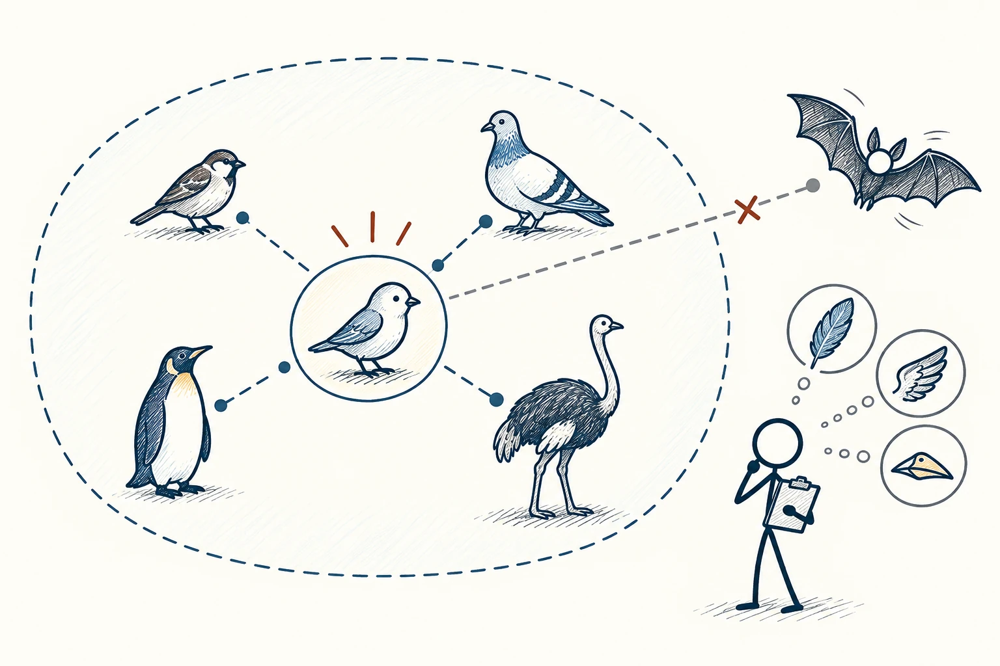
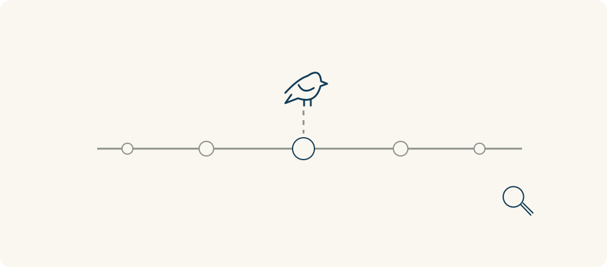

# 08 · 原型理论

Prototype Theory · 认知与推理

> 我们认识一类东西时，往往先想到一个“典型样子”。

*配图说明：原型与渐变成员的中心辐射：中心典型小鸟图标，周围放麻雀、鸽子、企鹅、鸵鸟和蝙蝠，鸟类成员到中心线不同远近，蝙蝠在类别虚线边界外；火柴人比较特征。*

## 定义

说到鸟，你可能先想到麻雀；说到椅子，可能先想到有靠背、四条腿的木椅。这些最先浮现的样子，就是你脑中的典型例子。原型理论说的，是我们常靠这种“像不像”的感觉来理解分类，而不总是先背一套严格定义。

在认知科学中，原型理论认为，类别中的成员可以具有不同的典型程度，人们常围绕典型实例及其特征来理解类别。

所以，同样属于鸟，企鹅可能让你多想一秒。这不是说它不够资格，而是它不像你最熟悉的样子。知道这点，能帮我们理解别人为什么看不懂某个设计，也能提醒自己别被熟悉的外形限制。

这里的“中心与外围”是在说典型程度，不是简单判断谁属于、谁不属于。企鹅不像常见的会飞小鸟那么典型，但仍然是鸟；蝙蝠会飞，也不会因此变成鸟。不能用离原型远就直接把成员排除。

*中心更接近典型形象，外围可以不那么典型；远近本身不决定类别归属。*

## 举个身边的例子

你给长辈装一个新的记账软件，首页全是彩色卡片和复杂图表。他找不到“记一笔”，觉得这根本不是记账本。你却觉得所有功能都在，怎么会不会用？

问题可能在于，他脑中的记账本是“日期、收入、支出、余额”一行行展开。先让入口接近熟悉的样子，再慢慢介绍图表，学习会轻松不少。你不是降低功能，而是在熟悉与陌生之间搭座桥。

## 换个场景看看

第一次吃植物做的肉饼，有人会说“味道不错，但不像肉”。这说明他在拿熟悉的肉饼作参照。若换成一道独立菜品介绍，期待可能就不同了。

## 可以这样试

**什么时候用得上：** 做介绍、教新工具、整理分类时，或你因为“不像”就想排除某个人时，可以用它。

1. 想想对方一听到这个名称，最先会想到什么具体东西。
2. 先保留几项容易认出来的特征，让人知道这是做什么的。
3. 再说明特别之处，也检查有没有被“典型印象”误伤的例外。

## 别用过头了

典型不等于标准答案。一个人不像你想象中的老师、程序员或领导，并不能说明他不合格。外形和风格，不是能力或身份的全部证据。

## 花一分钟试试

挑一个你熟悉的职业，写下第一印象。再想一个不符合这个印象、却做得很好的人，看看你把哪些特征误当成了必需。

## 顺着看下去

- [97 · 大五人格](077.md)
- [68 · 维恩图](048.md)
- [98 · DISC 行为风格模型](078.md)

## 来源与延伸

- [维基百科 · 原型理论](https://en.wikipedia.org/wiki/Prototype_theory)

---

例子为方便理解而设置，不是真实案例报道。
