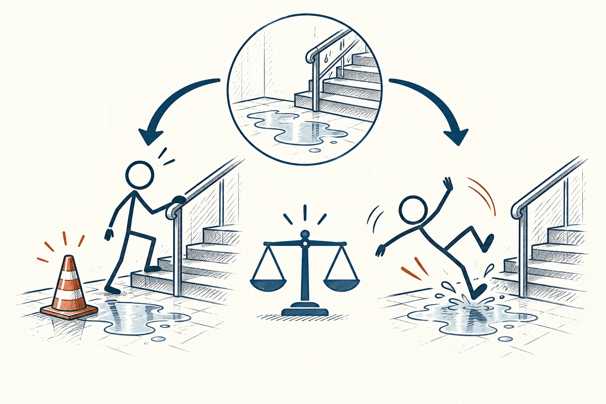

# 51 · 理性人标准

The Reasonable Person · 伦理与协作

> 别拿事后知道的一切，去要求当时的人早就应该知道。

*配图说明：同处境的合理注意对照：两位普通火柴人面对相同湿滑地面与楼梯，一位放置醒目无字警示锥并扶栏慢行，另一位奔跑滑倒。*

## 定义

“理性人标准”这个译名容易让人误会。原文说的是一个合理、谨慎的人，在当时那种情况下，通常应该注意到什么、做些什么。它不是要求人永远不犯错，也不是“只顾自己利益”的意思。

在法律语境中，合理人标准是一种客观参照，用于判断处于相同情境的合理审慎之人会采取什么行动或注意措施。

你可以把它当成一副回到现场的眼镜：当时有哪些信息？有什么明显风险？这个人有没有尽到该尽的注意？这样既不会因为出了事就一味怪罪，也不会拿“我又不知道”来躲开本该承担的责任。

## 举个身边的例子

朋友让你临时代看宠物，交代了食物、饮水和不能打开的窗户。你按约照顾，却遇到事先没有任何迹象的小问题，和你明知窗户没关却完全不理，是两种不同情况。

评估时不能只看最后有没有出事，还要看当时能合理预见什么、是否采取了该做的措施。这个思路能让复盘更公平：该改流程就改流程，该承认疏忽也不回避。

## 换个场景看看

你当年根据有限的课程介绍选了专业，后来才知道实际并不喜欢。可以从这次经历里学会更好地打听信息，却不必要求十八岁的自己拥有十年后的全部见识。

## 可以这样试

**什么时候用得上：** 事情出了问题，需要分清责任，或你总是用“当初早知道”责怪自己时，可以借它换个视角。

1. 先还原当时知道什么，不要把后来才出现的信息算进去。
2. 问一个认真负责、处在相同位置的人，通常会检查哪些事情。
3. 把正常的不确定和可以避免的疏忽分开，再讨论怎么改善。

## 别用过头了

它不是“多数人偷懒，所以我也能偷懒”，更不要求每个人都像专家。法律中的具体规则另有规定，这里只是帮助理解一种公平看待行为的方式。

## 花一分钟试试

想一个你至今后悔的决定，分两栏写：“当时知道的”和“后来才知道的”。看看你是否把第二栏都算成了当时的过错。

## 顺着看下去

- [53 · 黄金法则](037.md)
- [56 · 无知之幕](040.md)
- [60 · 汉隆剃刀](080.md)

## 来源与延伸

- [维基百科 · 理性人标准](https://en.wikipedia.org/wiki/Reasonable_person)

---

例子为方便理解而设置，不是真实案例报道。
