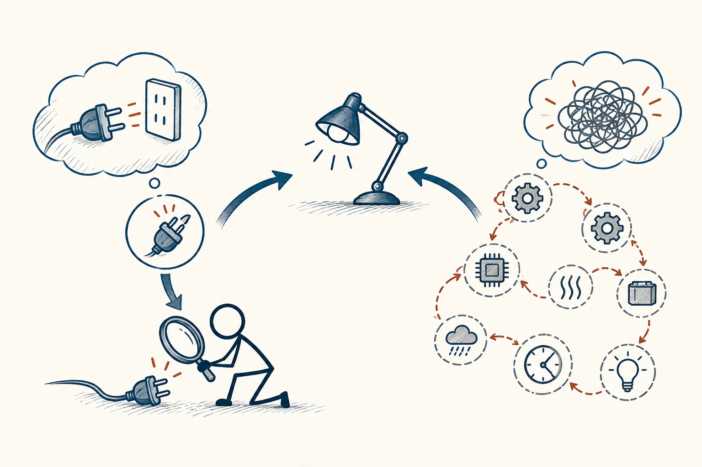

# 09 · 奥卡姆剃刀

Occam’s Razor · 认知与推理

> 先检查简单、常见、说得通的原因，别急着编一个大故事。

*配图说明：同等解释能力下的简约比较：同一盏不亮的台灯，一条短推理链连接松脱插头，另一条绕远的长链串许多无证据的齿轮与问号形不要问号改乱线；两侧都指同一观察。*

## 定义

手机突然没声音，你会先看是不是静音，而不是猜测芯片坏了、系统被入侵。奥卡姆剃刀的日常用法，就是在几种解释都能说通时，先考虑不需要添加太多额外假设的那一种。这样通常更省事，也更容易检查。

奥卡姆剃刀是一项简约原则：在对证据的解释能力相当时，优先选择引入更少额外假设的解释。

但“简单”不等于“随便”。这条规则不保证最简单的解释一定正确。你检查了静音、音量和耳机连接都没问题，当然要继续往下查。它帮助你安排检查顺序，不是让你拒绝复杂的真实情况。

## 举个身边的例子

你发给朋友的消息一天没有回复，脑子里很快出现一串剧情：他是不是对我不满？是不是上次的话说错了？是不是别人挑拨了什么？要让这套解释成立，你得同时猜中很多未被证实的事。

先考虑几个容易核实的原因：他在忙、没看到、不知道需不需要回复。你补一句“我周五前要确认，你方便时告诉我就好”，往往就能获得新信息。若长期有明确问题，再认真谈，而不是先被猜测折腾一天。

## 换个场景看看

家里的植物黄叶，先看看浇水、光照、盆土和季节变化，再考虑少见病害。不是说不会生病，而是先查最常见的几个原因，更容易找到头绪。

## 可以这样试

**什么时候用得上：** 遇到小故障、误解，或一件事情越想越像阴谋时，它能帮你先稳住。

1. 把眼前现象写下来，暂时别添动机和剧情。
2. 先查常见、条件较少，又容易核实的几个原因。
3. 如果查不到，就继续追，不为坚持“简单”而无视新线索。

## 别用过头了

“我嫌它复杂，所以它肯定不对”不是这条原则。也别只挑自己听着最顺耳的解释；证据比故事的长短更重要。

## 花一分钟试试

挑一件你最近想了很多、却没核实的事。列出一个不用脑补那么多细节的解释，再写下怎样查一下。

## 顺着看下去

- [01 · 启发式法则](002.md)
- [05 · 批判性思维](007.md)
- [60 · 汉隆剃刀](080.md)

## 来源与延伸

- [维基百科 · 奥卡姆剃刀](https://en.wikipedia.org/wiki/Occam%27s_razor)

---

例子为方便理解而设置，不是真实案例报道。
