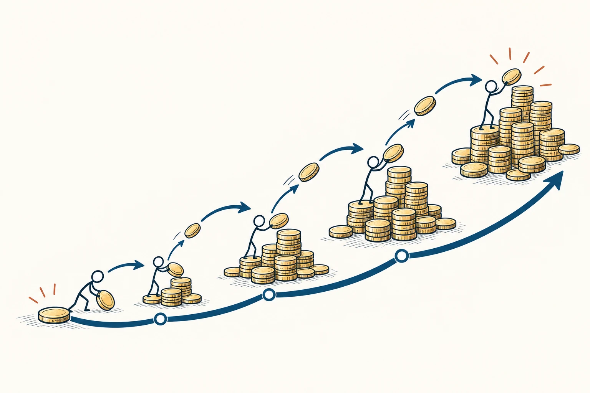
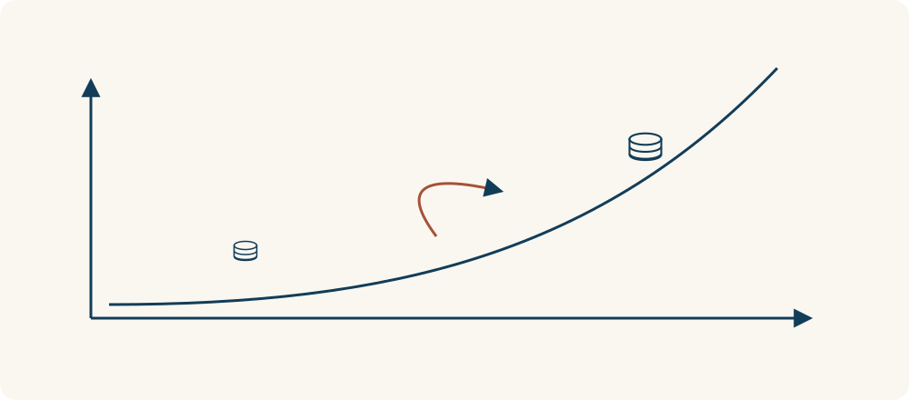

# 85 · 复利效应

Compounding · 行为与成长

> 让已经积累的东西，继续帮你积累下一份成果。

*配图说明：已有成果继续投入下一阶段，钱堆沿增长曲线逐渐积累。*

## 定义

同样每天学一点，有的人越学越能接上新知识，有的人却总在重新开始。差别可能不只是花了多久，还在于前面学到的东西，有没有保留下来、在后面的练习中继续派上用场。复利效应提醒我们看这种“积累还会参与下一轮”的过程。

复利原指将本金产生的利息计入后续计息基础，使利息也参与之后的增长；借作思考模型时，复利效应强调把已有成果继续投入下一轮，形成能够累积和放大的基础。

先用一个纯粹的计算例子理解：假设100元每期固定增长10%，增长部分也留在里面，第一期变成110元，第二期便按110元计算，得到121元，而不是120元。这里的比例只是演示，不是收益承诺。借到学习和工作里，我们关注的是可重复利用的积累，不能把人的成长直接套成固定增长公式。

理解复利时，除了看总量变大，还要看箭头有没有把已有成果带进下一轮。只是一笔笔增加同样的东西，属于累加；已有积累也参与后续增长，才抓住了复利的关键。学习中的这种图解是类比，并不保证固定增长速度。

*已有积累进入下一轮，成为后续增长的一部分。*

## 举个身边的例子

你开始写文章，每写一篇就整理一个讲清楚的例子、修正一个反复出现的问题，再把有效结构留作下次参考。过一段时间，新文章不再完全从空白开始：旧资料能用，新结构更熟，你也更容易发现哪里写得绕。

前一次产出的价值因此没有只停在那篇文章里，还帮助了后面的创作。这就是可以借复利思路理解的地方。如果只是每天复制一段自己也没看懂的文字，存得再多，也不一定形成同样的帮助。关键不只是次数增加，而是积累的质量，以及它有没有被重新用起来。

## 换个场景看看

你学做饭，每次都记录适合自家锅具的火力、时间和容易失手的步骤。以后做相近的菜，便能借用这些经验，少走一段弯路。这属于生活中的积累与复用，不代表每做一道菜，厨艺就按某个固定百分比增长；想继续进步，仍需要尝试、纠错和练习。

## 可以这样试

**什么时候用得上：** 当你选择长期学习、建立工作资料或练习一项技能时，可以看看每次投入能否留下以后仍用得上的东西，而不只关注当天完成多少。

1. 选一件值得长期积累的事，先把频率定到自己能持续的程度，不急着追求每天翻倍。
2. 每次留下一个以后用得上的成果，例如复习卡、修改记录、可复用模板或已经掌握的基本动作。
3. 定期回看这些积累是否真能帮助新任务；无效就调整方法，也给休息和复习留时间。

## 别用过头了

并不是坚持就一定指数增长。遗忘、疲劳、方法错误和外部变化都可能消耗积累，练习也会遇到平台期。看到问题时可以换方法、缩小安排或寻求反馈，别拿“以后会复利”当作继续做无效事情的理由。

## 花一分钟试试

选一件你每周都在做的事，写下：“这次做完，我能留下什么，让下一次更容易？”本周先留下一个小成果，再安排一次真的把它拿来用。

## 顺着看下去

- [89 · 遗忘曲线](063.md)
- [77 · 反馈回路](066.md)
- [78 · 收益递减规律](067.md)

## 来源与延伸

- [Investor.gov · Compound Interest](https://www.investor.gov/introduction-investing/investing-basics/glossary/compound-interest)

---

例子为方便理解而设置，不是真实案例报道。
