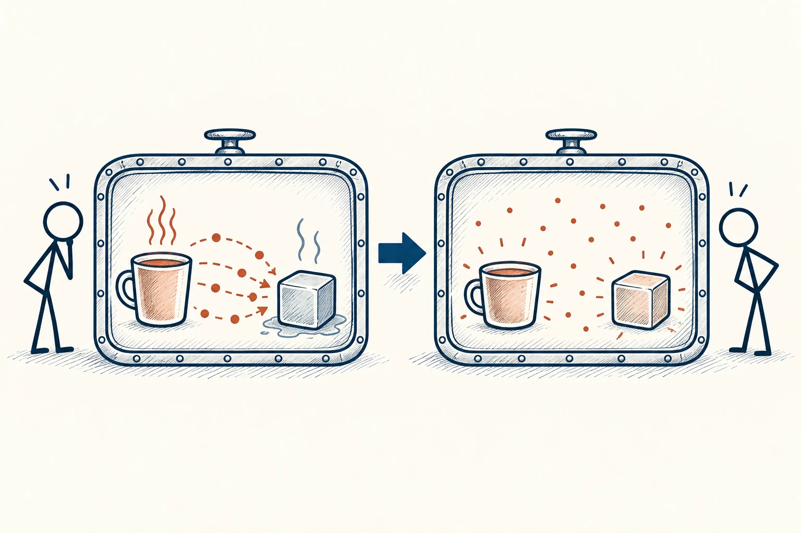

# 73 · 熵与热力学第二定律

Entropy · 系统与规律

> 整理一次只能好一阵子；想一直好用，就得有人持续照看。

*配图说明：孤立系统内热量趋于平衡的物理图解：两个密封大框前后比较，左框内红暖小杯和冷灰小块之间有温差，热能小点从热处向冷处传；右框两者接近同温，热分布均匀。*

## 定义

抽屉刚收拾完很整齐，过几周又塞满杂物；电脑文件夹刚整理过，没多久又出现“最终版、最终版2、真正最终版”。借用“熵”这个概念，生活里最实用的提醒就是：很多秩序都需要维护，不能只建一次就撒手。

热力学第二定律指出，孤立系统的总熵不会自发减少；熵是一个物理状态量，不能与日常所说的杂乱完全画等号。

不过要说清楚，物理中的熵是有严格含义的，热力学第二定律也不是一句“凡事都会越来越乱”。我们在这里做的是类比：新东西不断进来，旧东西没人清理，使用规则又不清楚，系统自然越来越不好用。既然知道原因，就能安排维护。

## 举个身边的例子

你花一个周末把照片按年份整理，觉得这次终于解决了。三个月后，新照片散在手机、聊天记录和下载目录里，想找一次旅行照片又要翻半天。

与其每次攒一大堆再重整，不如规定：每月固定备份一次，新照片先进一个入口，重复照片顺手删掉。你减少的不是“混乱的命运”，而是没人管、没时间管造成的积累。

## 换个场景看看

一份联系人表如果从不更新，号码会过期，职责会变化。它刚建立时很完整，也不能保证两年后仍可靠。资料的价值，一部分来自内容，一部分来自有人持续更新。

## 可以这样试

**什么时候用得上：** 整理文件、维护知识库、保持家务秩序，或估算一个长期项目的成本时，很适合用。

1. 挑一个总是重新变乱的地方，看看新东西从哪里进来。
2. 设置简单的归位和淘汰办法，尽量让收拾只多花一点点力气。
3. 安排一个小而固定的维护时间，别把所有整理留给大扫除。

## 别用过头了

别用“熵增”吓唬自己，好像一切都会不可挽回地崩坏。家、团队和软件都可以通过持续投入变得更有序，只是需要把维护也当成正式工作。

## 花一分钟试试

找一个反复失序的地方，设计一个五分钟内能完成的维护动作，再给它安排具体时间。

## 顺着看下去

- [77 · 反馈回路](066.md)
- [78 · 收益递减规律](067.md)
- [70 · 帕金森定律](069.md)

## 来源与延伸

- [维基百科 · 熵与热力学第二定律](https://en.wikipedia.org/wiki/Entropy)

---

例子为方便理解而设置，不是真实案例报道。
