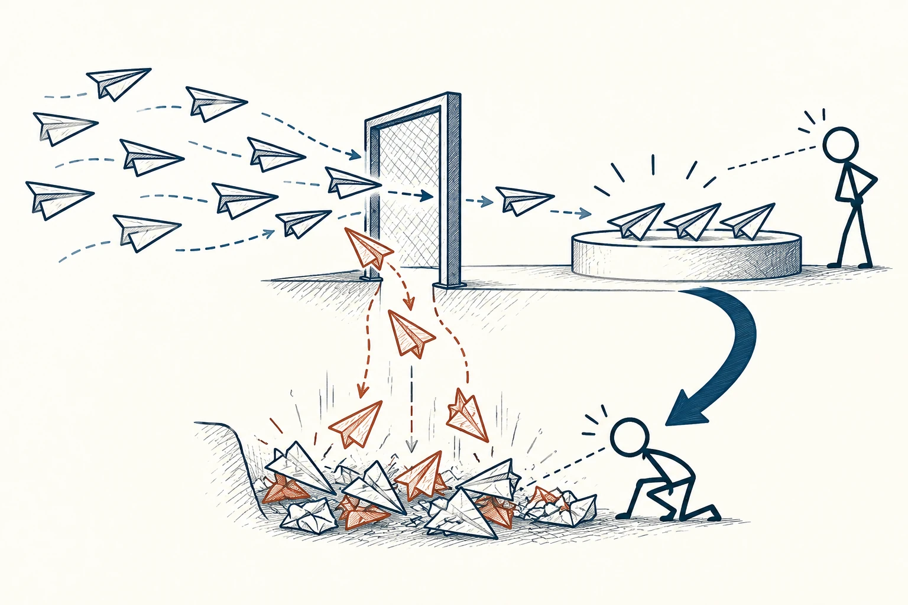
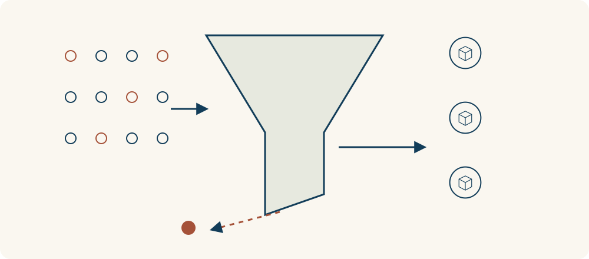

# 10 · 幸存者偏差

Survivorship Bias · 认知与推理

> 成功的人很显眼，没成功的人却常常不在画面里。

*配图说明：筛选漏斗与看不见的失败者：上方多只纸飞机起飞，只有少数穿过筛选门到达展示台，许多掉在门下；火柴人起初只看展示台，另一支藏蓝观察箭头引向下方被忽略的纸飞机，恢复整体。*

## 定义

刷到十位靠某种方法成功的人，你很容易想：“他们都做到了，我照着做应该也行。”可你看见的可能只是愿意分享、还在坚持或已经出头的人。试过同样方法却没做成的人，可能早就退出，也没机会出现在推荐里。

幸存者偏差是选择偏差的一种：分析只包含通过某种筛选、持续存在或被观察到的对象，却忽略被淘汰、退出或缺失的对象，从而使对整体的判断产生系统性偏差。

这里的“幸存”不一定指活下来，也可以是留在行业里、完成训练、经营到今天。问题不只是成功案例少，而是进入你视野的过程，本身就把许多不一样的结果筛掉了。只看留下来的那部分，容易把成功说得太简单，把风险看得太轻。

沿着“总体—筛选—留下来的人”看一遍，会更容易发现问题：成功案例通常在筛选后的末端，而退出和失败的人可能已经从视野中消失。判断整体之前，需要把这些缺失对象重新算进考虑。

## 举个身边的例子

你想开一家咖啡店，走访了五家生意不错的小店。店主都说自己喜欢咖啡、认真做产品，也肯花时间经营。于是你觉得，只要够热爱、够努力，开店应该能做下去。

但你拜访的是现在还营业、又愿意接受交流的店。附近去年关掉的店，可能同样认真，却遇到了租金、客流或现金安排的问题。更完整的了解，是再问问退出的人、查一查同一片区新开和关闭的情况，再比较位置、成本、经验等条件。成功经验仍值得学，只是不能直接当成“这样做就能成功”的保证。

*留下的对象只是筛选后的部分；退出视野的对象也属于原来的整体。*

## 换个场景看看

你看到祖父母留下的一件旧家具，觉得“过去的家具质量都比现在好”。可质量差、早就损坏的旧家具，可能已经被扔掉，没法留到今天让你看。要比较两个年代的整体质量，不能只拿上一代最耐用的少数，去比这一代所有高低不同的产品。

## 可以这样试

**什么时候用得上：** 看到成功访谈、课程成果、长期存活的品牌，或听到“以前的东西都更耐用”时，先想想没进入画面的那些对象。

1. 看到成功案例，先问一共多少人尝试过，退出和没达标的人是否也算进去了。
2. 尽量找同一时期、条件相近的未成功案例，了解他们遇到了什么，而不只听一句“他们不够努力”。
3. 把案例当作线索，再检查方法、资源、时机和运气各起了什么作用，不直接把故事换成成功概率。

## 别用过头了

成功者的经验并非没有价值，失败也不一定更有代表性。重点是补齐被筛掉的信息，用相近条件作比较；不知道总人数时，就承认还不能估计成功率，别从“有人做到了”跳到“谁都能做到”。

## 花一分钟试试

找一条最近让你心动的成功故事，补问三件事：总共多少人试过？谁中途退出了？没成功的人在哪里？先写出信息缺口，不用急着否定或相信。

## 顺着看下去

- [21 · 第三变量效应](022.md)
- [12 · 可得性启发式](027.md)
- [14 · 确认偏误](035.md)

## 来源与延伸

- [奥斯纳布吕克大学 MethodsLab · Survivorship Bias](https://www.methodslab.uni-osnabrueck.de/en/Survivorship_Bias.html)

---

例子为方便理解而设置，不是真实案例报道。
