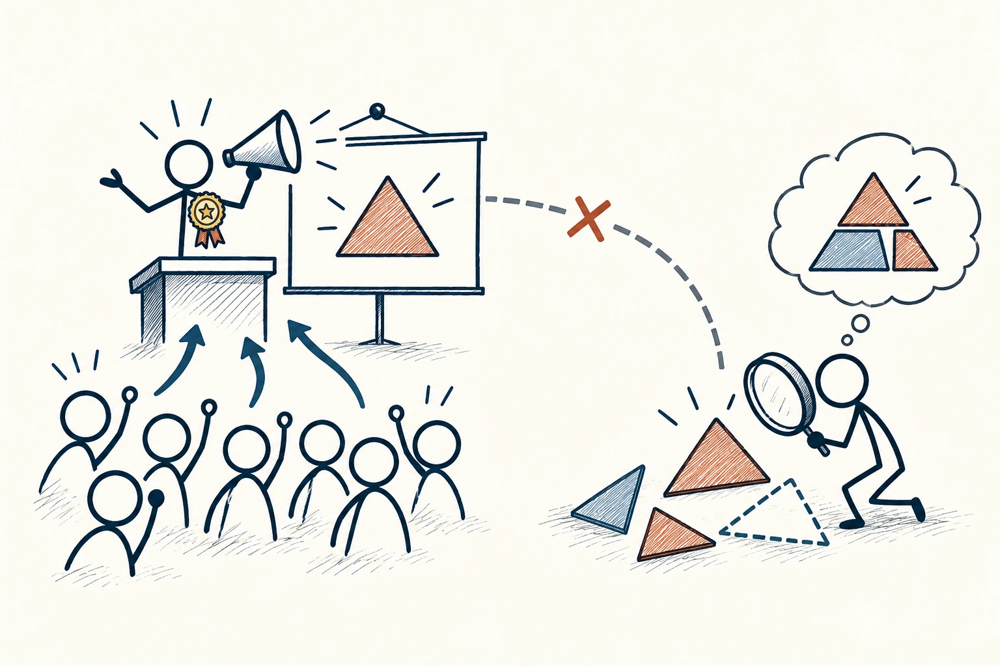

# 11 · 权威偏差

Authority Bias · 认知与推理

> 头衔能告诉你他擅长什么，却不能让他说的每句话都自动正确。

*配图说明：权威外观与证据分离：左侧站在讲台的火柴人戴奖章用大喇叭展示一个几何观点，听者自动跟随；右侧另一个普通火柴人用放大镜检验同样图案的证据拼块，奖章与真实性之间用断开的线，表达不能仅凭身份判断。*

## 定义

一位老师、一位医生、一位著名企业家，通常在自己的领域积累了很多经验，值得认真听。但我们有时会把这种信任扩大到任何话题：因为他做生意成功，就认为他讲教育、历史、营养也都可靠。这就是权威偏差常见的样子。

权威偏差指人们因为信息来自权威人物，而给予其观点过高的准确性判断或影响权重，未充分检查内容本身。

更稳妥的办法不是拒绝专家，而是把信任放对位置。先看这个人是不是在谈自己的专业，再看他拿出了什么依据、是否说明不确定的地方，以及其他了解这件事的人怎么看。

## 举个身边的例子

你在直播里看到一位很敬佩的作家推荐一个付费学习工具。他的书确实帮过你，所以你几乎不看功能和价格就想购买。可写作能力强，不代表他知道你的学习习惯，也不代表他试过所有同类产品。

你可以把推荐当作一条线索，先试免费版，检查数据能否导出、是否真解决自己的问题。这样既没有否定作家的经验，也没有把他的声望当成替自己花钱的充分理由。

## 换个场景看看

老师擅长教数学，不代表知道每个学生最适合什么职业；同事做过一次成功项目，也不代表同一方案适合所有客户。尊重经验，同时问清条件，并不失礼。

## 可以这样试

**什么时候用得上：** 名人推荐、头衔很亮眼的演讲，或团队因为“老板说了”就停止讨论时，可以用它。

1. 先问：他说的这件事，和他的专业经验有多大关系？
2. 再看具体依据、适用条件，以及有没有商业合作等需要知道的信息。
3. 重要决定多找一个独立来源，别只重复听同一位名人的说法。

## 别用过头了

“专家也会错”不意味着随便一个人的猜测就和专业研究同样可信。要比较的是相关经验和证据，而不是在盲从与逢专家必反之间摇摆。

## 花一分钟试试

找一个你最近听从的建议，补上两句话：“这位建议者擅长的是……”以及“这次我还需要自己核实的是……”。

## 顺着看下去

- [19 · 举证责任](012.md)
- [10 · 幸存者偏差](018.md)
- [46 · 影响力六原则](033.md)

## 来源与延伸

- [维基百科 · 权威偏差](https://en.wikipedia.org/wiki/Authority_bias)

---

例子为方便理解而设置，不是真实案例报道。
