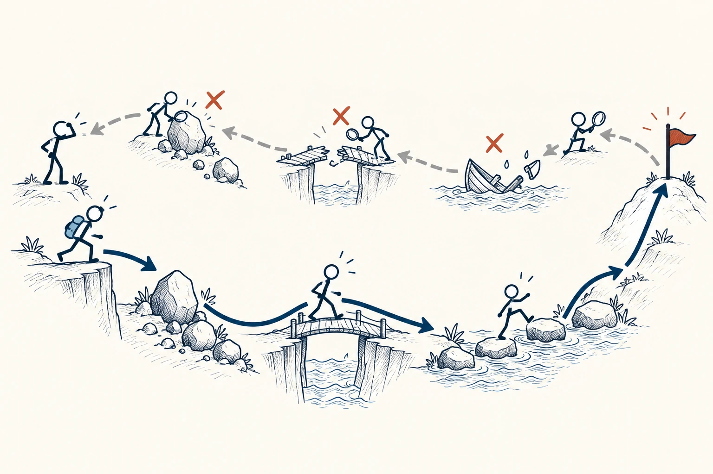
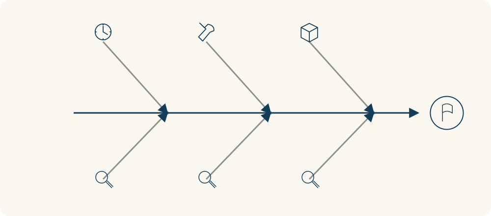

# 30 · 逆向思维

Inversion · 选择与决策

> 想不出怎样做好时，先想想：怎样一定会把事情搞砸？

*配图说明：逆向规划的反向结构：右侧目标是一座可到达的旗杆，左侧出发火柴人；上方灰线从目标倒推经过绊脚石、断桥、漏水小船等失败点，火柴人从后往前标记障碍并修桥；下方藏蓝路线从出发到目标，避开已识别的障碍。*

## 定义

准备做一件事，我们通常先问：“怎样才能成功？”可这个问题太大，脑子里容易只剩下“努力一点”“认真一点”。换个方向，问问“做哪些事，会让它很难成功”，答案往往具体得多：临时准备、不确认要求、一直拖到最后。

逆向思维是一种从目标的相反方向分析问题的思考方法：先识别会阻碍目标、导致失败的条件，再寻找减少或排除这些条件的行动。它可以补充正向规划，帮助我们发现容易遗漏的障碍。

把这些容易踩的坑写出来，再逐一想办法避开，你就得到了一份能执行的准备清单。比如，把“别迟到”变成“提前查路线，给换乘多留二十分钟”。

这里的“逆向”，是换个方向检查同一个目标。它不是凡事跟别人唱反调，也不是把一句话倒过来就算有道理。你仍然想把事情做好，只是先从失败的入口找漏洞。

倒着想不只是把步骤顺序倒过来。你可以从一个不想发生的结果往回找原因，再把每个原因转成预防动作。原因之间可能是并列的，不必硬排成一条必然发生的链。

## 举个身边的例子

你要在周末组织一次朋友聚会，想让每个人都玩得开心，却不知道从哪儿开始。先问：“怎样会让大家白跑一趟？”很容易想到：地点发错、到场才发现没座位、有人不能吃辣却没问、结束后回不去。

于是你提前发定位、订好座位、问清忌口，再确认末班车时间。这些动作未必让聚会惊艳，却能减少几种本来可以避免的扫兴。做完这些，再去安排游戏和小惊喜，会更踏实。

*从不希望发生的结果往回看，找出几个可能的原因。*

## 换个场景看看

想把手机用得少一点，先问“怎样能让我一直刷下去”：通知全开、手机放枕边、每次无聊就点开短视频。你可以先关掉不必要的通知、睡前把手机放远，并给无聊时准备一本书。接下来还要观察，自己是不是又换了别的方式拖延。

## 可以这样试

**什么时候用得上：** 准备活动、提交作业、安排出行，或者计划听起来很好、却总担心漏了什么时，可以先反过来检查。

1. 写清一个具体目标，比如“周五前交出符合要求的方案”。
2. 反过来列出三个最可能让它失败的原因，优先选自己能影响的。
3. 把每个原因改成一个预防动作，做完后再检查：还需要什么才能达成目标？

## 别用过头了

避开失败条件，并不等于已经满足成功条件。准时到场不代表面试就能通过，材料齐全也不代表方案就有价值。别把这套方法用成无限担忧：先处理两三个最现实的风险，再往前行动。

## 花一分钟试试

选一件本周要完成的小事，补完这句话：“如果我想让它失败，我会……”写三条，然后挑一条，立刻做一个预防动作。

## 顺着看下去

- [76 · 墨菲定律](059.md)
- [34 · 决策树](049.md)
- [84 · 控制圈](006.md)

## 来源与延伸

- [Farnam Street · Inversion](https://fs.blog/inversion/)

---

例子为方便理解而设置，不是真实案例报道。
