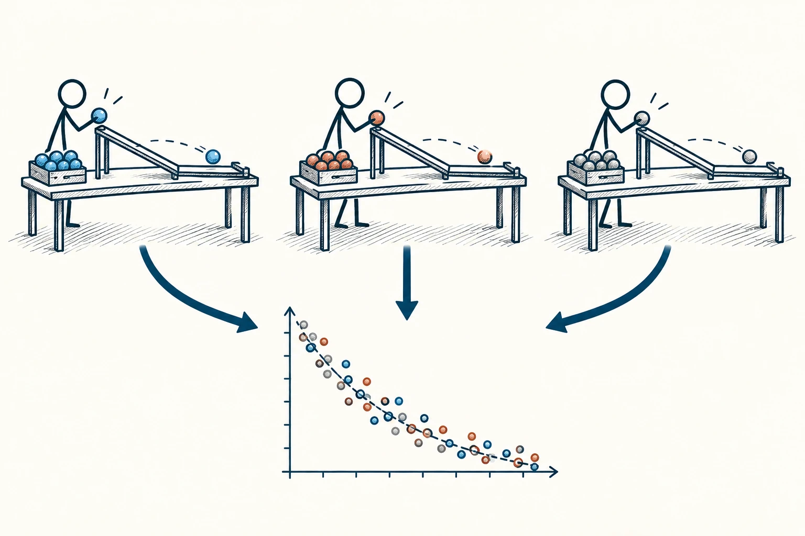

# 20 · 实验可重复性

Replication · 证据与统计

> 一次做成，可能有运气；换一批人、换一次时间，还行不行？

*配图说明：独立重复实验的并排小面板：三位不同火柴人在三张不同桌子上按相同装置做小球沿斜坡滚动的试验，每张桌子都有新的一组小球；末端观测结果以相近的点分布叠到一个共同区域，旁边保留少量差异。*

## 定义

你第一次照着一个方法做，结果特别好，很容易觉得找到了秘诀。但那天可能正好状态好、任务简单、有人帮忙。可重复性提醒我们：别只看一次漂亮结果，还要看看相似条件下，能不能再出现。

在研究中，重复研究通常指使用新收集的数据检验既有发现；使用原有数据与分析方法重新得到结果，则主要检验分析的可重现性。

在研究里，别人用新资料重新检验，和拿原来的资料重新计算，都很重要，但不是同一件事。日常先记住更简单的一点就够了：把过程留下来，让第二次不只靠“凭感觉再来”。失败的一轮也要看，它可能告诉你限制在哪里。

## 举个身边的例子

你发了一条短视频，播放量比平时高十倍，于是判断“以后都晚上九点发”。接下来连续照做，效果却回到原来水平。回头看才发现，第一次刚好谈了一个正在被大量讨论的话题。

如果你记录过主题、内容和发布时间，就更容易拆开原因。九点发布可能有帮助，也可能只是那次成功里不重要的一部分。多试几轮，你才会慢慢找到真正稳定、又适合自己的做法。

## 换个场景看看

你做出一盘好吃的饼干，却忘了烤箱温度和烘烤时间。比起只拍成品，留下一份能重做的记录，才能把偶然成功变成慢慢掌握的手艺。

## 可以这样试

**什么时候用得上：** 推广新做法、购买所谓成功秘诀，或准备把一次好成绩当成长期能力时，尤其值得用。

1. 把成功时做了什么、面对谁、在什么条件下做，简单记下来。
2. 尽量在另一个时间或另一批对象上试一次，别总重复同一小群人。
3. 把成功与失败一起看，找出哪些条件一变，效果就明显不同。

## 别用过头了

一次重复失败，不一定证明前一次骗人；可能条件、样本或操作不同。多次成功也不保证到哪里都有效，目的是摸清规律和范围，不是得到永远的保证。

## 花一分钟试试

挑一次让你很满意的成果，写出别人照着也能试的五个关键步骤。哪些地方你还只能说“凭感觉”？

## 顺着看下去

- [21 · 第三变量效应](022.md)
- [18 · 证伪原则](011.md)
- [24 · A/B 测试](025.md)

## 来源与延伸

- [维基百科 · 实验可重复性](https://en.wikipedia.org/wiki/Reproducibility)

---

例子为方便理解而设置，不是真实案例报道。
