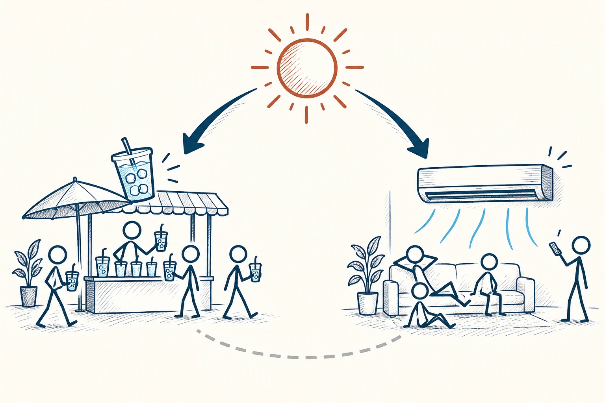
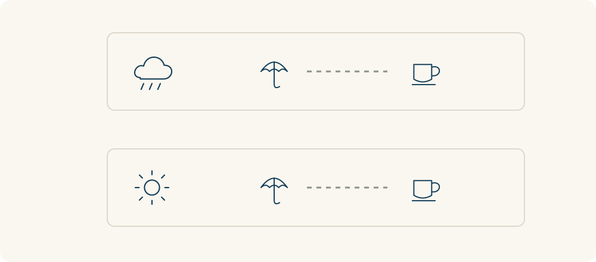

# 21 · 第三变量效应

Third-Variable Problem · 证据与统计

> 看到两件事一起变化，别忘了找找背后共同的推手。

*配图说明：共同原因的倒Y结构：顶端炎热太阳分别向左下冰饮销量图标和右下空调风扇图标发出清楚箭头；两组下各有更多火柴人使用物件。*

## 定义

夏天冷饮卖得多，空调也开得多。你当然不会认为，是喝冷饮让大家打开了空调。这里有一个更容易被忽略的主角：天气热。它同时推动了两件事，让两者看起来很有关系。

第三变量问题指的是：两个变量之间观察到的关联，可能部分或全部来自另一个因素的共同影响。在因果分析中，这类共同原因可能造成混杂，使我们难以仅凭表面关联判断一个变量对另一个变量的影响。

把这件事当成思考工具，就是每次听到“用了它，所以变好了”，先停一下：是不是还有什么，同时影响了“用不用它”和“结果好不好”？这个问题能帮你少把功劳记错，也少把钱和精力花在不一定起作用的地方。

找到一个可能的共同因素，只是多了一种解释，还不能直接宣布破案。接下来要看资料、问条件，或者做更合适的比较。也可能有好几个因素同时起作用，不一定只有一个藏在背后的答案。

最清楚的关系是一条分叉：天气热分别影响冷饮销量和空调使用。两个结果一起变化，可能只是因为它们有共同原因；在两个结果之间加一条因果箭头，还需要另外的证据。

## 举个身边的例子

假设一家店发现，撑伞的顾客比没撑伞的顾客更常买热饮。店主于是打算给路人发伞，希望热饮卖得更多。可先想想：会不会是下雨天偏凉，既让人撑伞，也让人更想喝热的？

如果真正起作用的是天气，单纯发伞就未必能复制效果。店主可以先按晴天、雨天以及气温把记录分开，在相近条件下比较，再判断伞本身是否有影响。这个例子提醒我们，眼前显眼的东西，未必是推动结果的关键。

*先按天气等共同条件整理记录，再比较原来的联系；一起变化本身还不能证明因果。*

## 换个场景看看

假设你发现，经常去图书馆的同学成绩也比较好。图书馆可能确实有帮助，但也可能是学习动力更强的同学，既更愿意去图书馆，也更愿意认真复习。想判断环境本身的作用，需要尽量比较学习动力、基础等条件接近的人，不能只看去没去图书馆。

## 可以这样试

**什么时候用得上：** 看到产品效果宣传、学习经验分享，或者想从一组数据里找出成功原因时，可以先检查有没有共同影响因素。

1. 把你看到的关系写成一句话：“有 A 的时候，B 往往也更多。”
2. 列出可能同时影响 A 和 B 的条件，比如天气、经验、时间或原有习惯。
3. 找相近条件下的比较或合适的实验，看看原来的关系是否仍然存在。

## 别用过头了

别凭空想到一个因素，就认定它是原因。第三变量也可能只能解释一部分联系。更不能把所有相关都说成假的：有些关系确实包含直接影响，只是需要更充分的证据来区分。

## 花一分钟试试

找一句你最近听过的“做了 A，就会得到 B”。写出一个可能同时影响 A 和 B 的条件，再写下：需要知道什么，才能判断这个解释是否站得住？

## 顺着看下去

- [19 · 举证责任](012.md)
- [20 · 实验可重复性](021.md)
- [24 · A/B 测试](025.md)

## 来源与延伸

- [OpenStax · Analyzing Findings：共同因素与混杂](https://openstax.org/books/psychology/pages/2-3-analyzing-findings)

---

例子为方便理解而设置，不是真实案例报道。
