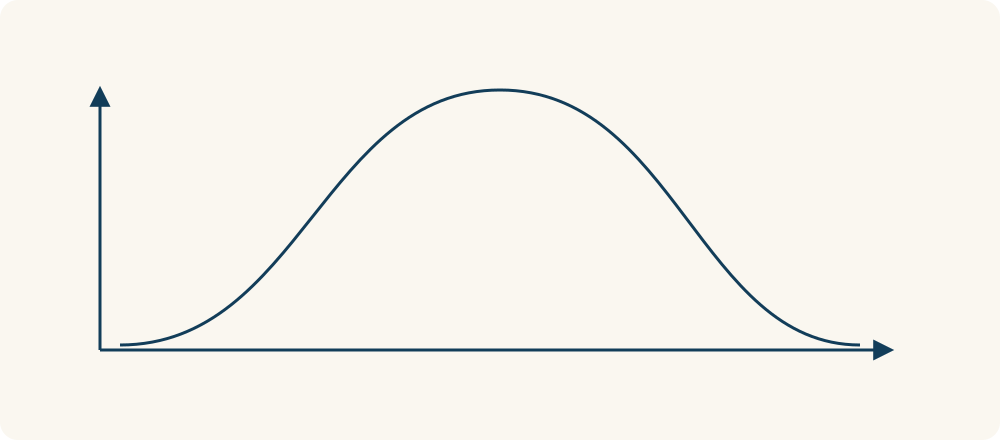

# 22 · 正态分布

Normal Distribution · 证据与统计

> 有些事情，大多数挤在中间，特别高和特别低的都比较少。

*配图说明：钟形分布：底部很多高度均匀排列的小柱，中间最高两端矮，平滑对称钟形曲线盖在上方；许多火柴人站在中间，较少在两边，中央细垂线，两侧不标优劣。*

## 定义

把一大群成年人的身高按人数画出来，在合适的人群范围内，常能看到类似钟的形状：中间常见，往两边越来越少。这就是正态分布想描述的样子。“正态”不是说谁正常、谁不正常，只是一个统计上的名字。

正态分布是由均值和标准差确定的连续、对称的概率分布，其密度曲线呈钟形，均值位于中心。

理解它，可以先抓住两个问题：大家大概围着哪个数上下波动？散得开不开放？前者常用平均数描述，后者可以用“标准差”这种尺子描述。越分散，标准差通常越大。先懂图的形状，比急着背公式有用。

钟形图里，中间高表示这一带附近的取值更集中，两端低表示相应范围内较少见。比较多少时要看一段范围对应的面积，不能把某个位置的曲线高度直接当成那个精确数值的概率。

*中间附近更集中，两端附近较少；这是一种分布形状。*

## 举个身边的例子

假设一批测量误差大致符合正态分布，中心在0，标准差为1。那么大约68%的误差会落在负1到正1之间，约95%落在负2到正2之间。这些比例依赖“确实近似正态”这个前提，不是随便一组数字都能套。

换成家庭收入，少数特别高的数字可能把平均数拉得很高，图形也不再左右对称。你若还照钟形曲线理解，就容易误会“普通人”实际处在什么位置。

## 换个场景看看

你看到一个班平均分80，仍不知道大家是不是都接近80：可能大多在75到85，也可能一半60、一半100。只知道平均数，还看不到分布。

## 可以这样试

**什么时候用得上：** 看平均成绩、测量误差或波动范围时，它能帮你知道一个数字大概处在什么位置。

1. 先把数字画成简单的分组柱形图，看看是否中间高、两边低且大致对称。
2. 如果看起来合适，再用平均数描述中心，用标准差描述分散程度。
3. 遇到特别偏、几个山头或少数极大值的数据，先别硬套钟形曲线。

## 别用过头了

不是所有成绩、收入和浏览量都符合正态分布。落在少见区域的人也不代表有问题；分布描述的是某个人群里的情况，不是对个人价值的评价。

## 花一分钟试试

拿一组熟悉的数据，例如一周每天的通勤时间。先看看有没有特别高的数，再问自己：只报平均数，会不会漏掉重要信息？

## 顺着看下去

- [23 · 均值回归](024.md)
- [12 · 可得性启发式](027.md)
- [78 · 收益递减规律](067.md)

## 来源与延伸

- [维基百科 · 正态分布](https://en.wikipedia.org/wiki/Normal_distribution)

---

例子为方便理解而设置，不是真实案例报道。
