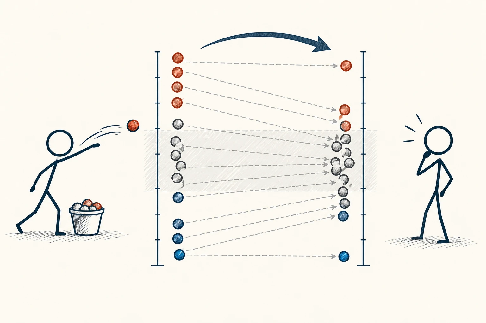
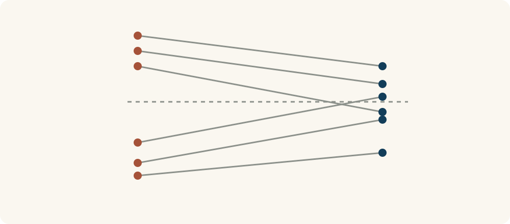

# 23 · 均值回归

Regression to the Mean · 证据与统计

> 特别好或特别差的一次，下一次可能只是回到平常水平。

*配图说明：极端后趋于中间的散点配对：左列首次极高和极低的小球投掷记录，右列后续记录更多靠近中间灰带，细线分别连接同一对象；不把全部都拉到均值，保留少数仍极端的点。*

## 定义

考试突然考得特别好，可能既有实力，也有刚好复习到题目的运气；突然考得特别差，可能又赶上没睡好。下一次实力没怎么变，但运气未必再偏向同一边，结果就可能没那么极端。这种现象叫均值回归。

在两次测量存在不完全相关等条件下，因首次结果极端而选出的对象，其后续测量的平均表现往往不再同样极端，这称为均值回归。

它不是“好运用完了就会倒霉”，也不是一个看不见的力量把分数往中间拉。关键在于：我们特别注意到的那次表现，往往混着一份不容易重复的偶然因素。那份因素不再出现，结果自然更像平常。

把同一批对象的两次结果用线连起来，常会看到首次特别高或特别低的对象，后来没那么极端。这里说的是整体倾向，不是每个人都必定回到平均，更不是平均数在背后把人拉回去。

## 举个身边的例子

你家孩子平时数学在80分上下，一次只考了60分。你狠狠批评了一顿，下一次考到78分，便觉得“果然骂了就有效”。但即使不挨骂，孩子也可能因为睡好了、题目更熟而回升。

要知道批评有没有帮助，不能只看这一次涨分，还要观察学习过程、情绪和较长时间的变化。否则容易把自然回升误认成严厉手段的功劳，之后越用越重。

*同一批对象的两次结果相连，后一次可能不像最初那么极端。*

## 换个场景看看

一家店某天意外接到团购大单，营业额翻了几倍。第二天恢复普通水平，不代表经营突然变差，可能只是前一天有一次额外因素。看一段时间，才不容易被单日结果带着跑。

## 可以这样试

**什么时候用得上：** 分析某次突然的高分、爆款、低谷，或评价低谷之后采用的办法时，很值得想起它。

1. 看到极端好坏的结果，先查看此前几次大概处在什么水平。
2. 找出当天可能存在的偶然因素，例如状态、难度或临时事件。
3. 判断一个办法有无效果时，别只挑最低谷开始、回升后就宣布成功。

## 别用过头了

能力真的进步、环境真的恶化时，平常水平也会改变。均值回归不是保证“差的自动变好”，更不能拿来否定持续努力的作用。

## 花一分钟试试

回想一次特别好或特别差的表现，分别写下稳定原因和当天偶然因素。下次你会怎样更公平地评价自己？

## 顺着看下去

- [21 · 第三变量效应](022.md)
- [22 · 正态分布](023.md)
- [24 · A/B 测试](025.md)

## 来源与延伸

- [维基百科 · 均值回归](https://en.wikipedia.org/wiki/Regression_toward_the_mean)

---

例子为方便理解而设置，不是真实案例报道。
