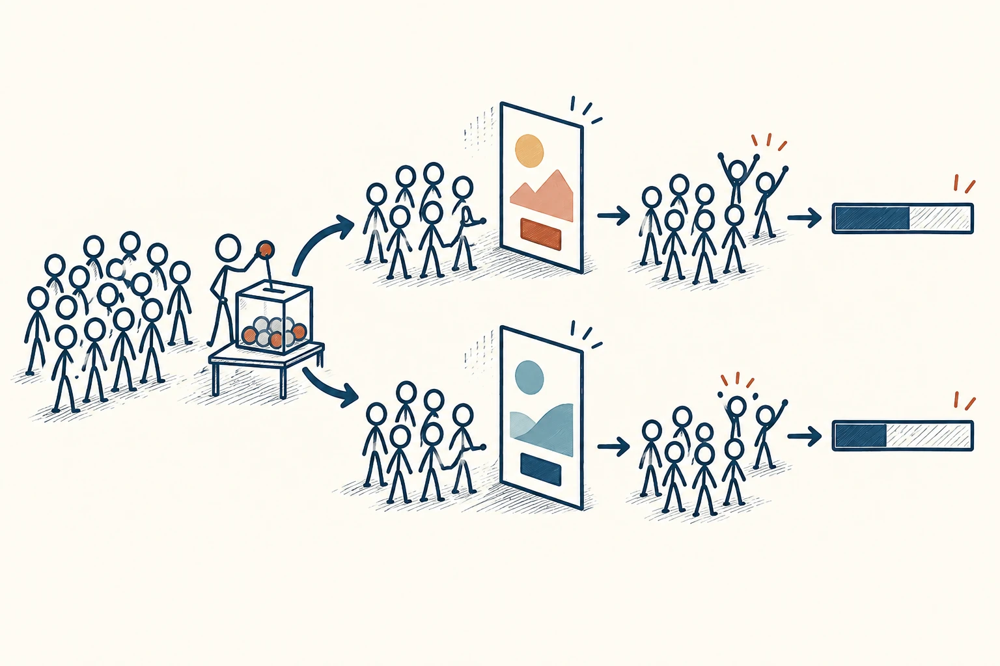

# 24 · A/B 测试

A/B Testing · 证据与统计

> 两个方案拿不准，先安排一场尽量公平的小比较。

*配图说明：随机分配两版本并比较比例：左边一群相同火柴人被无字抽签箱随机分成数量相近两路，各看不同布局但无字的两张海报，后面各有相同数量观众图标以及少数举手完成报名的人，最后用两个无刻度条形长度比较完成比例。*

## 定义

你做了两张海报，一张标题直接，一张标题有悬念。朋友们各有各的喜好，争论半天也没答案。这时可以先让两批人分别看到一个版本，看看哪一张更能帮你实现目标，比如带来实际报名。

A/B 测试是一种比较两个版本效果的实验方法：通常将参与者随机分配到 A、B 两组，让各组接触相应版本，再依据预先确定的指标评估差异。作为思考工具，它强调用可比较的观察结果检验方案，而不只靠直觉选答案。

它的价值是把“我觉得这样更好”，变成“在这次条件下，我们观察到了什么”。为了看清差别，入门时最好只改一个关键点：比较标题就先保持图片、价格和报名流程一致。否则即使有一版赢了，你也很难知道究竟是哪项改动起了作用。

正式的 A/B 测试通常会同时开展，并随机决定谁看到哪个版本，尽量减少两组人原本就不一样带来的影响。结果还要结合人数、差距和持续时间判断，不能今天 A 多了两次点击，就马上认定它永远更好。

比较结构可以先分成两路，但分组前还要有一个尽量公平的分配步骤。两路最后对照的是同一个事先选好的指标，而且要记分母：报名十五人，必须连同看过海报的总人数一起看。

## 举个身边的例子

假设你为一场读书会做报名海报。A 的标题是“周六一起读书”，B 的标题是“用两小时读懂一个新观点”，其他内容相同。你提前决定，以报名完成率作为主要比较指标，并让同一时期的潜在参与者随机看到其中一版。

看结果时，既要记报名人数，也要记各有多少人看到了海报。A 有十人报名、B 有十五人报名，如果 B 的曝光人数多了一倍，就不能直接说 B 更有效。人数太少或差距不明确时，可以诚实地记为“暂时看不出”，再决定是否继续测试。

*相同分母下比较完成比例；只比较完成总数可能误判。圆点只示意比较方式，不是实验数据。*

## 换个场景看看

你也可以借用这种比较思路，试试早晨背单词和晚上背单词。给两种安排相近的时长与材料难度，多记录几次第二天的记忆情况。不过这是个人交替尝试，会受疲劳、先后顺序等影响，不能当成严格的两组随机 A/B 测试，更不能据此判断所有人都适合早起。

## 可以这样试

**什么时候用得上：** 两种标题、页面布局或活动安排各有道理，而且可以低成本试一试时，适合用它收集依据。

1. 先写清要解决的问题、两个版本的差别，以及用什么结果判断好坏。
2. 尽量同时、随机分配版本，保持其他条件一致，并提前安排测试人数或时长。
3. 比较比例而不只看总数，同时检查样本是否足够、有没有额外代价；证据不够就先不下结论。

## 别用过头了

不要一看到喜欢的结果就提前收工，也不要反复换指标直到某一版获胜。点击更多不一定代表报名更多、体验更好。测试只说明特定人群和条件下的表现，换了场景可能要重新验证。

## 花一分钟试试

选一个能小范围尝试的方案，写下 A 版、B 版、唯一想改的地方，以及一个事先选定的判断指标。再补一句：“出现什么情况，我会承认还看不出差别？”

## 顺着看下去

- [21 · 第三变量效应](022.md)
- [20 · 实验可重复性](021.md)
- [64 · 最小可行产品](043.md)

## 来源与延伸

- [GOV.UK · A/B testing: comparative studies](https://www.gov.uk/guidance/ab-testing-comparative-studies)

---

例子为方便理解而设置，不是真实案例报道。
