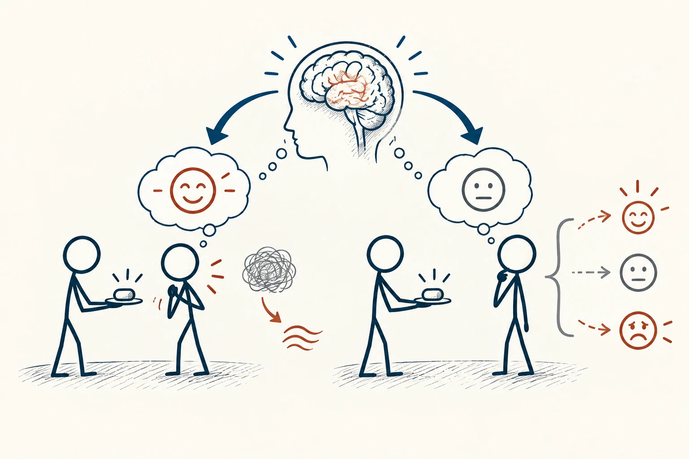

# 25 · 安慰剂效应

The Placebo Effect · 证据与统计

> “我觉得它会有帮助”这份期待，有时也会影响自己的感受。

*配图说明：期待与主观体验的路径：两位情境相近火柴人获得外观相同的无字中性小物件，左边一个带安心微笑图标的无字对话泡后主观紧张线减少，右边一组变化不一。*

## 定义

同样一项体验，如果先被告诉“很多人觉得很放松”，你可能更容易注意到放松的感觉。安慰剂效应提醒我们，体验不只取决于东西本身，也会受到期待、过去经历和被对待的方式影响。这个概念常见于医学研究，这里先用它理解“感觉改善”是怎么来的。

安慰剂效应指由期待、学习以及治疗情境等因素引起的结果变化，它不同于安慰剂组观察到的全部改善。

同时要分清：接受某种安排后变好了，不代表改善全来自期待。时间过去本来就可能恢复，糟糕状态也可能回到平常。想知道各自起了多少作用，需要合适的比较，不能看见改善就随便归因。

## 举个身边的例子

设想两组人使用速度一样的软件，一组看到“已开启高速模式”，另一组没有提示。如果前一组觉得更快，这可能和期待有关；但不能因此说客观加载时间真的缩短了。要同时看看实际耗时，才能把体验和速度分开。

对日常用户来说，清楚的提示确实可能让等待没那么焦虑。但如果产品根本没变快，却用假提示长期误导，也会破坏信任。理解心理影响，是为了看懂体验，而不是教人用话术代替实际改善。

## 换个场景看看

新买了昂贵的枕头，第一晚睡得特别安心，可能既有枕头的作用，也有“终于解决了”的放松。继续观察几晚、留意作息，通常比只凭第一晚下结论稳妥。

## 可以这样试

**什么时候用得上：** 看待产品体验、仪式感和“试完立刻觉得有效”的评价时，可以借它多想一步。

1. 先区分两件事：我感觉变好了，还是能够测量的结果也变了？
2. 回想是否同时多了期待、关注、安慰或仪式感。
3. 重要效果要看合适的比较，不把一次感受当成完整结论。

## 别用过头了

期待能影响部分体验，不代表“相信就能治好病”。身体问题应按适当方式处理。也别嘲笑别人“只是心理作用”，感受本身可能是真实的，只是原因要分清。

## 花一分钟试试

回忆一次“刚用就觉得有效”的体验。除了物品本身，还有没有期待、环境或额外照顾发生了变化？先列出来，不必急着否定感受。

## 顺着看下去

- [23 · 均值回归](024.md)
- [24 · A/B 测试](025.md)
- [88 · 霍桑效应](062.md)

## 来源与延伸

- [维基百科 · 安慰剂效应](https://en.wikipedia.org/wiki/Placebo)

---

例子为方便理解而设置，不是真实案例报道。
