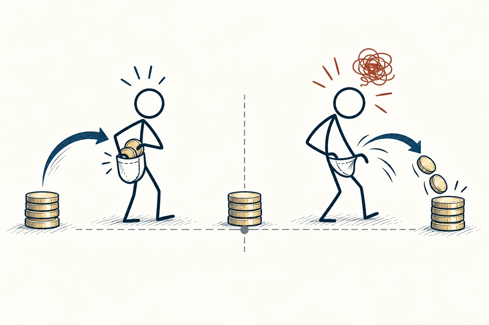
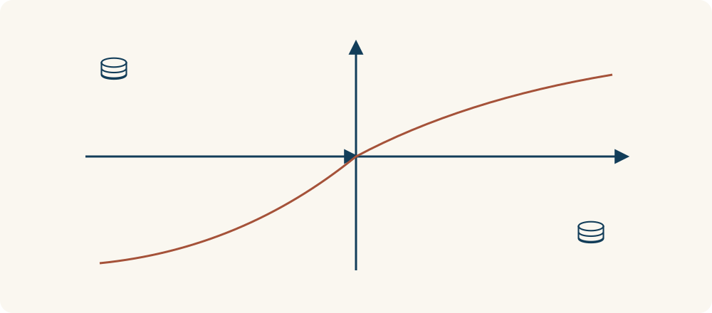

# 31 · 损失厌恶

Loss Aversion · 选择与决策

> 失去手里已有的东西，常比得到同样多的东西更让人在意。

*配图说明：等量得失的不对称感受：两边相同大小和数目的无字硬币，左侧硬币进入火柴人口袋，头上小喜悦线；右侧同样数量离开，头上明显更大失落乱线。*

## 定义

捡到一百元会高兴，丢掉一百元却可能郁闷很久。同样是一百元，我们对失去的感受，常比对获得更强烈。这就是损失厌恶。这里没有对每个人都适用的固定倍数，你只要先注意这份不对称就好。

在前景理论的描述中，损失厌恶指人们围绕某个参照点评价结果时，损失往往比同等大小的收益具有更强的心理影响。

我们还会给“目前拥有的”“原来价格”“本来以为能拿到的”设一个心理起点。结果看起来是赚还是亏，很受这个起点影响。商家、谈判者和我们自己，都可能通过换个说法，让同一件事显得完全不同。

先在心里固定同一个起点，再比较“增加一点”和“失去同样多”带来的感受。损失厌恶说的是反应可能不对称，不是损失的实际金额一定更大，也不是每个人在所有场景下都一样。

*起点和数量相同，失去与获得带来的感受仍可能不对称。*

## 举个身边的例子

两份工作最后每月都给一万元。一份最开始就说一万元，另一份先说一万一，后来解释条件调整，改成一万元。即使其他安排相同，你对第二份也可能更不满意，因为脑中先有了“一万一属于我”的预期。

这种失落可以理解，但作决定时，还要回到实际：最后的薪资、内容、稳定性和承诺是否可靠。感受到“少了一千”，与这份工作最终是否合适，是有关却不同的两个问题。

## 换个场景看看

店员说“今天不买就损失两百元优惠”，你可能比听到“今天能省两百元”更着急。但如果东西原本就不需要，不买也许才是保住预算的办法。

## 可以这样试

**什么时候用得上：** 你因为“不能亏”而难以换方案、放弃优惠或调整原有安排时，可以先看看心理起点。

1. 找出自己的心理起点：我把什么当成了本来就属于自己的？
2. 把不同说法还原成实际结果，看看最后分别能得到什么、付出什么。
3. 给失落一点时间，再比较未来选择，不让“怕失去”一个人作主。

## 别用过头了

损失厌恶不等于所有舍不得，也不等于过去投入越多就该继续。后者常涉及沉没成本。必要的谨慎可能很合理，不能一律说成心理偏差。

## 花一分钟试试

把“现在不做就亏了”改写成实际账单：如果做，我会支出多少；如果不做，我会真实失去什么？把想象中的损失单独标出。

## 顺着看下去

- [32 · 错失恐惧](034.md)
- [35 · 利弊清单](050.md)
- [38 · 权衡取舍](055.md)

## 来源与延伸

- [维基百科 · 损失厌恶](https://en.wikipedia.org/wiki/Loss_aversion)

---

例子为方便理解而设置，不是真实案例报道。
