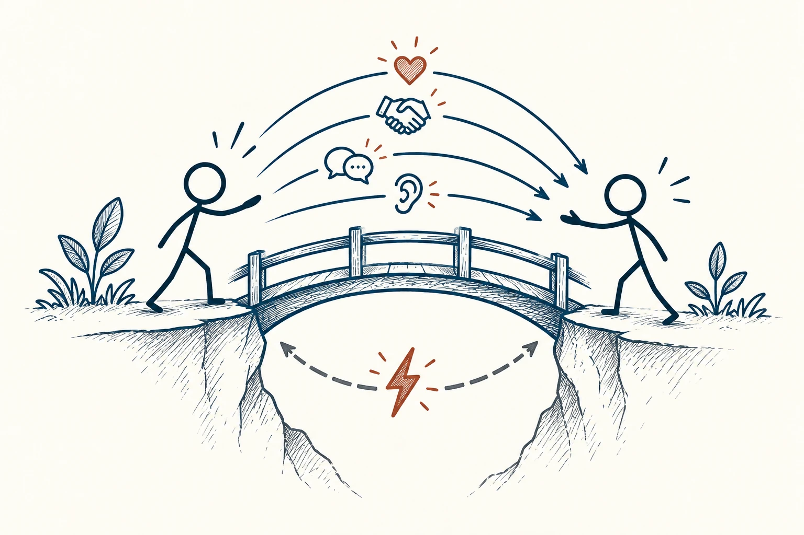

# 43 · 神奇比例

The Magic Ratio · 沟通与影响

> 好的关系，靠平时一点点的回应养出来，不只靠吵架后的补救。

*配图说明：关系互动的温度示意：两位火柴人之间一座小桥，上方几条友善互动线带握手、耳朵、爱心等纯图形，下方一条小摩擦闪电；友善行为在冲突中帮助维持连接。*

## 定义

“神奇比例”来自关于伴侣互动的研究，常被概括为冲突中的正向与负向互动约5∶1。你不必拿着计算器经营感情。更容易用在生活里的提醒是：一段关系要撑得住分歧，平时和冲突中都得有理解、关心与修复。

戈特曼关于伴侣关系的研究将冲突互动中约5∶1的正负互动比例，与关系稳定性的某些模式联系起来；这一比例是特定研究情境中的发现，而非普遍的关系定律。

正向互动也不一定是夸奖。认真听完、承认对方有道理、道谢、用温和方式表达不同意见，都可能让人感觉仍在一起面对问题。关键是有内容的连接，不是背台词凑数量。

## 举个身边的例子

两个人讨论谁做家务，一方说：“最近都是我收拾，你从来不管。”另一方如果立刻翻旧账，很快就会变成争输赢。换一种回应：“这周确实是你做得多。我们把晚上最麻烦的两件事分一下，好吗？”

这没有让家务问题消失，却让对方先感到付出被看见。接下来才能谈具体分工。若答应之后仍不行动，再多好听话也撑不住，关系里的正向回应需要和实际改变连起来。

## 换个场景看看

朋友每次见面都认真听你的烦恼，你却从不问他的近况。关系未必立刻出问题，但长期只有单向消耗，会让连接变薄。一句真诚的追问可能就是重新回应的开始。

## 可以这样试

**什么时候用得上：** 你发现两个人只剩分配任务、挑问题，很少表达理解和感谢时，可以把它当成提醒。

1. 平时留意具体的付出，想到感谢时就说出来，别只在有矛盾时开口。
2. 有分歧时，先准确回应对方的一部分意思，再讲自己的困难。
3. 答应的改动落到行动，发现失误就尽早修复，不等积累成大爆发。

## 别用过头了

5∶1不是所有关系通用的精确规则，也不是“夸五次就可以伤害一次”。侮辱、控制和持续越界，不能靠好话兑换掉。

## 花一分钟试试

今天找一个人，感谢他最近一件具体的小事。别只说“谢谢你”，试着说明那件事怎样帮到了你。

## 顺着看下去

- [13 · 负面偏差](029.md)
- [53 · 黄金法则](037.md)
- [57 · 可信度四核心](042.md)

## 来源与延伸

- [The Magic Relationship Ratio · The Gottman Institute](https://www.gottman.com/blog/the-magic-relationship-ratio-according-science/)

---

例子为方便理解而设置，不是真实案例报道。
