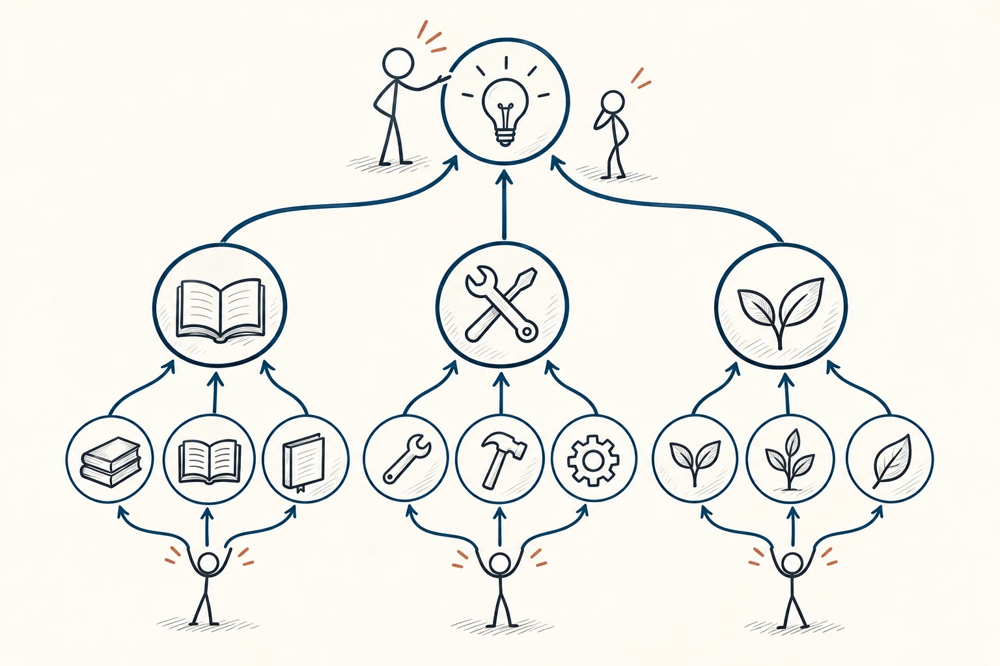
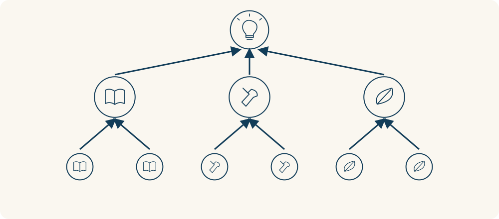

# 45 · 金字塔原理

The Minto Pyramid Principle · 沟通与影响

> 先让人知道你想说什么，再把理由一层层讲清楚。

*配图说明：底层同类材料分组汇总，再支持顶端的中心观点。*

## 定义

你有没有听过这样的汇报：先说昨天联系了谁，再说今天遇到什么，讲了五分钟，你还不知道对方到底想让你做什么。金字塔原理就是帮我们把散落的信息排出层次，让听的人不用自己从一堆细节里猜重点。

金字塔原理由芭芭拉·明托提出，是一种组织思考与表达的方法：围绕一个中心思想，将相关观点分组、概括并安排成层次，使上层观点统领和总结下层内容。它强调观点之间的支持关系，而不只是把信息列成清单。

最上面放一个中心意思，比如“我建议把聚会改到室内”。下一层讲支持它的理由，比如天气、场地和出行；再往下才放具体情况。对方想听多少细节，就能沿着相应的理由继续问。

整理时可以反过来：先把材料摆出来，把同类信息归到一起，再看看这些材料到底支持什么结论。这里的“先说结论”，是表达顺序，不是让你先认定答案、再挑对自己有利的材料。发现理由撑不住，就要改结论。

层级关系可以从两边检查：向下看，中心观点有没有理由和事实支持；向上看，同一组材料能不能概括成一个清楚的意思。把几个点排成三角形还不够，下层必须确实撑得住上层。

*下层事实支持分组概括，分组概括再支持最上面的中心意思。*

## 举个身边的例子

周末要和朋友去野餐，你查了天气、问了场地，还看了交通信息。如果把查询过程从头复述一遍，朋友可能听完还要问：“所以我们到底去哪？”

你可以这样说：“建议改成室内聚餐。第一，预报有雨，户外安排不稳；第二，原场地没有遮雨处；第三，附近餐厅还能订位。大家同意的话，我今晚订桌。”先给建议，再讲理由，最后说明需要的行动，朋友就更容易讨论是否接受，而不是忙着拼凑你的意思。

## 换个场景看看

你给同事发进度消息，可以先写“主体内容已完成，但还需要一天核对数据，建议周三提交”，再分开说明已完成的内容、延迟原因和后续安排。把同一类信息放在一起，对方更容易找到需要确认的地方；不必让每条消息都变成长篇报告。

## 可以这样试

**什么时候用得上：** 写邮件、提建议、汇报进度，或者发现自己说了很多、对方仍不知道重点时，可以用它重新整理。

1. 先问对方需要知道什么，再用一句完整的话写出你最想表达的意思。
2. 把相关材料按理由、步骤或其他清楚的关系分组，同一层尽量回答同一个问题。
3. 检查每条理由是否支持结论、是否有事实支撑；表达时先讲中心意思，再按需要展开。

## 别用过头了

结构整齐不代表结论正确，三条理由也不是固定要求。别为了凑格式重复观点，更别删掉关键的反面证据。聊天、安慰别人或讲故事时，也可以先听、先交代背景，再决定什么时候说结论。

## 花一分钟试试

找一段最近发出的长消息，用一句话写出对方最需要知道的事。再把剩下的内容分组，删掉不能解释或支持重点的部分，看看是否更容易读懂。

## 顺着看下去

- [44 · 知识的诅咒](031.md)
- [66 · 5W1H 分析法](045.md)
- [05 · 批判性思维](007.md)

## 来源与延伸

- [Barbara Minto · The Minto Pyramid Principle](https://www.barbaraminto.com/)

---

例子为方便理解而设置，不是真实案例报道。
