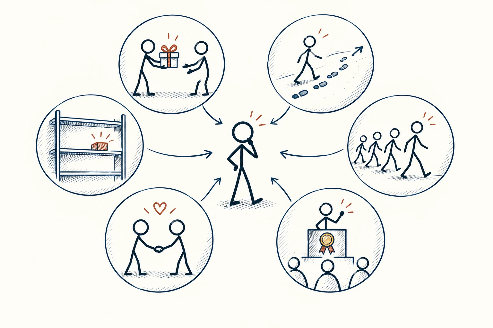
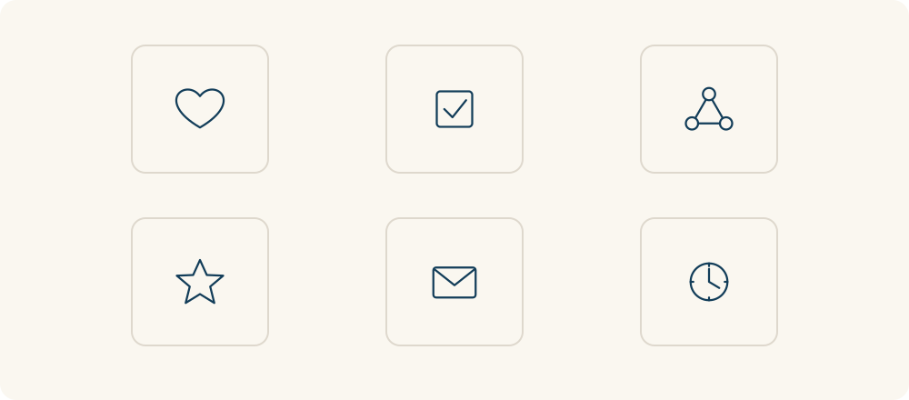

# 46 · 影响力六原则

Six Principles of Influence · 沟通与影响

> 别人怎样影响你的决定，常有几条熟悉的路。

*配图说明：六种影响因素的六瓣轮盘：中心一个正在比较的火柴人，外侧六个独立图形节点分别是互相送礼、脚印延续同方向、群体跟随、奖章讲台、友善握手、剩最后一个小物件的货架。*

## 定义

免费帮忙后想回报，是互惠；答应过就想坚持，是承诺与一致；看到大家都选就安心，是社会认同。再加上权威、喜好和稀缺，就是原文采用的影响力六原则。它们描述人常受什么影响，并不是六句说了就灵的咒语。

西奥迪尼的早期影响力框架归纳了互惠、承诺与一致、社会认同、权威、喜好和稀缺六项原则，用于解释人们为何更可能接受某些请求或选择。

这些影响有时帮人作决定，比如真实评价能减少不了解；也可能被利用，比如假的销量、永远重置的倒计时。学它既可以让表达更诚恳清楚，也可以帮自己在被催促时，检查到底是什么让你心动。

这六项更适合并列理解：它们是不同的影响线索，不是先做完互惠、再做社会认同的固定流程。一个情境可能同时涉及好几项，也可能只有某一项比较明显。

*六种影响线索并列存在，实际场景可能同时涉及其中几项。*

## 举个身边的例子

你本来只是随便逛一个购物页面，先看到“大家都在买”，再看到喜欢的博主推荐，接着弹出“仅剩两件”。几种影响叠在一起，你突然觉得不买就来不及。

这时可以把页面暂时关掉，问一句：“如果没有人推荐、没有倒计时，我还需要它吗？”若答案仍是需要，再检查价格、品质和退货。你不是必须抵抗所有影响，而是把决定权拿回来一点。

## 换个场景看看

朋友先免费帮了你一个忙，后来提出一个明显超出你能力的请求。感谢可以表达，但不必为了“欠人情”勉强答应。回报善意与保护边界并不冲突。

## 可以这样试

**什么时候用得上：** 购物、接受推荐、答应请求，或需要向别人介绍一个方案时，都能用它看看影响从哪来。

1. 辨认自己被哪一点打动：人情、承诺、他人选择、权威、喜欢，还是稀缺？
2. 核实相关信息是否真实，例如评价来自谁、名额限制有没有原因。
3. 如果你在影响别人，提供真实依据和清楚条件，也给对方说不的空间。

## 别用过头了

不同版本的框架有扩展，这里保留原文六项。也别把正常善意都猜成套路：重点看是否真实、是否透明、是否尊重选择。

## 花一分钟试试

回看最近一次临时购买，圈出最推动你的那一项影响。假如去掉它，你还会买同样的东西吗？

## 顺着看下去

- [11 · 权威偏差](019.md)
- [45 · 金字塔原理](032.md)
- [32 · 错失恐惧](034.md)

## 来源与延伸

- [西奥迪尼 · 影响力著作与六原则介绍](https://www.influenceatwork.com/books-and-publications/)

---

例子为方便理解而设置，不是真实案例报道。
