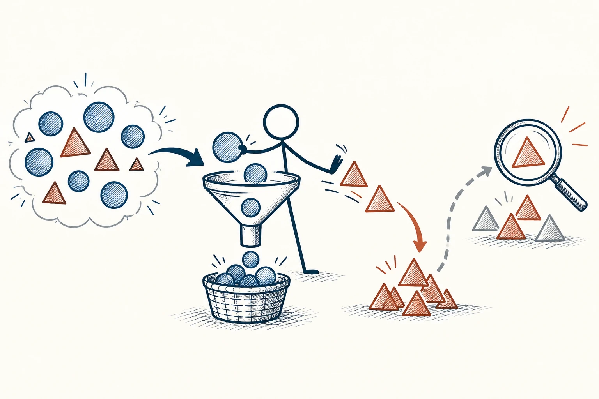
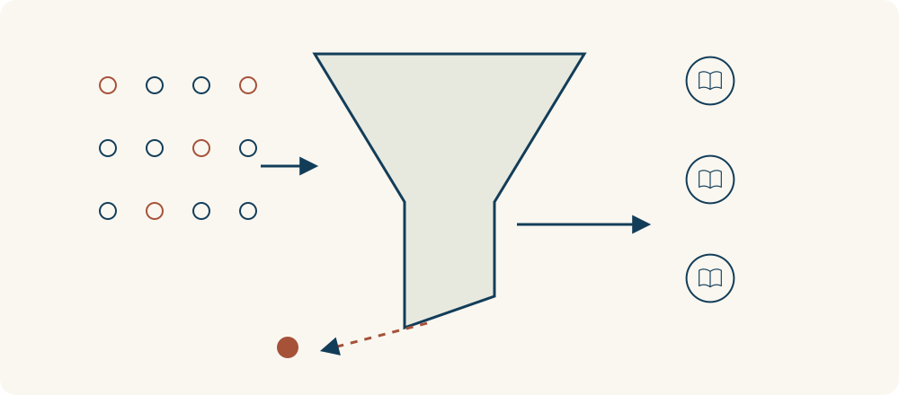

# 14 · 确认偏误

Confirmation Bias · 认知与推理

> 我们很容易只看见那些能证明“我早就说对了”的信息。

*配图说明：选择性筛选的漏斗：火柴人先持圆形观点图标，面对圆形与三角形两类证据，他只把圆形放入篮子，把三角形推到一旁；另一支细箭头和放大镜将被排除的三角形重新纳入审查。*

## 定义

你认定一个品牌不好，看到差评就觉得果然如此，看到好评却说肯定是广告；你认定一个人可靠，他失约也能找到一堆理由。这就是确认偏误：我们不只挑信息，还会用不同标准解释同样的信息，好让原来的想法继续成立。

确认偏误指人们倾向于寻找、解释、重视或记住支持既有信念的信息，而对不一致的信息采取不同标准。

它不代表你故意不讲道理。大脑喜欢熟悉和一致，改主意又常让人觉得丢脸。所以练习的重点不是强迫自己反对自己，而是提前给“我可能看错”留个位置，对反例也认真一点。

把筛选过程画出来，就能多问一步：哪些信息被我留下，哪些被我放到一旁？如果支持自己的材料容易通过，不支持的材料却被要求达到格外高的标准，这个筛选本身就需要检查。

## 举个身边的例子

你想开一家咖啡店，心里已经很期待，问朋友时便说：“这里是不是特别缺一家舒服的小店？”朋友客气点头，你越发觉得机会很大。但你没问他们平时在哪里买、每次花多少、多久来一次，也没去看关门的店为什么没做下去。

如果改问真实消费经历、调查成本和客流，即使答案没那么让人兴奋，也更能保护你的投入。调查的目的不是收集赞同，而是帮自己少踩坑。

*偏好的信息容易留下，不一致的信息容易被漏掉；筛选过程也值得检查。*

## 换个场景看看

你觉得自己“总是运气不好”，便格外记得排队最慢、出门下雨，却很少记下顺利赶上车的日子。换成连续记录，可能会看到更完整、没那么偏向一边的生活。

## 可以这样试

**什么时候用得上：** 你已经爱上一个方案、特别讨厌一个人，或搜索关键词里都写着“为什么它很好/很差”时，值得用。

1. 在查资料前写下原先想法，以及你最担心自己看错的地方。
2. 主动找一个有分量的反例，或请了解情况的人认真指出问题。
3. 让支持与反对的证据用同样标准过关，别一边轻信、一边苛求。

## 别用过头了

不是随便找一句反对话就叫客观。反例也要相关、可靠。最后仍可以支持原来的选择，只要你确实认真检查过。

## 花一分钟试试

针对一个你很确定的看法，写一句：“如果看到……，我愿意调整判断。”如果想不出，就问问自己是不是已经关上了听新信息的门。

## 顺着看下去

- [05 · 批判性思维](007.md)
- [18 · 证伪原则](011.md)
- [10 · 幸存者偏差](018.md)

## 来源与延伸

- [维基百科 · 确认偏误](https://en.wikipedia.org/wiki/Confirmation_bias)

---

例子为方便理解而设置，不是真实案例报道。
