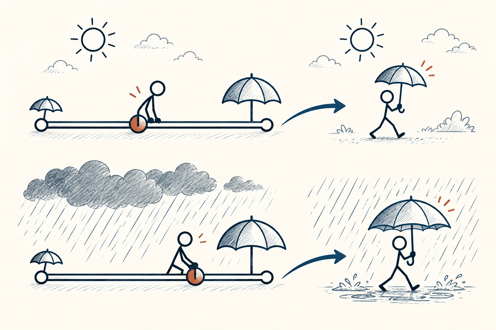
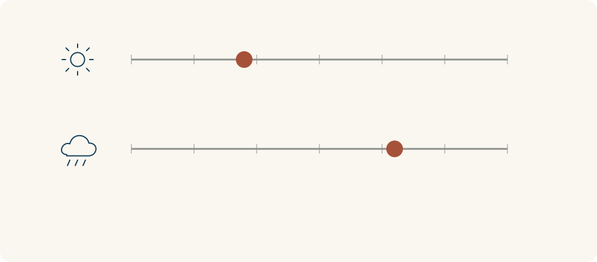

# 52 · 中道原则

The Golden Mean · 伦理与协作

> 做事讲究合适的分寸，不一定越多越好，也不一定两边各让一半。

*配图说明：合宜位置随场景移动：两条并列的连续横线各有不足与过度两端，火柴人根据晴天与暴雨两种场景把雨伞大小滑块调到不同合宜位置，一个偏左一个偏右，都不在机械中点。*

## 定义

关心太少让人觉得冷漠，过度干涉又可能让人喘不过气；勇敢能帮助行动，完全不顾危险则变成鲁莽。中道原则提醒我们，很多品质要放到具体事情里看：对谁、什么时候、做到多少，才合适。

亚里士多德的中道思想将某些德性理解为过度与不足之间的合宜状态，这种合宜取决于具体处境和理性判断，而非算术平均。

它不是一道“求平均数”的算术题。有人说一天读一页，有人说一百页，不等于五十页就是正确答案。你要结合目标、时间、能力和后果，找到有理由的分寸，而不是只因自己站在中间就觉得更高明。

中道更像一条范围里的合宜位置，而且位置会随情境移动。小雨带一把轻伞就够，暴雨可能需要改行程；合理的做法不一定落在两个极端的正中间。

## 举个身边的例子

朋友最近情绪低落，你一开始怕打扰，几乎不联系。后来又担心自己不够关心，便每天连续追问有没有好一点，对方反而有压力。你可以改成先问他需要什么，例如想聊时陪一会儿，或约定隔几天问候。

合适的关心既不是完全退开，也不是不断追着确认。它来自了解这个人当下的需要，再调整自己的行动。所谓分寸，不是第一次就找准，而是愿意看反应、听反馈，再改一点。

*合宜的位置随情境移动，不一定总落在正中间。*

## 换个场景看看

整理房间时，完全不扔可能越堆越满，把所有纪念品都扔掉又可能后悔。你可以先留最有意义的几件，给其余物品限定空间，按自己的生活需要慢慢调整。

## 可以这样试

**什么时候用得上：** 表达关心、给反馈、控制工作强度，或你在两个极端之间反复摆动时，很适合用。

1. 想想这件事“太少”和“太多”分别会带来什么麻烦。
2. 根据具体对象和目标，选一个你能说明理由的做法。
3. 观察反应，必要时调整，不为坚持“刚好”而拒绝改变。

## 别用过头了

有些问题不能折中，例如真话与假话不会各取一半就更真，伤害也不能因为“适量”就合理。底线问题需要明确，分寸问题才讨论多少。

## 花一分钟试试

选一件你觉得“不是做过头，就是不够”的事。各写一个过头和不足的表现，再设计一次较小的调整。

## 顺着看下去

- [54 · 白金法则](038.md)
- [53 · 黄金法则](037.md)
- [38 · 权衡取舍](055.md)

## 来源与延伸

- [维基百科 · 中道原则](https://en.wikipedia.org/wiki/Golden_mean_(philosophy))

---

例子为方便理解而设置，不是真实案例报道。
