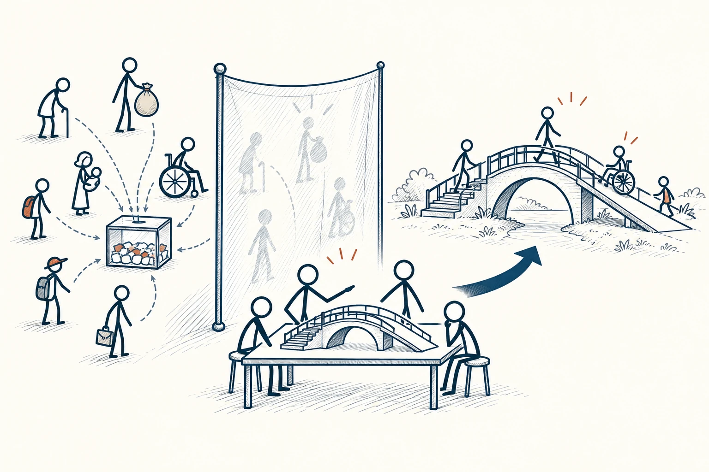

# 56 · 无知之幕

Veil of Ignorance · 伦理与协作

> 制定规则时，先别知道自己会站在最有利还是最吃亏的位置。

*配图说明：无知之幕的公平分配：左侧不同高矮、不同资源袋的火柴人身份图标被一层半透明幕隔开，幕前一组同样无身份装饰的火柴人共同决定一座人人可用的桥与坡道；身份具体分配在幕后的打乱抽签箱里。*

## 定义

想象大家要分一块蛋糕，但在确定分法前，你不知道最后会拿哪一块。你可能就更愿意把每一块切得差不多。无知之幕借用的，就是这种暂时不知道自己处在何种位置的想象，帮助人讨论更公平的规则。

在罗尔斯的正义理论中，无知之幕要求选择社会原则的人，暂时不知道自己的社会地位、出身与某些个人特征，以减少特殊利益对选择的影响。

它不是让你忘掉现实困难，而是让你先别只为自己眼下的优势打算。设想自己可能是新人、照顾孩子的人、身体不方便的人，某些原本觉得无所谓的规则，可能立刻需要补上保障。

## 举个身边的例子

合租的几个人要分配房间、租金和家务。如果你已经选中最大的房间，当然容易觉得“大家平摊最简单”。先换个问法：假如房间最后随机分，我是否还愿意让每个人出一样的钱？

这样可能更容易讨论按面积、采光和设施调整租金，也给家务、公共空间和临时变动定规则。大家不一定得到完全相同的安排，但能更清楚地解释，为什么差别是合理的。

## 换个场景看看

安排会议时，如果你不知道自己会在哪个时区，或是否需要接孩子，就可能愿意控制晚间会议，并提供异步参与方式。规则于是能容纳更多人的生活。

## 可以这样试

**什么时候用得上：** 分配值班、家务、公共资源，或讨论奖惩和使用规则时，很适合先盖住名字想一遍。

1. 先列出规则里有哪些不同位置，谁可能比较方便、谁可能吃亏。
2. 想象自己会随机落在任一位置，重新看基本保障是否够用。
3. 把调整、申诉和特殊情况的处理办法提前说清，别只顾正常时候。

## 别用过头了

公平不总是每人一模一样。例如无障碍安排多照顾某些人，是为了让他们也能使用。思想实验提供检查角度，不会自动生成所有人都同意的答案。

## 花一分钟试试

找一条你觉得很合理的规则，站到其中最不方便的人那边。你会想增加哪项解释、保障或调整？

## 顺着看下去

- [51 · 理性人标准](014.md)
- [53 · 黄金法则](037.md)
- [55 · 绝对命令（定言令式）](039.md)

## 来源与延伸

- [维基百科 · 无知之幕](https://en.wikipedia.org/wiki/Original_position)

---

例子为方便理解而设置，不是真实案例报道。
