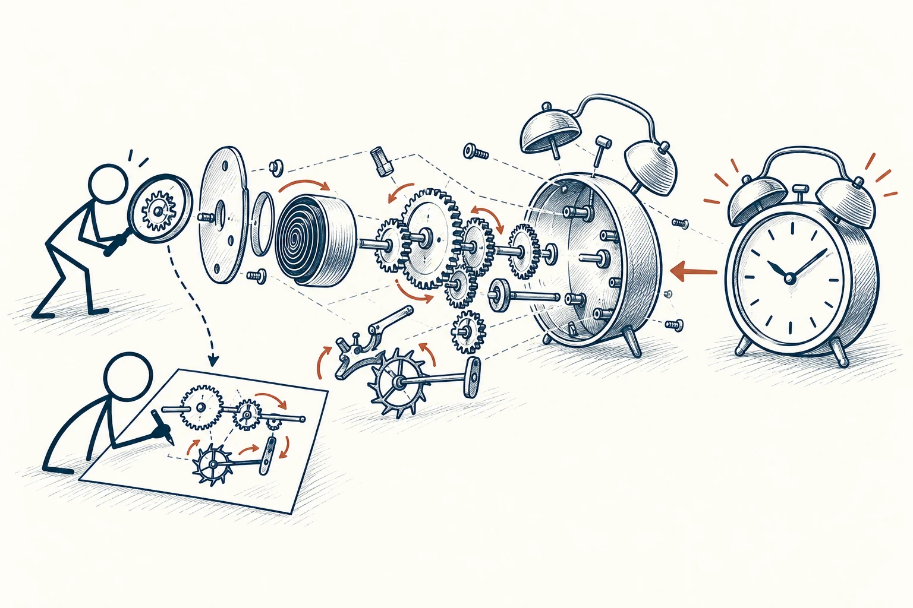
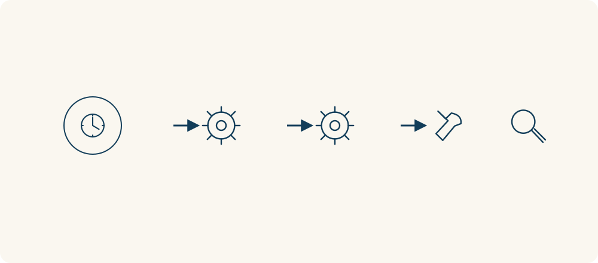

# 63 · 逆向工程

Reverse Engineering · 工具与行动

> 遇到一个好作品，别只说“厉害”，试着看看它是怎么做出来的。

*配图说明：从成品回溯运行机制：右侧完整机械小闹钟，通过向左的逐层爆炸视图揭示齿轮、发条、传动箭头，火柴人用放大镜追踪齿轮相互连接再画简洁无字机制图。*

## 定义

一份读起来清楚的报告、一段打动人的视频、一家运转顺畅的小店，都可以拿来拆解。逆向工程的意思，是从已经完成的东西往回看：它由哪些部分组成，先后顺序是什么，哪些地方让它有效。

逆向工程指通过分析既有产品或系统，识别其组成、关系与运行原理，从而获得设计或实现知识的过程。

这么做的好处，是把模糊欣赏变成能学习的细节。你不必复制别人全部做法，可以先拆结构，再换自己的材料试一次。试着重做时，往往才知道自己看懂了哪些，又猜错了哪些。

逆向工程可以沿“成品—组成—连接—运行”往回看。重点不仅是拆出了多少零件，还包括一个部件怎样影响下一个部件；知道这些关系，才算逐渐理解它为什么能工作。

*从成品往回观察零件、连接与运行方式。*

## 举个身边的例子

你喜欢一篇讲复杂知识却不枯燥的文章，便不再只收藏，而是逐段看它怎么写：开头用了一个日常问题，中间把概念拆成三点，每讲一点就配一个例子，结尾给了一个能立刻做的动作。

接着你选自己的题目，照这个结构写一段。写完请朋友读，看看是否更清楚。你学到的是组织信息的办法，而不是换掉几个词，假装别人的文章是自己的成果。

## 换个场景看看

一道好吃的菜，你可以分析口感、香味和处理顺序，再回家试做。第一遍不成功并不可惜，因为对照差异，你开始知道哪些步骤真正重要。

## 可以这样试

**什么时候用得上：** 想学习写作、设计、流程或产品，又不知道从哪里开始时，这种方法很好用。

1. 选一个目标与你相近的成品，别一开始就挑战资源差距过大的作品。
2. 拆出主要部分、排列顺序和每部分起的作用。
3. 用自己的材料重做一小段，通过实际效果检查原来的推测。

## 别用过头了

成品不会告诉你背后失败了多少次、花了多少资源。看起来简单，不一定做起来便宜。学习也要尊重原作者的作品与使用边界，别把拆解当成抄袭借口。

## 花一分钟试试

挑一个你最近收藏却没再看的作品，写出它的三个部分及各自作用，再用自己的内容重做其中最小的一部分。

## 顺着看下去

- [03 · 第一性原理](004.md)
- [64 · 最小可行产品](043.md)
- [34 · 决策树](049.md)

## 来源与延伸

- [维基百科 · 逆向工程](https://en.wikipedia.org/wiki/Reverse_engineering)

---

例子为方便理解而设置，不是真实案例报道。
