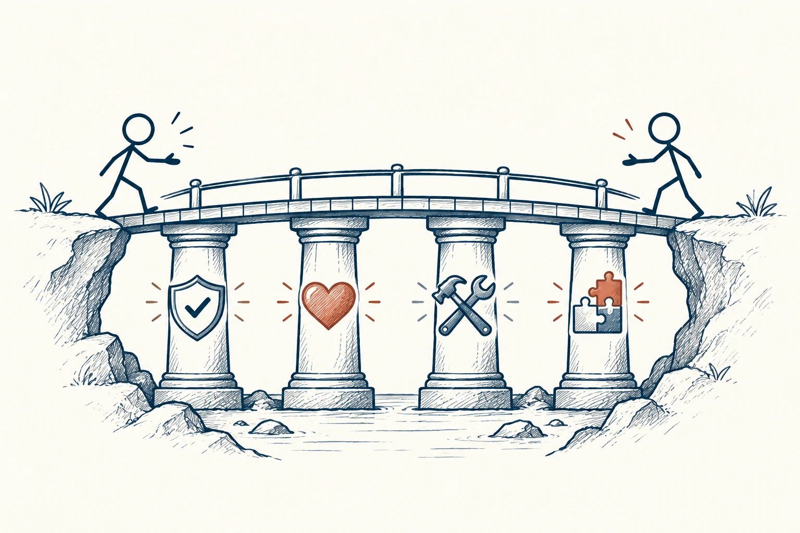

# 57 · 可信度四核心

The 4 Cores of Credibility · 伦理与协作

> 让人放心，不只靠人好，也不只靠有本事。

*配图说明：四根支柱共同支撑信任桥：四柱分别用对勾盾牌、面向他人的爱心、熟练工具、已完成拼图表示诚信意图能力成果，两位火柴人从桥两端走近，四柱各独立可见、不标文字。*

## 定义

你愿意把一件重要的事交给谁？通常既希望他诚实、有好意，也希望他会做、能交出来。可信度四核心把这几方面拆成诚信、意图、能力和成果。名字虽像管理课，实际是在问：他说真话吗？替谁着想？做得了吗？以前做成过吗？

史蒂芬·M·R·柯维的可信度框架包括诚信、意图、能力和成果四个核心，前两项侧重品格，后两项侧重胜任能力。

拆开之后，你才能知道信任卡在哪里。态度很好却总估错时间，可能需要补能力和方法；技术很强却经常隐瞒问题，可能需要补透明和承诺方式。不同问题，不能都靠“你要让我放心一点”来解决。

四个核心是并列的检查角度，不是四级晋升台阶。一个人可能很真诚却还缺能力，也可能能力强但意图让人不放心。判断可信度时，要看当前任务最需要什么，以及各方面是否有实际依据。

*诚信、意图、能力和成果共同影响可信度，各自需要实际依据。*

## 举个身边的例子

你请朋友帮忙拍活动照片。他很热情，也确实愿意帮，但从来没拍过室内快速移动的场景。你若直接把全部记录交给他，后来照片模糊，关系也可能受伤。

更合适的安排是提前看作品、说明关键需求，让他先试拍，必要时请有经验的人负责关键时段。你没有否定他的好意，而是在让能力与责任匹配。坦诚讲清局限，本身也会增加信任。

## 换个场景看看

你向家人承诺每周整理一次账单，连续做了几周，比一次保证“以后财务全交给我”更让人安心。信任常来自可看见的小记录，而不是一次表态。

## 可以这样试

**什么时候用得上：** 选择合作伙伴、委托任务，或你觉得关系不错却不敢交重要事情时，可以用它分清顾虑。

1. 把不放心的原因说具体，是怕隐瞒、担心动机，还是能力和交付没有把握？
2. 让承诺小一点、边界清楚一点，先用一次可检查的交付建立信心。
3. 及时说进度和风险，不等失败后才解释当初为什么做不到。

## 别用过头了

这不是给人格打总分的公式。一个人在某件事上不够熟练，不代表整个人不可信；制度、资源和配合也会影响结果。

## 花一分钟试试

选一个你希望别人更信任你的方面。写下一个本周能兑现、能让对方看见的小承诺，再按时完成。

## 顺着看下去

- [11 · 权威偏差](019.md)
- [58 · 双赢思维](057.md)
- [53 · 黄金法则](037.md)

## 来源与延伸

- [FranklinCovey · The 4 Cores of Credibility](https://www.franklincovey.com/blog/the-4-cores-of-credibility/)

---

例子为方便理解而设置，不是真实案例报道。
