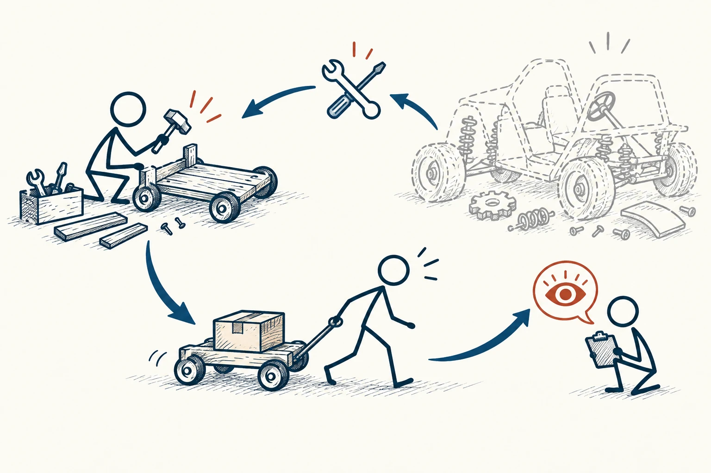
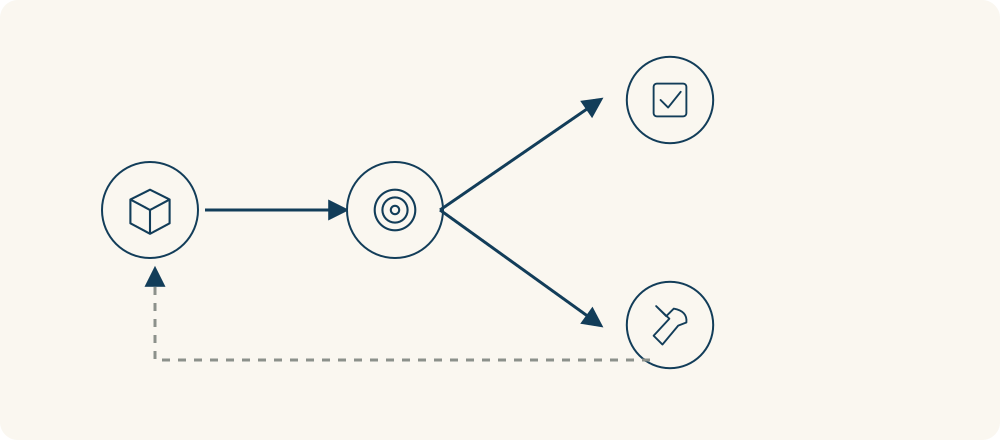

# 64 · 最小可行产品

Minimum Viable Product / MVP · 工具与行动

> 先做一个小到能试、又真能回答问题的版本。

*配图说明：最小验证的短循环：火柴人用少量木片做一辆能承重的简单小车，真实使用者拉着小车运一个小箱子，观察反馈用眼睛图标回流到修改工具；旁边大而复杂的未完成车轮廓淡灰对照。*

## 定义

想做一件大事，最容易卡在“等我准备齐了”。最小可行产品，常缩写为MVP，鼓励你先用较小投入，看看真正需要这件事的人愿不愿意用。它的重点不是把东西做得简陋，而是尽早检查最可能猜错的地方。

在精益创业方法中，最小可行产品用于以较小投入启动真实反馈与学习过程，检验关键假设，而不只是交付功能较少的产品。

比如你想开店，先卖一小批；想做工具，先手工帮几个人完成同样任务。你在验证的是需求、使用方式或付费意愿，而不是向别人展示“我已经开发了很多功能”。先想要学到什么，再决定做多少。

最小可行产品不是一条做完就结束的直线，而是一个学习回路：先做出能检验关键想法的版本，让真实使用带来反馈，再据此调整。回路里最重要的收获可能是发现原来的想法并不成立。

*验证结果可能支持下一步，也可能提示修改假设；反馈并不只意味着成功。*

## 举个身边的例子

你想做一款整理旅行计划的软件，脑中已经有地图、预算、拼车和分享功能。与其立刻开发几个月，不如先找几位正要出行的人，用表格和聊天帮他们整理路线，观察哪些信息反复要、哪些根本没人看。

如果他们只需要一个能共同修改的日程表，你就少开发了一堆用不到的功能。如果连手工服务都没人愿意试，也能更早检查对象、需求或表达是不是找错了。小版本让试错变便宜，不保证想法一定成功。

## 换个场景看看

你想组织读书会，先约四个人读同一篇短文，看看讨论是否顺畅、大家是否愿意再来，比先设计整年的课程和收费体系更能获得信息。

## 可以这样试

**什么时候用得上：** 你有一个创业、课程、社群或工具的想法，却还不知道真实需求时，最适合先这样试。

1. 先写出最担心猜错的一件事，例如“有没有人真的每周需要它”。
2. 设计一个能接触真实用户的小版本，哪怕先用现成工具和手工完成。
3. 提前约定看到什么才继续、哪里要改，别只因为舍不得投入而硬做。

## 别用过头了

小版本也要能完成基本承诺，不能拿安全、隐私或误导用户来换速度。一个既没人试、又回答不了问题的半成品，不会因为叫MVP就有价值。

## 花一分钟试试

把一个拖了很久的大计划缩成“这周能让一个真实的人体验的版本”。写明你想从这次体验中知道什么。

## 顺着看下去

- [24 · A/B 测试](025.md)
- [63 · 逆向工程](041.md)
- [65 · 最小有效剂量](044.md)

## 来源与延伸

- [The Lean Startup · Methodology](https://theleanstartup.com/principles)

---

例子为方便理解而设置，不是真实案例报道。
