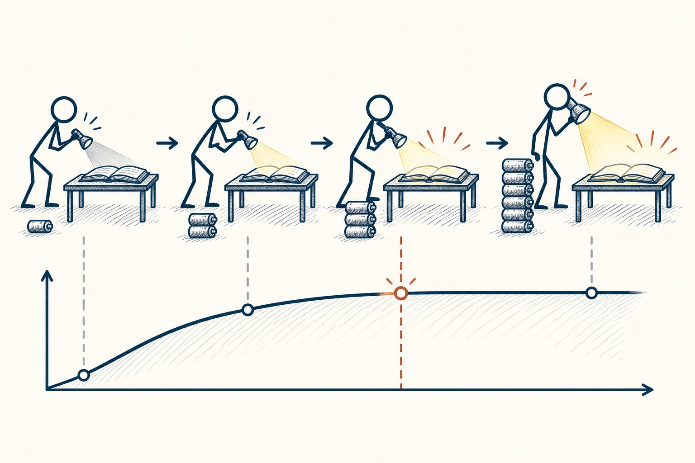
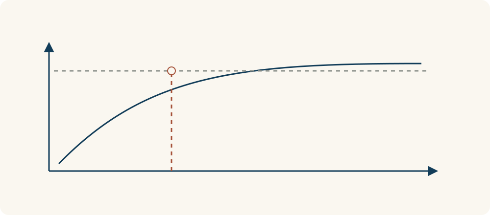

# 65 · 最小有效剂量

Minimum Effective Dose · 工具与行动

> 先看看做到多少已经有效，别习惯性地一直加码。

*配图说明：效果阈值与最小投入：火柴人逐渐增加手电筒电池，小而足够的光刚好照亮需要看的书页，有一条清楚的目标光照界线；继续添很多电池只使负担增加不改变读清这页的目标。*

## 定义

练习、开会、整理资料，有时加一点就明显改善，之后继续加却没多大帮助。最小有效剂量就是在问：为了眼前这个目标，至少做多少，已经能起作用？这里说的是工作和生活里的投入，不是让你自行调整药量。

最小有效剂量在日常效率语境中指产生预期效果所需的最小投入量，它依赖事先明确的目标、对象和衡量标准。

它适合帮助我们减轻过重的起步安排。你原本想每天读一小时，忙起来就完全放弃；改成能持续的十分钟，反而真的开始了。不过，要先说清目标：十分钟可能够建立习惯，却未必够准备一个月后的考试。

把投入和效果放在一起看，会发现“刚好达到目标的位置”比“投入越多越好”更值得关注。先说清楚什么结果算够用，再找能稳定达到它的投入范围；换了目标或条件，这个范围也要重看。

## 举个身边的例子

团队每天开半小时同步会，可大部分内容只是轮流念进度。先明确目标是“让阻塞问题被看见”，再试着改成会前写进度、会上只讨论需要别人配合的部分，时间缩到十分钟。

试行两周后检查：问题有没有漏、协作有没有慢。如果没有明显损失，就不需要为了“显得充分”再加回二十分钟。如果确实遗漏重要事情，就补回必要环节。减量是试出来的，不是凭感觉硬砍。

*先确定够用的目标，再寻找能够达到它的投入范围。*

## 换个场景看看

给朋友写祝福，不一定要长篇大论；一句记得他的处境、说到具体心意的话，可能比套话写满一页更有效。目标是让对方感到被记得，而不是完成字数。

## 可以这样试

**什么时候用得上：** 计划总是太重、因为做不到完整版本就不开始，或你怀疑投入已经过头时，很值得用。

1. 把目标写成能检查的结果，别只说“做得更好”。
2. 从一个较小、容易坚持的投入开始，给它一段观察时间。
3. 不够就补足具体缺口，够用就先停，不把多做自动当成负责。

## 别用过头了

“最少”不是唯一目标。长期训练、稳定性和应对意外都可能需要余量，也不是每项工作都能无限压缩。适量比一味追少更重要。

## 花一分钟试试

找一个你总觉得“没时间做”的习惯，设计一个五到十分钟的入门版本，同时写清它能达到什么、暂时达不到什么。

## 顺着看下去

- [64 · 最小可行产品](043.md)
- [69 · 二八法则与帕累托原则](056.md)
- [78 · 收益递减规律](067.md)

## 来源与延伸

- [Tim Ferriss · 最小有效剂量原书节选](https://tim.blog/wp-content/uploads/2014/10/4-hour-body.pdf)

---

例子为方便理解而设置，不是真实案例报道。
