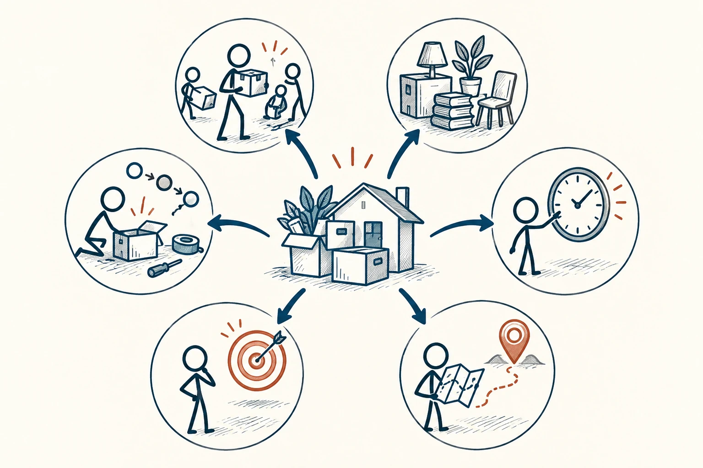

# 66 · 5W1H 分析法

The 5 Ws and 1 H · 工具与行动

> 把一件事讲清楚，先补齐六个最基本的问题。

*配图说明：六辐分析图：中心一场搬家任务的房箱图标，六个向外分支分别到人物、箱子物件、无数字时钟、地图位置针、目的地靶心、工具与步骤。*

## 定义

“周末弄一下那个活动”听完你知道该做什么吗？谁负责、做哪部分、什么时候完成、在哪进行、为什么要做、怎么做，都没说清。5W1H就是这六个问题的英文缩写：谁、什么、何时、何地、为什么、如何。

5W1H是一种信息整理与问题分析框架，通过Who、What、When、Where、Why和How六类问题补全事情的基本要素。

它没什么神秘的，像出门前检查钥匙和手机一样，帮你减少遗漏。别人没有你脑中的全部背景，自己也可能只是“感觉想清楚了”。把六个问题走一遍，常能发现真正缺的不是努力，而是一句明确交代。

六类问题适合围绕同一件事并列检查，不需要固定从哪一个开始。它们像六个观察窗口：有一格空着，就提醒你可能还没说清对象、时间、地点、目的或做法。

*同一件事，可以从人物、对象、时间、地点、目的和做法六个角度检查。*

## 举个身边的例子

你让朋友“帮忙订个吃饭的地方”，他挑了价格合适的店，最后却发现有人吃素、有人七点后才到，店里又没有包间。大家都用心，只是开始没讲清要求。

下次可以说：“周六七点，六个人，在地铁站附近，想给小陈过生日，预算每人一百元，其中一位吃素。你帮忙找两家有安静座位的，周四前一起定。”细一点的说明，能省掉后面一串来回。

## 换个场景看看

“电脑坏了”不好求助；补成“今天更新后，家里的笔记本能开机但连不上无线网，手机同一网络正常，重启过一次”，别人就更容易判断下一步问什么。

## 可以这样试

**什么时候用得上：** 布置任务、组织聚会、复盘故障或求别人帮忙时，特别容易派上用场。

1. 写下六个问题，先补对完成任务真正有影响的信息。
2. 把负责人、截止时间和完成标准说明确，不用“尽快”“差不多”代替。
3. 不知道的部分直接标出来，先确认，不假装已经安排好。

## 别用过头了

它是一份检查清单，不是要求每条消息都写六段。有时两句话就能交代完整。复杂事情还需要补预算、依赖和风险，六问不是万能模板。

## 花一分钟试试

把你最近发出的一条模糊请求改写一遍。先不用变长，只补上最容易让对方猜错的两项信息。

## 顺着看下去

- [07 · 苏格拉底式提问法](010.md)
- [44 · 知识的诅咒](031.md)
- [34 · 决策树](049.md)

## 来源与延伸

- [维基百科 · 5W1H 分析法](https://en.wikipedia.org/wiki/Five_Ws)

---

例子为方便理解而设置，不是真实案例报道。
