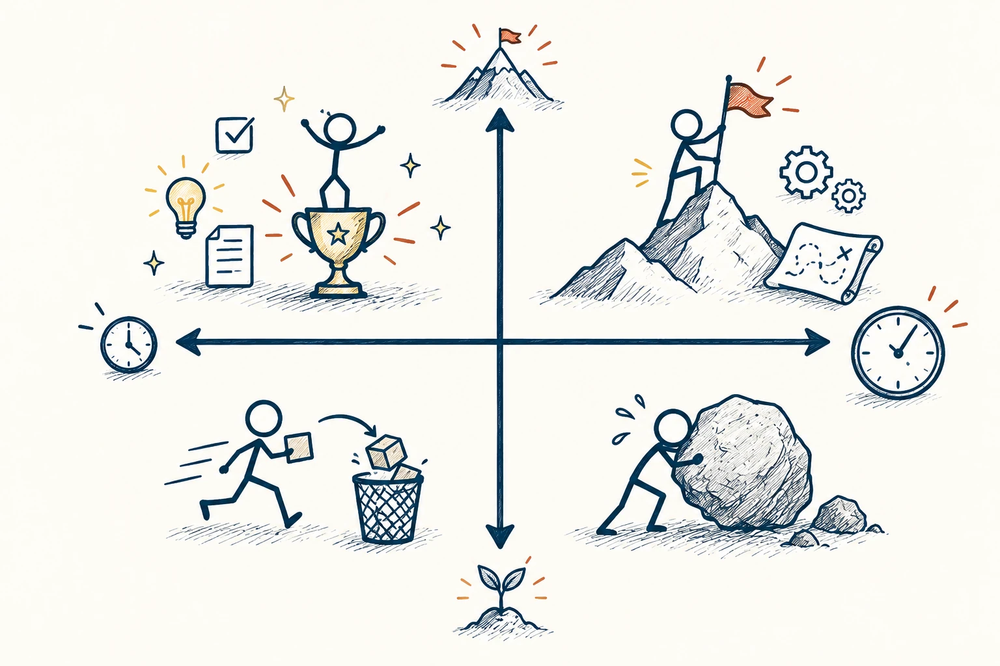
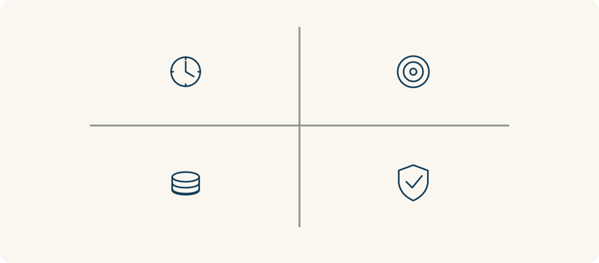

# 67 · 2×2 矩阵图

2×2 Matrix Diagram · 工具与行动

> 事情一多，先用两个关键问题，把它们放进四个格子里。

*配图说明：清楚的四象限格：两条正交轴把画面分成四块，两轴端点分别画短长时钟及小大目标价值的图标，四区内用大小和位置不同的任务图标与火柴人整理，突出两个维度同时比较。*

## 定义

面对十几个待办事项，脑中一团乱时，可以先选两个重要维度，例如“影响大不大”和“做起来费不费劲”。横一条线、竖一条线，就得到四个格子：高影响低成本、高影响高成本、低影响低成本、低影响高成本。这就是2×2矩阵。

2×2矩阵是用两个各分为两档的维度构成四个象限，将选项按其特征分类并辅助比较的分析工具。

它的价值，是把“都很重要”拆成可讨论的差别。你不用把每件事算到小数点，只要让自己和别人看见，为什么有些先做、有些暂缓。不过，两个问题要选得对，否则画得再整齐，也只是把混乱装进四个盒子。

四象限真正有用的地方，是把两个维度同时摆出来。先说清横向和纵向各在比较什么，再确定高低的分界；如果维度含混，格子画得再整齐也帮不了判断。

*两个维度交叉，让不同类型的选项各有位置。*

## 举个身边的例子

你想让家里住得舒服一点，清单里有换灯泡、修漏水、重刷墙、买摆件和更换大柜子。用“影响”和“成本”分一下，修漏水和换坏灯泡可能属于先处理的事项，摆件则可以晚点再看。

重刷墙和换柜子影响也许很大，却需要预算和时间，就单独计划。分类之后，你不用因为一下做不完所有改造而放弃，也不再被最容易买到的小装饰吸走全部精力。

## 换个场景看看

学习计划也能这样看：对目标帮助大、容易开始的练习先做；耗时很长却用处不大的资料先放一放。不是所有看起来像学习的事，都值得同等投入。

## 可以这样试

**什么时候用得上：** 整理任务、比较需求、安排预算，或一群人对优先级没有共识时，很适合用。

1. 先说清楚当前最想解决什么，再选两个真正相关的比较维度。
2. 给“高、低”定个粗略标准，把事项放进去，不确定的先做标记。
3. 先处理最值得做的少数几件，再补查可能改变分类的信息。

## 别用过头了

格子的边界是你画的。两项工作只是差一点点，不能因为落在不同格子就判得天差地别。安全、期限等重要条件，也可能需要另外检查。

## 花一分钟试试

拿纸画四格，用“帮助大不大”和“花时间多不多”放入本周五个待办，挑一个最值得先完成的。

## 顺着看下去

- [68 · 维恩图](048.md)
- [33 · 决策矩阵](047.md)
- [38 · 权衡取舍](055.md)

## 来源与延伸

- [The Design Society · 2×2 矩阵方法](https://www.designsociety.org/exchange/method/37/2x2_matrix)

---

例子为方便理解而设置，不是真实案例报道。
