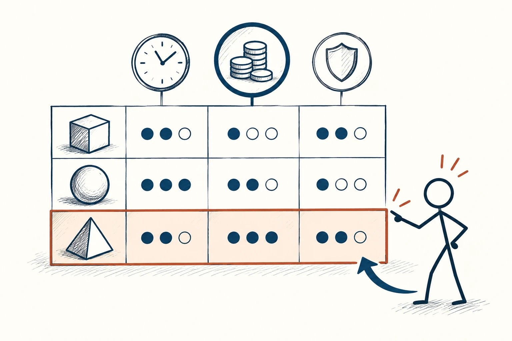
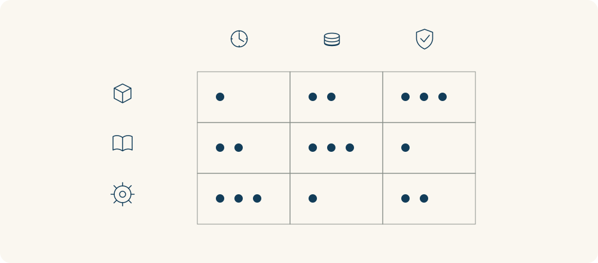

# 33 · 决策矩阵

Decision Matrix · 选择与决策

> 把几个选项放到同一张表里，比在脑中反复横跳更清楚。

*配图说明：共同标准对比的矩阵：左侧三个不同形状候选小物件，顶端三列纯图标标准为时钟、硬币、盾牌；九个格子用少量实心小圆点多少表示表现，火柴人按标准指向符合目标的一项。*

## 定义

买电脑时，你可能一会儿被价格吸引，一会儿又觉得外观重要，最后越看越乱。决策矩阵就是先列出自己在意的几项标准，再让每个选项按同样标准过一遍。有些标准更重要，可以给它更大分量。

决策矩阵将候选方案放在一组共同标准下进行比较，必要时结合标准权重汇总评价，以明确各方案的相对优劣。

表格不是替你作主，而是让你看见自己在取舍什么。特别重要的一点是，先筛掉不合底线的选择：如果电脑根本跑不动你必需的软件，就不能靠颜色好看、赠品多来补足这个问题。

矩阵里，同一列应该用同一把尺子比较所有方案。标准的重要程度也可能不同：租房时，安全和通勤未必能被一堆小优点抵消。打分是整理判断，不是把主观选择变成绝对客观的答案。

*每个候选方案都放在同一组标准下比较。*

## 举个身边的例子

你在三处出租房之间犹豫，先写下硬条件：预算上限、可接受通勤、基本采光。排除明显不合适的，再比较安静程度、收纳、生活便利和房东沟通。

你原本很喜欢其中一间的装修，但填表后发现，每天多出的通勤会吃掉不少休息时间。你仍可能为了喜欢而选择它，只是现在知道这个喜欢具体要付出什么。清楚地选择，比事后才发现代价更自在。

## 换个场景看看

两份工作可能一份薪水高、一份成长好。把通勤、工作内容、稳定性和生活安排一起列出，你会更知道自己为什么选，而不是只被最近听见的一个优点带走。

## 可以这样试

**什么时候用得上：** 选择租房、设备、课程、合作工具，或者选项各有长短时，很好用。

1. 先列不可妥协的要求，不满足的就不要继续靠其他优点抵分。
2. 挑三到五项主要标准，说明你更看重哪一项，别列太多。
3. 给选项评分或写优缺点，换一换重要程度，看看结果是否容易翻转。

## 别用过头了

数字来自你的判断，不会因为乘了权重就变成客观真理。若两项只差一点，不必迷信总分，回到最重要的差异，再查信息或试用。

## 花一分钟试试

为一个真实选择画一张三列小表：标准、选项甲、选项乙。先写你最不能退让的一条，再填其他内容。

## 顺着看下去

- [67 · 2×2 矩阵图](046.md)
- [35 · 利弊清单](050.md)
- [36 · 成本效益分析](051.md)

## 来源与延伸

- [维基百科 · 决策矩阵](https://en.wikipedia.org/wiki/Decision-matrix_method)

---

例子为方便理解而设置，不是真实案例报道。
