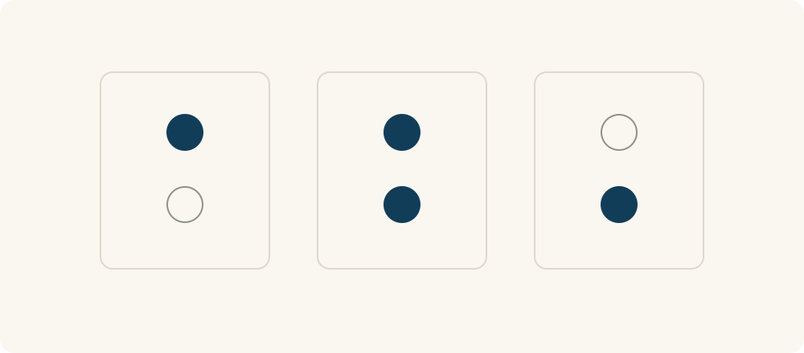

# 68 · 维恩图

Venn Diagram · 工具与行动

> 有些人或事情，同时属于两个圈子；重叠的地方值得单独看。

*配图说明：三个半透明空心相交圆：每圈分别放书本、耳机、人物小图标，交叠处放同时满足两种或三种条件的组合图标，火柴人用指针观察中央共同区域。*

## 定义

你有会做饭的朋友，也有周末有空的朋友，两类人不完全相同。把他们各画成一个圈，重叠部分就是“会做饭，而且周末有空的人”。这种用圆圈表示共同点与差别的图，就是维恩图。

维恩图是一种集合关系图示，以区域及其重叠表示集合之间的交、并与补等关系，帮助辨认成员同时满足哪些条件。

它特别适合帮我们讲清“同时满足”和“满足一个就行”。听起来只是几个字，实际安排往往差很大。你想找的是什么组合，先画出来，比大家各自理解“都可以”“都需要”更不容易出错。

重叠区域表示“同时满足”，不是两边数量简单相加。如果两个圈分别是喜欢阅读的人和喜欢听播客的人，中间就是两者都喜欢的人；各圈剩下的部分则保留各自独有的情况。

*三个位置依次表示：只满足第一个条件、两个都满足、只满足第二个条件。*

## 举个身边的例子

你想组织一次桌游活动，有些朋友喜欢桌游，有些周六有空，有些住得比较近。把三个条件分开看，就知道并非每个爱玩的人这次都能来，也不是只有住得近才有资格参加。

先明确真正必需的条件，例如“愿意来且当天有空”，再把距离当成安排交通时的考虑。图能帮你检查条件是否混在一起，也避免用一个无关标准把合适的人漏掉。

## 换个场景看看

你喜欢、擅长、又有人需要的事情，可能有一块重叠。这个图能帮助你提问，但重叠区域是否真实存在、能否长期支撑生活，仍要实践和了解。

## 可以这样试

**什么时候用得上：** 整理人群、说明规则、寻找共同需求，或讨论“哪些人同时符合条件”时，很方便。

1. 先写清每个圈代表什么，尽量让人能判断是否符合。
2. 标出你想找的是交集“而且”，还是并集“或者”。
3. 举几个真实或假设例子，看看有没有被遗漏或放错位置。

## 别用过头了

随手画的圆大圆小，不代表人数多少。几类人重叠关系太复杂时，用表格可能更清楚，没必要为了画图把事情弄得难读。

## 花一分钟试试

用两个圈画出“我想做的事”和“我这周有时间做的事”。在重叠部分放一个你准备真的开始的行动。

## 顺着看下去

- [02 · 矛盾律](003.md)
- [08 · 原型理论](013.md)
- [67 · 2×2 矩阵图](046.md)

## 来源与延伸

- [维基百科 · 维恩图](https://en.wikipedia.org/wiki/Venn_diagram)

---

例子为方便理解而设置，不是真实案例报道。
