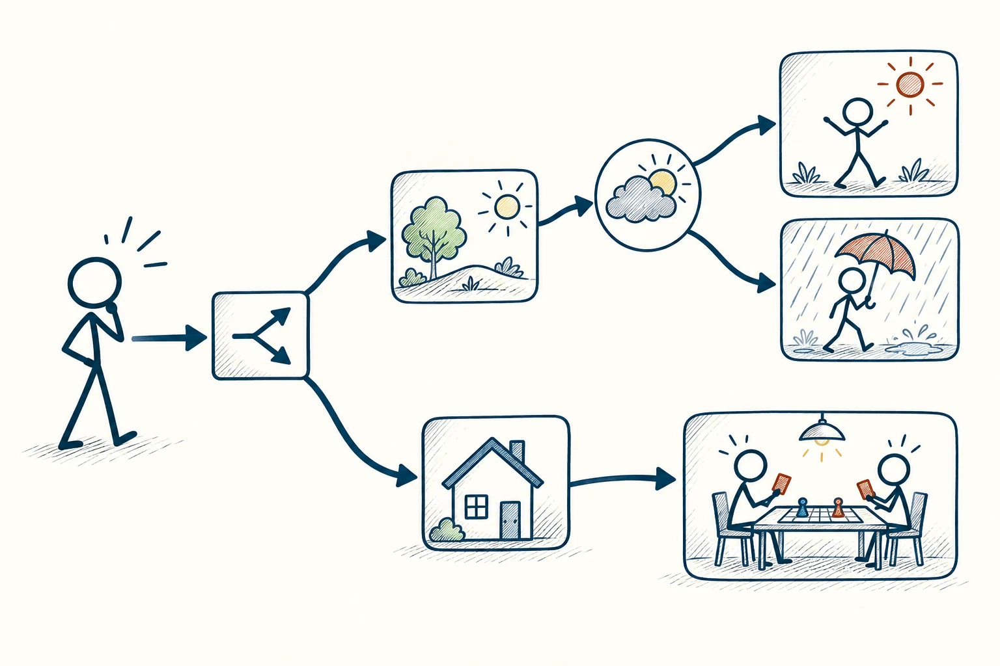
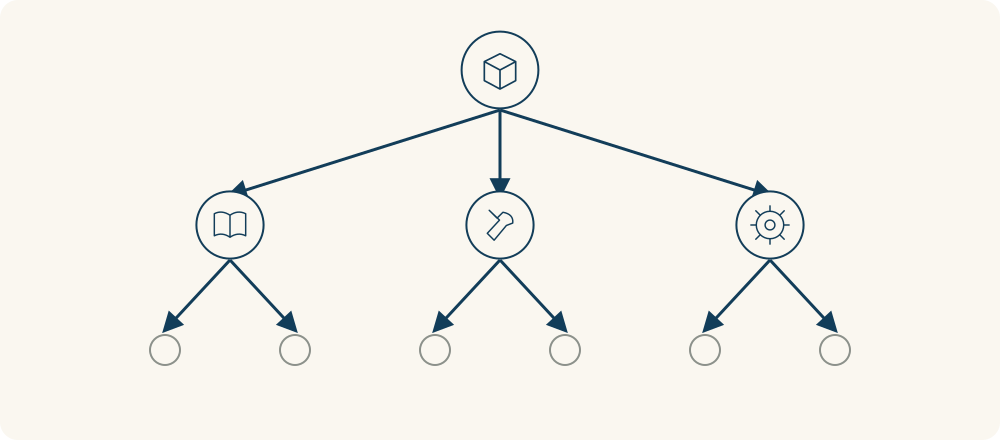

# 34 · 决策树

Decision Tree · 选择与决策

> 先把“如果这样，接下来会怎样”展开，选择就没那么一团乱。

*配图说明：横向展开决策树：左边火柴人面前一个方形选择节点，分为室外活动与室内活动两种图标，外出分支再用圆形天气事件节点分晴雨，分别到伞下与阳光下的结果；室内分支到桌游。*

## 定义

有的决定不是只看眼前一步，而是会带来后续岔路。决策树像把这些岔路画成树枝：我能选什么，选完可能发生什么，不同情况下一步怎么办。你会更容易看见代价，也知道哪些信息值得先打听。

决策树通过分支表示可选择的行动、可能发生的事件及其结果，必要时加入概率与价值估计，以辅助分析决策路径。

其中要分清两种分支：有些是你能选的，比如买不买票；有些不是你控制的，比如活动当天是否下雨。把可决定与不可决定的部分分开，比在脑中反复问“万一下雨呢”更有助于安排。

树上的分岔有两种不同含义：一种是你可以选的行动，另一种是你选完后仍不能决定的事情，比如天气。把它们分开，才能看清自己能控制哪一步，以及每条路还面临什么不确定性。

## 举个身边的例子

你准备周末办户外聚会，可以直接预订草坪，也可以先选能转室内的场地。每条路继续往下看：晴天怎样、下雨怎样、取消要付多少、临时换地方是否来得及。

如果大家从很远赶来、临时取消代价很高，多花一点选有备用空间的地方可能值得。如果只是附近几个人临时见面，保留可取消安排也可能够了。同一个“天气风险”，因为后续代价不同，选择就不一样。

*选择会分出不同路径，路径中还可能遇到自己无法决定的事件。*

## 换个场景看看

想养宠物，不只画“领养后很开心”，也要画出出差、生病、搬家时怎么办。不是为了吓退自己，而是让喜欢和长期责任一起进入决定。

## 可以这样试

**什么时候用得上：** 决定是否先试用、怎样安排备用方案，或一个选择会牵出多种后果时，很适合用。

1. 先画出现在真正能选的两三种行动，不用把想象中的所有可能都加进去。
2. 每种行动补上最重要的后续情况，写下成本和可以补救的办法。
3. 找出哪个未知信息最可能改变选择，先花力气查它。

## 别用过头了

画出树枝不代表已经知道概率。对不确定的数字诚实一点，可以用几种情景比较，别编出精确数字让自己误以为算清了。

## 花一分钟试试

挑一个近期选择，画两条主枝，每条再写两个可能结果。哪一条需要你提前留退路？

## 顺着看下去

- [66 · 5W1H 分析法](045.md)
- [33 · 决策矩阵](047.md)
- [36 · 成本效益分析](051.md)

## 来源与延伸

- [维基百科 · 决策树](https://en.wikipedia.org/wiki/Decision_tree)

---

例子为方便理解而设置，不是真实案例报道。
