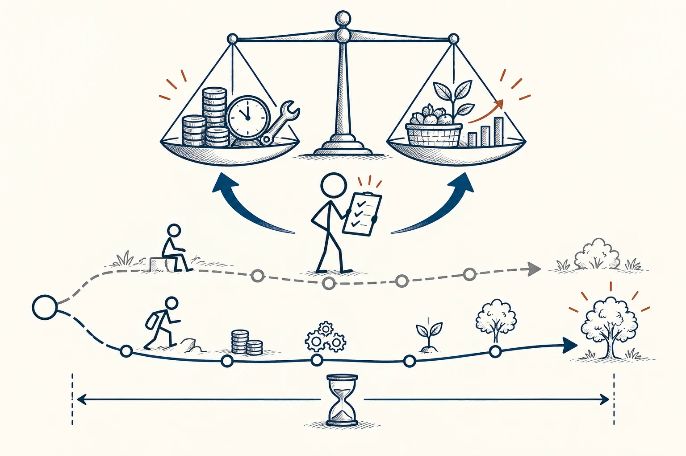

# 36 · 成本效益分析

Cost–Benefit Analysis · 选择与决策

> 别只看买的时候花多少，还看看以后要付什么、能换回什么。

*配图说明：同一时间范围内的成本收益天平：一边未来需要投入的硬币、时钟、工具，另一边预期收获的成果篮、成长小树，沿下方有限时间轴比较继续与维持现状两条细路径，火柴人核对基础条件。*

## 定义

一台便宜打印机，后续墨盒可能很贵；一个自动化工具，买回来还要花时间设置。成本效益分析，就是把一段时间里的主要付出与收获摊开比较。成本不只包括钱，也包括学习、维护、占用空间和你因此做不了的别的事。

成本效益分析在明确的比较基线和时间范围内，系统比较行动的相关成本与预期收益；可货币化的跨期结果通常还需考虑时间价值。

“效益”也不一定都能换成钱，轻松、方便和陪家人的时间同样值得考虑。你可以把能算的部分算清，难以标价的部分另外写出来，不需要为了显得科学，硬给每种快乐标个金额。

## 举个身边的例子

你想买洗碗机，看到价格后觉得贵。但如果只比购买价，就没看到安装、耗材和空间，也没看到每天省下的清洗时间。先估计家里多久做饭、餐具是否适合、谁来摆放和维护，再和继续手洗比较。

最后可能是值得买，也可能因为很少开火而不合算。关键是按自己的使用情况算，不把广告里的“每天节省一小时”直接拿来当成自己必然获得的收益。

## 换个场景看看

远一点的超市每次便宜十元，却多花四十分钟往返。愿不愿意去可以因人而异，只是把路费、时间和体力放进去后，你会更知道自己在选什么。

## 可以这样试

**什么时候用得上：** 买设备、订阅服务、选择交通方式，或决定某项改造是否值得时，很容易用上。

1. 明确比较对象和时间范围，例如未来一年买与不买分别怎样。
2. 列购买、学习、使用和维护等主要成本，也列实际能得到的好处。
3. 把关键数字估得乐观一点、保守一点各算一遍，看看结论是否仍站得住。

## 别用过头了

已经花掉、无法改变的钱，不该单独决定你以后还花不花。省出来的时间也未必自动变成收入，别把想象中的收益全当到账。

## 花一分钟试试

选一项你考虑购买的工具，除了价格再列三项成本，再写出自己一周会真实使用几次。看看原来的“很划算”是否需要调整。

## 顺着看下去

- [33 · 决策矩阵](047.md)
- [29 · 机会成本](009.md)
- [78 · 收益递减规律](067.md)

## 来源与延伸

- [维基百科 · 成本效益分析](https://en.wikipedia.org/wiki/Cost%E2%80%93benefit_analysis)

---

例子为方便理解而设置，不是真实案例报道。
