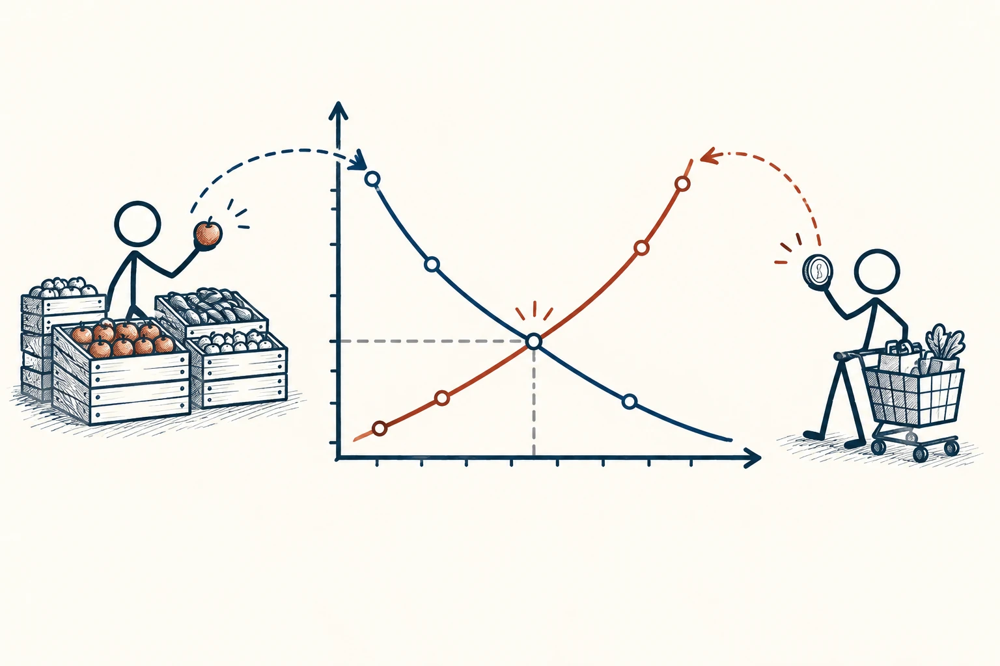
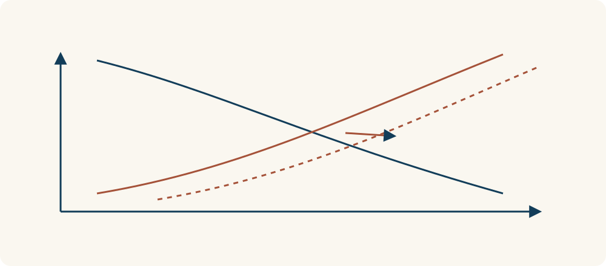

# 74 · 供给与需求

Supply and Demand · 系统与规律

> 想买的人变多，能提供的东西变少，价格常常就会动起来。

*配图说明：供需相交曲线与市场双方：中央无标签坐标上藏蓝向下曲线与砖红向上曲线相交，左边摊主与商品箱，右边顾客与硬币，点与价格标签纯图形连线。*

## 定义

供给是卖方愿意提供多少，需求是买方愿意并且有能力买多少。两边都与价格有关，也受到别的因素影响。一个东西大家都喜欢，但没人愿意按那个价格购买，不能直接等同于很强的实际需求。

在经济学中，需求与供给分别描述一定时期内，其他条件给定时，买方和卖方在不同价格下愿意且能够购买或提供的数量。

最容易混淆的是两件事：因为涨价，所以你少买；因为生活变化，即使同样价格，你也想多买。前者是价格本身在影响选择，后者则是购买需要变了。分清它们，才更容易理解为什么某种商品突然难买或涨价。

看供需图时，要区分沿同一条曲线移动和整条曲线改变。价格变化可以对应曲线上的不同位置；成本、偏好等条件发生变化，则可能需要重新画曲线，不能把所有变化都解释为同一件事。

*实线与虚线区分条件改变前后的供给；曲线本身移动，与沿同一曲线改变位置是两件事。*

## 举个身边的例子

下雨时，地铁口想买雨伞的人突然变多，但小店库存一时只有那么多，便可能很快售罄，或者价格上涨。天晴后，临时需求减少，同样一把伞也可能没那么多人着急买。

这不意味着卖家任何涨价都合理，真实交易还有规则、承诺和公平问题。供需这个角度只是帮你看清，一次价格变化背后，可能有哪些人在改变行为、库存又能多快跟上。

## 换个场景看看

小区附近多了办公楼，午餐购买需求可能增加；但如果同时开了十家餐馆，竞争也会改变。看到“人变多”只是分析的开始，不是开店必赚的保证。

## 可以这样试

**什么时候用得上：** 看房租、票价、节日商品和服务排队变化时，可以用它拆开原因。

1. 先分别问：买的人发生了什么变化，提供的人又有什么变化？
2. 想想有没有替代选择，以及补货或扩大产能需要多久。
3. 别只凭一个价格判断所有原因，留意成本、季节、规则和竞争。

## 别用过头了

供求关系很有用，但不能解释所有价格。市场力量、信息差和制度都会影响交易，也不意味着需求热门就一定值得创业或投资。

## 花一分钟试试

选一个最近涨价的东西，写出两个可能的需求变化和两个可能的供给变化。哪一项你有事实依据，哪一项只是猜测？

## 顺着看下去

- [75 · 临界规模与引爆点](053.md)
- [38 · 权衡取舍](055.md)
- [78 · 收益递减规律](067.md)

## 来源与延伸

- [维基百科 · 供给与需求](https://en.wikipedia.org/wiki/Supply_and_demand)

---

例子为方便理解而设置，不是真实案例报道。
