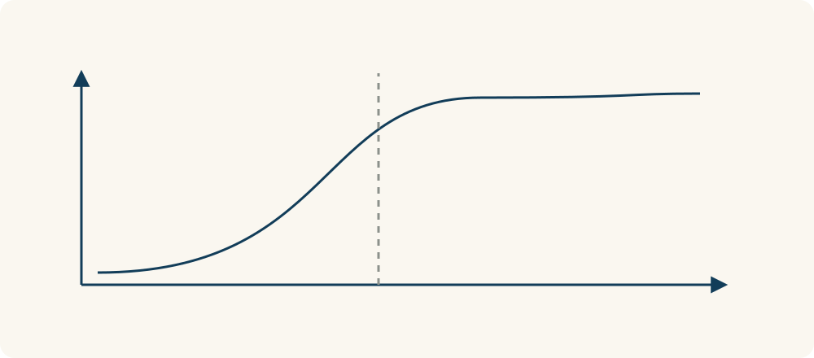

# 75 · 临界规模与引爆点

Critical Mass / Tipping Point · 系统与规律

> 有些事情，前面加一点没什么动静，到了某个程度却会突然不一样。

*配图说明：越过阈值才自我持续：左侧零散几块多米诺间距太大无法传递；右侧足够密集的一串多米诺在起始推动后持续倒下，关键间隙用藏蓝圈标记。*

## 定义

你建了一个互助群，只有几个人时，问问题经常等不到回答；参与者和技能种类增加后，回应开始变快，更多人愿意回来。临界规模与引爆点都提醒我们：有些变化不是一直匀速发生的，过了某个条件，过程可能开始自我延续或明显加快。

临界规模指某个过程得以持续或自我维持所需的关键数量或密度，引爆点则通常强调系统跨过阈值后出现的显著变化或加速。

但别急着把它翻译成“只差第一百个人”。真正起作用的，可能是活跃人数、彼此连接程度、使用频率或可靠性，而不是一个神奇总数。要看清是哪种互动在支撑系统。

关键不只是“数量变多”，而是系统有没有越过能持续运转的条件。稀疏的多米诺可能推不下去，间距足够接近才可能传递。实际场景中的阈值还取决于连接、质量和环境，并不是一个到处通用的人数。

*关键条件跨过阈值后，系统可能开始持续运转或加速变化。*

## 举个身边的例子

你想组织固定的周末羽毛球局，群里二十个人却常常约不成，因为大家有空的时间不一样。后来不是简单拉满五十人，而是找到八位经常在同一时段有空的人，并固定场地和报名规则，活动才稳定下来。

这时真正被补上的，是足够稳定的参与和安排。每次活动能顺利办，大家更愿意提前报名，组织又更省心。规模和反馈一起变了，活动才有机会持续，而不是靠群人数好看。

## 换个场景看看

小区旧物交换板如果总挂着过期资料，人再多也未必好用；当更新及时、类别够全、回应够快，大家才愿意经常来看。有效使用密度比报名数字更重要。

## 可以这样试

**什么时候用得上：** 运营社群、组织活动、理解平台增长，或你发现人数不少却仍运转不起来时，很值得用。

1. 先找出让事情能持续运行的关键互动，例如回应、匹配或参与。
2. 观察缺的是数量、密度、时间重合，还是某个重要角色。
3. 通过小范围记录寻找变化点，别凭一个整数当成必然门槛。

## 别用过头了

不是所有项目都有清楚的引爆点，也不是坚持堆数量就一定等来爆发。没有真实价值，更多人还可能把问题一起放大。

## 花一分钟试试

想一件你觉得“人再多一点就会好”的事。具体写清，多出来的人必须做什么，才真的能让它更好？

## 顺着看下去

- [77 · 反馈回路](066.md)
- [79 · 创新扩散曲线](071.md)
- [92 · 盖洛普 Q12](072.md)

## 来源与延伸

- [维基百科 · 临界规模与引爆点](https://en.wikipedia.org/wiki/Critical_mass_(sociodynamics))

---

例子为方便理解而设置，不是真实案例报道。
