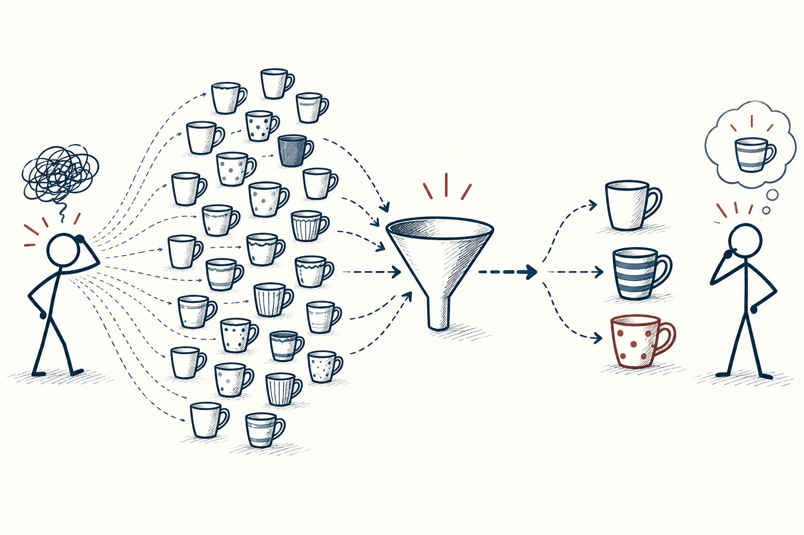
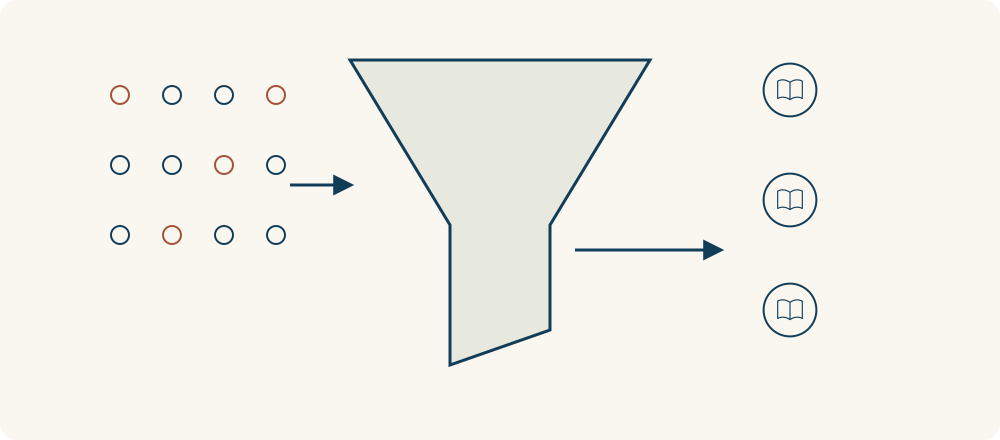

# 37 · 选择悖论

The Paradox of Choice · 选择与决策

> 选择多到难比较时，原本的自由也可能变成负担。

*配图说明：分支爆炸到收敛决策：左边火柴人面对扇出许多极相似杯子的分支头顶乱线，右边把选项先过滤后只保留少量可区分杯子，火柴人更容易比较。*

## 定义

打开点餐软件，半小时过去还没选好；挑一支牙膏，越看参数越担心漏掉更好的。选择悖论讲的是，有些情况下选项增加，反而让人更难开始，也更容易选完后后悔。因为你不仅要判断每项，还要不断想象放弃的其他项。

选择悖论强调，在某些条件下增加选项可能加重比较负担、延迟决定并降低满意度，这类选择过载并不在所有情境中出现。

不过不是所有人都怕多。熟悉相机的人可能喜欢丰富选择，新手却只想知道哪几台适合自己。关键是你有没有目标、比较标准，以及一个可以停止搜索的点，而不只是选项总数。

可以把选择过程看成先展开、再收拢的漏斗：先承认有多种可能，再用明确标准排除不合适的，最后比较少量候选。收拢是为了减轻比较负担，不是为了随便删到只剩一个。

## 举个身边的例子

你想买一把普通办公椅，起初只想坐着舒服、价格合适。看了一周评测后，开始担心扶手、材料、网布、底盘等每个细节，越研究越不敢下单。

可以回到自己的使用情况：每天坐多久，哪里不舒服，预算多少，能否试坐和退换。先筛出三款满足基本要求的，实际试一试，再在约定时间作决定。目标是买到合适的椅子，而不是证明全市场不存在更好的。

*先展开可能，再用明确标准收拢到少量候选。*

## 换个场景看看

和朋友约饭时，问“随便吃什么”可能拖很久；先问“面、火锅还是简餐”，再根据忌口选具体店，常能轻松很多。减少一次要处理的比较，比替所有人作决定更好。

## 可以这样试

**什么时候用得上：** 购物越看越乱、选课程迟迟不开始，或你总在做完决定后继续翻比较时，很适合用。

1. 先确定最重要的两三项需求，以及不能超过的预算或时间。
2. 用这些条件筛到少数可比较的选项，不再无限增加新候选。
3. 设定“达到这些就够了”的标准，合适时允许自己停止搜索。

## 别用过头了

不是选项越少越好。选择差别真实、信息清楚时，丰富选择也很有价值。也别为了省事，隐藏对别人重要的替代方案。

## 花一分钟试试

给一个卡住的选择定三条要求、最多三个候选和一个截止时间。到点后按要求选，不再以“也许还有更好”无限延期。

## 顺着看下去

- [31 · 损失厌恶](028.md)
- [32 · 错失恐惧](034.md)
- [33 · 决策矩阵](047.md)

## 来源与延伸

- [维基百科 · 选择悖论](https://en.wikipedia.org/wiki/The_Paradox_of_Choice)

---

例子为方便理解而设置，不是真实案例报道。
