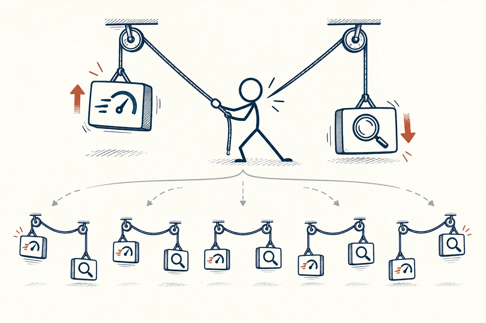
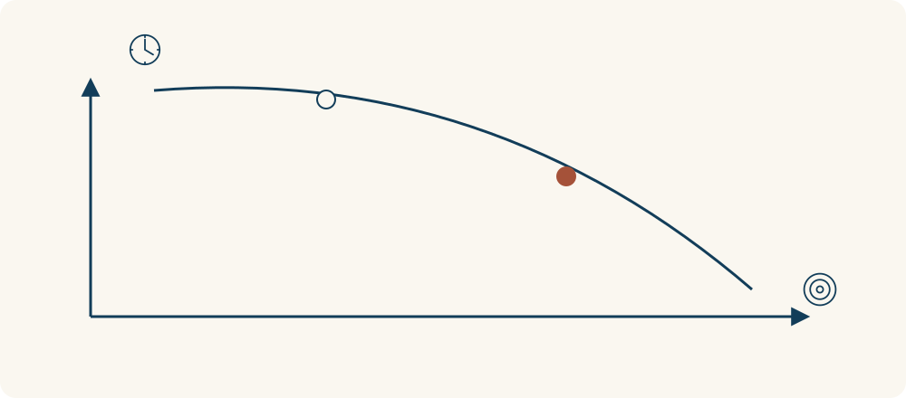

# 38 · 权衡取舍

Trade-Offs · 选择与决策

> 选了这一边，常常就得少拿一点另一边；把代价说清，反而更容易选。

*配图说明：有限资源下的权衡：火柴人手中一条固定长度的绳子连接两个滑块，拉高一边的速度风图标，另一边精细检查放大镜下降；下方呈现若干可选平衡点而非唯一最佳。*

## 定义

旅行想便宜、近、舒服、随时出发，往往没法每项都要到最好；工作想快、范围大、质量高，也需要资源支持。权衡取舍就是承认有限条件，决定这次先保住什么，愿意在哪些地方少一点。

权衡取舍指在约束条件下，为获得某方面的改善而接受另一方面的牺牲或成本，是多个目标不能同时完全满足时的常见决策情形。

它听起来像“妥协”，实际也可以帮你更主动。你不是糊里糊涂被迫放弃，而是在知道代价后选择。同时别太早认输：有些看似冲突的目标，可以通过换个安排一起改善，不一定非得二选一。

如果两个目标受同一份时间或预算限制，可行方案往往形成一条边界：往一边多走一点，另一边就可能要让出一些。先确认约束是不是真的存在，再决定愿意交换什么，别把所有目标都默认成互相冲突。

*在同一约束下，改善一个目标，可能需要让出另一个目标的一部分。*

## 举个身边的例子

你准备搬家，想离公司近、房间大、租金低。三处房子各占一个优点，你一直等着出现完美选项。先把自己的真实需求排一排：最近最需要的是睡眠和休息，那通勤可能要优先；如果长期在家工作，空间又可能更重要。

也可以寻找新组合，例如地铁换乘更方便的片区、和朋友合租、调整入住时间。先探索能改的条件，再明确接受哪项代价，比不停责怪自己“怎么挑都不满意”更有用。

## 换个场景看看

想陪家人又想参加朋友聚会，可能改成短暂参加、换一天约、或提前说明本次缺席。取舍不一定是彻底丢掉一边，有时是重新安排时间和范围。

## 可以这样试

**什么时候用得上：** 你想同时满足太多目标、承诺越来越满，或每个选项都让你有点不甘心时，很需要用。

1. 把最想要的几项列出，再标明这次最不能退让的是哪一项。
2. 逐个问：保住它，会增加什么成本，又要放弃什么？
3. 先找能改变条件的新办法；仍无法兼顾时，就作出清楚的取舍。

## 别用过头了

别把不合理安排轻易包装成“人生就是要取舍”。有些冲突来自流程或资源分配，可以争取改善；也别把真实底线当成随时可以牺牲的小项。

## 花一分钟试试

为一个即将作出的选择补一句：“这次我优先要……，愿意接受……，但不能接受……。”看看这句话能否说得具体。

## 顺着看下去

- [29 · 机会成本](009.md)
- [35 · 利弊清单](050.md)
- [15 · 虚假两难](065.md)

## 来源与延伸

- [维基百科 · 权衡取舍](https://en.wikipedia.org/wiki/Trade-off)

---

例子为方便理解而设置，不是真实案例报道。
