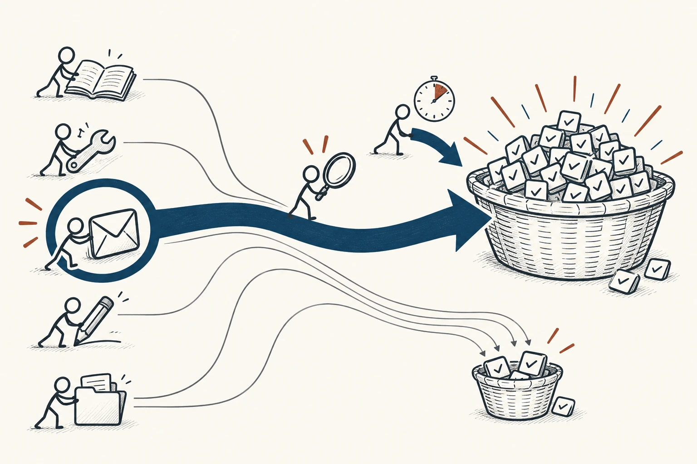
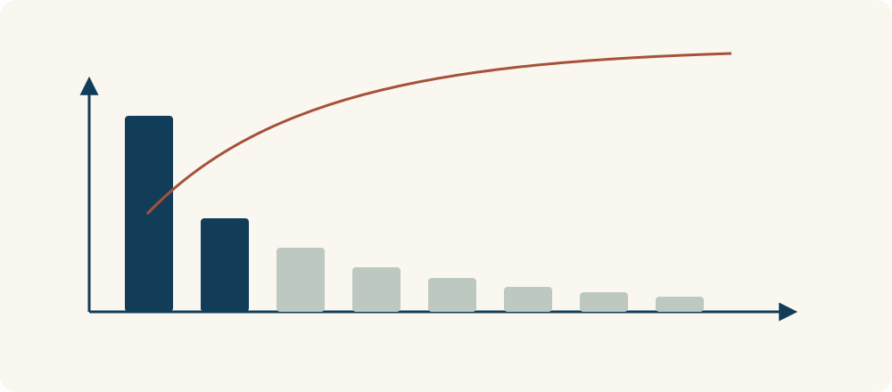

# 69 · 二八法则与帕累托原则

The 80/20 Rule / Pareto Principle · 工具与行动

> 别把力气平均撒出去，先找最能改变结果的那几件事。

*配图说明：少数关键任务以较宽流带贡献多数成果，其余任务贡献较少。*

## 定义

有时十项工作里，只有两三项真正推动了进展；一堆反复出现的小故障，可能主要来自几个原因。二八法则想提醒的是：贡献常常不平均，值得先找到占分量大的那部分。“80”和“20”是常见概括，不是每件事都得凑出的精确比例。

帕累托原则用于概括投入与结果分布不均的现象，即少数原因或活动可能贡献较大部分结果，80∶20是常用近似而非固定规律。

它也不只是教你偷懒，而是帮你把有限精力放到更有用的地方。如果你每天忙着改文档格式，却迟迟不去了解读者问题，可能很认真，却没碰到最能让内容变好的事。

把各项贡献从大到小排开，再逐项累计，会更容易看出成果是不是集中在少数因素上。这里要找的是分布不均的实际证据，不是先认定最前面的两项一定贡献八成。

*少数因素可能贡献较多结果，累计后更容易看出贡献是否集中。*

## 举个身边的例子

你想提高英语口语，每天收藏十篇学习方法、换几个软件，却很少真正开口。回看两周后发现，最有帮助的时刻，反而是和朋友用英语聊了十分钟，并认真改了两个反复说错的表达。

于是你把主要时间留给开口练习和回看错误，资料收藏只留一个小窗口。不是其他学习活动全没用，而是先保证影响大的部分真的发生，再把余力放到次要事情上。

## 换个场景看看

家里每周花很多时间清洁，可能主要是几个容易积灰和乱堆的地方。先改入口收纳、鞋柜和台面的使用方式，比平均多擦所有角落更可能减少重复劳动。

## 可以这样试

**什么时候用得上：** 事情很多却进展不明显，或你不知道该先改善哪类问题时，很值得用。

1. 回看最近的投入与结果，找出哪些事情做完后确实有明显推进。
2. 把其中最重要、又能自己影响的两三项放进固定时间。
3. 过一段时间再检查，别永远拿上个月的重点当现在的重点。

## 别用过头了

低频却代价很大的事情，不能因为占比小就忽略，例如备份和安全检查。也别把“重要少数”变成只做喜欢的任务、把责任全留给别人。

## 花一分钟试试

从本周待办里圈出三项：假如只能完成这三项，这周仍会有实质进展吗？如果不能，再想想真正重要的是什么。

## 顺着看下去

- [65 · 最小有效剂量](044.md)
- [36 · 成本效益分析](051.md)
- [78 · 收益递减规律](067.md)

## 来源与延伸

- [维基百科 · 二八法则与帕累托原则](https://en.wikipedia.org/wiki/Pareto_principle)

---

例子为方便理解而设置，不是真实案例报道。
