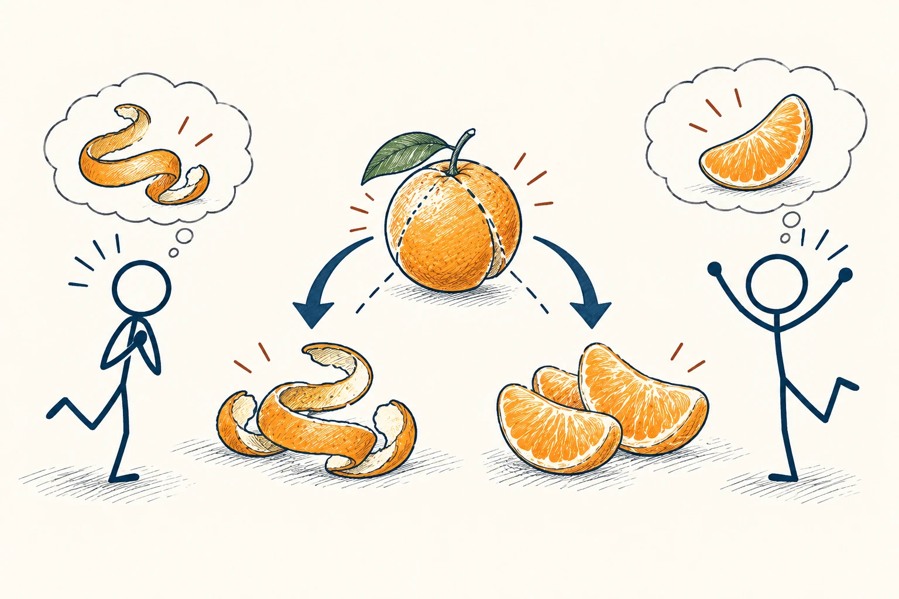
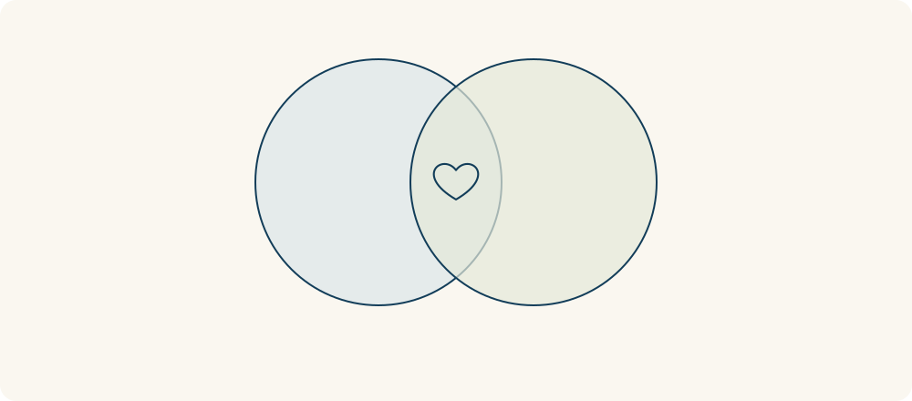

# 58 · 双赢思维

Win–Win · 伦理与协作

> 先弄清双方真正要什么，有时就不用非得一赢一输。

*配图说明：扩大共同收益：两位火柴人分别想要橙子皮和橙子果肉，用各自无字想法泡表示；中央同一橙子拆分外皮与果肉分别送到合适的一方，双方得到更重视的部分。*

## 定义

你说“我必须早点交付”，我说“我必须有时间做好”，听起来像只能有人让步。双赢思维先把表面要求拆开：你为什么着急？我担心哪部分？是不是能改变范围、时间或方式，让两边的核心需要都被照顾到。

双赢是一种以共同获益为目标的协商思路，强调识别各方利益，并探索相较各自替代选择都更有价值的安排。

双赢不等于人人得到完全相同的东西，也不保证所有冲突都有圆满办法。它更像一种寻找顺序：先试着创造更合适的安排，再决定要如何分配，别一开始就把对方当成必须击败的人。

两个人的利益可以先画成两个区域，找找有没有重叠的目标；但共同获益不只来自交集，也可能来自互补。比如一方要橙皮、一方要果肉，重点是重新安排交换，而不是只把两边重叠的部分分掉。

## 举个身边的例子

两位室友，一个想开窗透气，一个怕夜里冷。争论只围着“开还是不开”，很难结束。细聊才发现，前者主要怕做饭的气味，后者主要担心睡觉时吹风。

于是大家约定做饭后固定通风一段时间、睡前关窗，再处理厨房排气问题。需求被拆开后，出现了比“各忍一半”更适合的办法。并不是更会说话的人赢了，而是两人都更接近舒适生活。

*重叠处是共同利益；重叠以外的差异，也可能带来互补交换。*

## 换个场景看看

客户要明天看到成果，团队需要一周完成。若客户其实只需明天作内部演示，就可以先交一个可展示的小部分，余下按计划完善。重点是问出了“明天要用来做什么”。

## 可以这样试

**什么时候用得上：** 谈合作、分家务、安排时间，或你发现双方一直在争同一个资源时，很适合用。

1. 先各自说最在意的结果，别只重复原来的要求。
2. 找可以调整的地方，例如时间、范围、顺序、资源或承担风险的方式。
3. 比较新方案与不合作时各自的选择，确认双方真的愿意接受。

## 别用过头了

一方被迫接受、另一方再说“这对你也好”，不叫双赢。遇到持续越界或明显不公平，可以拒绝，不必为了关系好看勉强同意。

## 花一分钟试试

想一个当前分歧，分别写“我提出的要求”和“我真正想达到的结果”。再试着替对方也写一遍，最后找机会确认有没有猜对。

## 顺着看下去

- [54 · 白金法则](038.md)
- [57 · 可信度四核心](042.md)
- [59 · 囚徒困境](064.md)

## 来源与延伸

- [FranklinCovey · 双赢思维](https://www.franklincovey.com/habit-4/)

---

例子为方便理解而设置，不是真实案例报道。
