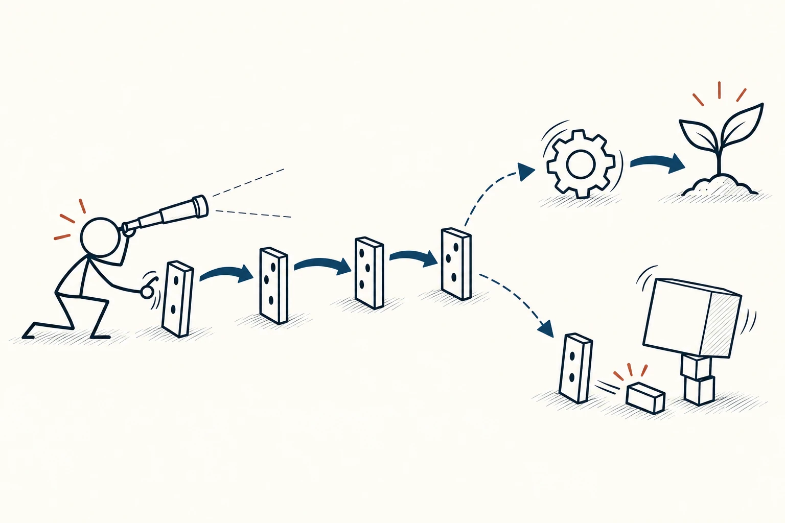
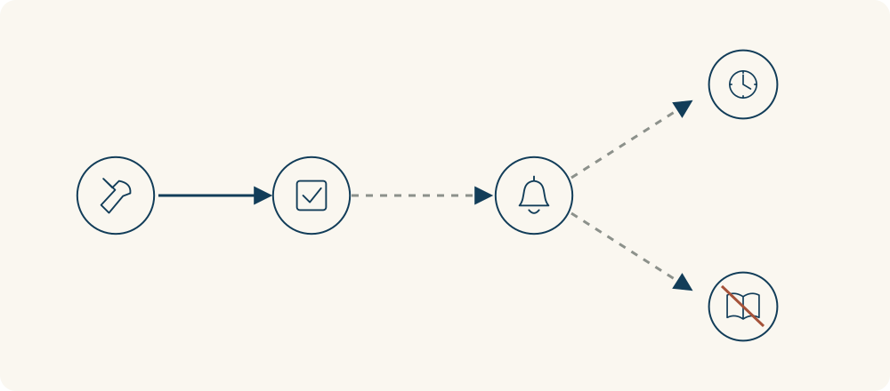

# 39 · 二阶思维

Second-Order Thinking · 选择与决策

> 别只看眼前会怎样，再问一句：然后呢？

*配图说明：沿连锁变化向远处看：火柴人一手准备轻推第一块多米诺，一边用望远镜观察后续；最初的连锁变化分出两条较远的可能路径，一条带动齿轮与幼苗，另一条影响支撑上的方块。米白底、深灰线稿、藏蓝箭头，少量砖红点缀，无文字。*

## 定义

一个办法刚想到时，往往只能看见最直接的好处：少做一道检查，今天交付更快；把难题全替同事处理，眼前的麻烦立刻消失。二阶思维让我们再往后看一步：检查省掉后，错误会不会流到下一环节？总替别人收尾，会不会让问题下次照样回来？

二阶思维是一种决策分析方法：在考虑行动的直接结果之外，进一步推演这些结果引起的间接影响、他人反应，以及随时间展开的后续变化。

这里的“二阶”不是规定只能想两步，也不是谁比谁聪明。它提醒我们把行动、直接结果和后续变化连起来，尤其看看别人会怎样回应、原有规则会不会因此改变。同一个决定，短期和长期的影响也可能不一样。

比如学一项新技能，开始会慢一点、累一点，但之后可能更独立、更省时间。二阶思维既能看见眼前好处背后的代价，也能看见眼前辛苦后面的价值。它帮我们把比较范围拉长，而不是一味否定马上见效的办法。

画图时先把“采取什么行动”放在左边，再接“直接结果”和“后续影响”。有不同可能就分叉；证据不够的连接可以画虚线。关键不是把箭头画得很长，而是写清每一步为什么可能引出下一步。

## 举个身边的例子

你负责一个小团队，每次有人遇到难题，你都直接接过来做。第一层结果很明显：任务很快完成，眼前的进度保住了。继续问“然后呢”，就会出现另一条可能的路径：同事没机会练习，下次还来找你；你越来越忙，自己的重要工作反而不断推迟。

这不意味着以后都不帮忙。你可以先判断是不是紧急情况：必须马上处理的，先一起完成；时间允许时，让同事先提出一个方案，你再给提示、检查关键步骤，最后请他自己做完。这样当下可能多花一点时间，却有机会减少后续反复接手的成本。

这条连锁变化只是需要验证的判断，不是说一次帮忙就一定让人依赖。可以选一类常见问题试两周，看看同事独立完成的次数有没有增加，你花在同类问题上的时间有没有下降，再调整做法。

*从左往右：接手任务、当下完成、下次仍来求助；右侧分支表示可能增加的时间压力和减少的练习机会。虚线提示这些后续影响还需要验证。*

## 换个场景看看

你为了每天多睡十分钟，总把第二天要带的东西留到出门前才收拾。眼前多睡了一会儿，但接下来可能是匆忙找东西、忘带资料，再临时折返。真正需要比较的是整个早晨的时间和精力，而不只是起床的那一刻。

可以试着前一晚花五分钟整理，观察一周后是否减少了早晨的手忙脚乱。如果提前整理并没带来帮助，就检查是不是还有别的原因。把后续影响算进去，也要允许事实纠正最初的想象。

## 可以这样试

**什么时候用得上：** 一个决定眼前很划算，却可能影响长期习惯、团队分工或他人行为时，适合多问一步。

1. 先写这个决定最直接的好处和代价，不跳过眼前的问题。
2. 再问两轮“然后呢”：别人会如何回应，接下来会多出什么任务或机会，并标出不确定的地方。
3. 比较短期和后续影响，选一个可调整的小做法，再用实际反馈检查推测。

## 别用过头了

后果想得远，不代表预测就准确。每多一环都可能加入新假设，别把一连串“可能”说成“必然”，也别只想最坏的结果。普通小事不必无限推演；紧急情况先处理眼前风险。二阶思维关注后续影响，机会成本关注放弃的其他选择，反馈回路则要求结果重新影响起点，三者可以一起用，但不完全相同。

## 花一分钟试试

选一个你正准备做的决定，写三栏：“直接结果”“接下来可能发生什么”“谁会因此改变做法”。选出最影响决定、又最不确定的一条，想想可以怎样先核实。

## 顺着看下去

- [30 · 逆向思维](020.md)
- [34 · 决策树](049.md)
- [77 · 反馈回路](066.md)

## 来源与延伸

- [Farnam Street · 二阶思维](https://fs.blog/second-order-thinking/)

---

例子为方便理解而设置，不是真实案例报道。
