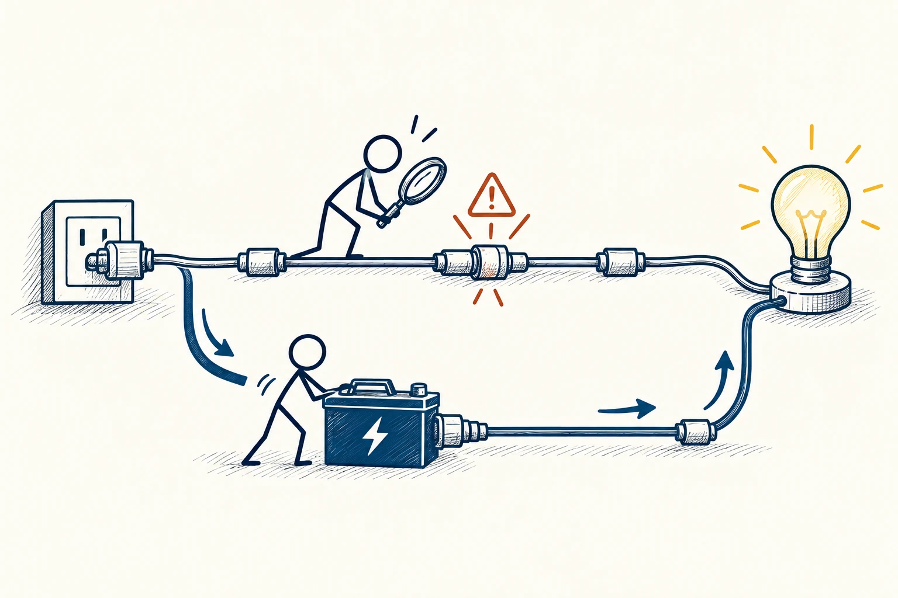

# 76 · 墨菲定律

Murphy’s Law · 系统与规律

> 别指望每次都刚好顺利，给重要环节留条能走的备用路。

*配图说明：故障预案的备用路径：主电源线有潜在断点，火柴人先检查薄弱接头并准备备用电池，正常路径与备用路径都能通向亮灯。*

## 定义

出门越赶时间，越怕遇到堵车；要上台演示，电脑偏偏连不上投影。“墨菲定律”用夸张的话提醒我们：可能出错的环节，值得提前想一想。它不是说倒霉一定发生，而是别让整个计划只在完美条件下才能成功。

墨菲定律是一条关于差错与意外的经验性警句，提醒人们重视可能失败的环节，而非一个声称所有失误必然发生的科学定律。

有用的准备也不必很复杂。重要资料留备份、出门多留一点时间、把接手方法讲给别人，都可能大幅减少出错后的慌乱。比起想象所有灾难，更值得练习的是：真出问题了，我能怎样继续？

## 举个身边的例子

你要在线上分享一份演示稿，已经在云端保存，便觉得稳了。活动前再问一步：如果临时没网、账号进不去、自己掉线，主持人还能不能继续？

于是你下载本地文件，把PDF提前给主持人，也简要说明讲到哪里可以先暂停。准备可能只多花十分钟，却把“一个小故障就全场等候”，变成“有人知道下一步怎么做”。备用方案的价值，就在需要时能真的启动。

## 换个场景看看

旅行时把证件信息安全备份、记下必要联系途径，不代表你预计一定会丢东西，而是希望万一发生时，自己不至于完全没办法。

## 可以这样试

**什么时候用得上：** 赶重要行程、做演示、保存资料、组织活动时，用它检查一次通常很值得。

1. 找出几个一出问题就会让整体停住的环节，不必把所有小事都当灾难。
2. 为它们留简单、独立的备份或替代安排。
3. 实际试一次恢复过程，别只有一个从未打开过的备份文件。

## 别用过头了

无限加保险也会花钱、增加复杂度。按影响大小和恢复难度安排准备，别让预防意外本身吞掉整个生活。

## 花一分钟试试

为最近一件重要安排写三行：最怕哪个环节出问题、怎么尽早发现、出问题后谁来做什么。

## 顺着看下去

- [34 · 决策树](049.md)
- [36 · 成本效益分析](051.md)
- [77 · 反馈回路](066.md)

## 来源与延伸

- [维基百科 · 墨菲定律](https://en.wikipedia.org/wiki/Murphy%27s_law)

---

例子为方便理解而设置，不是真实案例报道。
